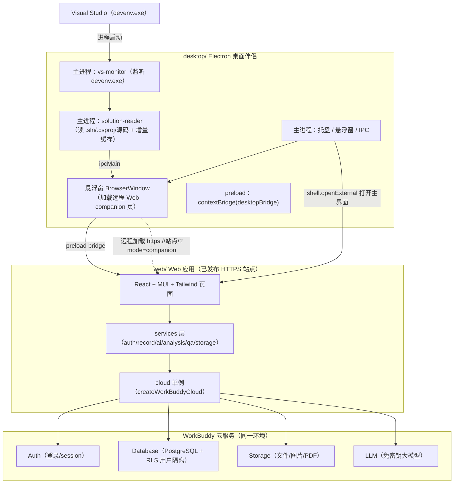
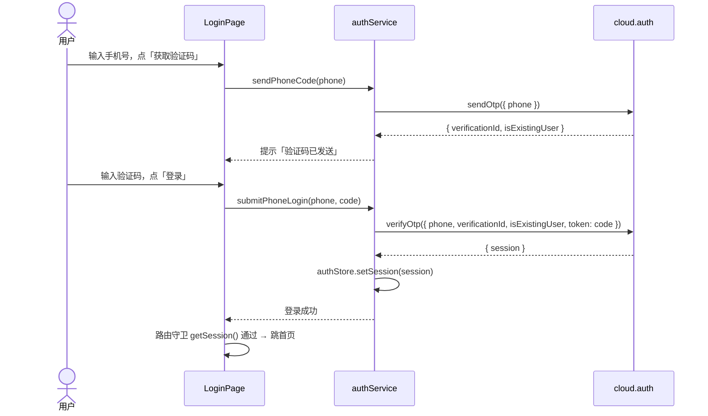
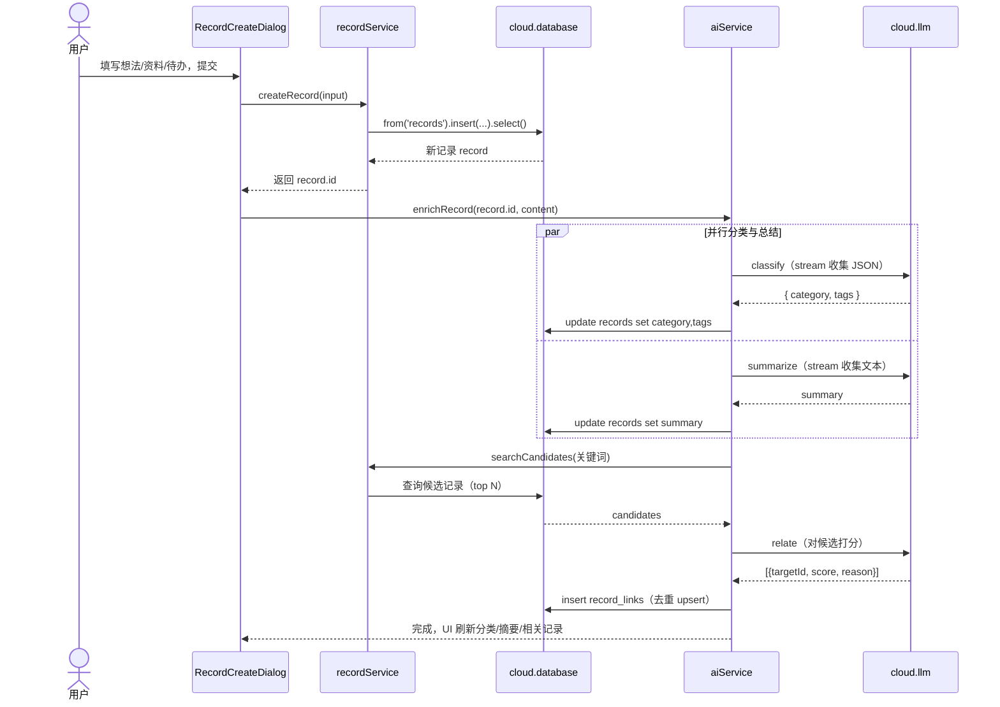
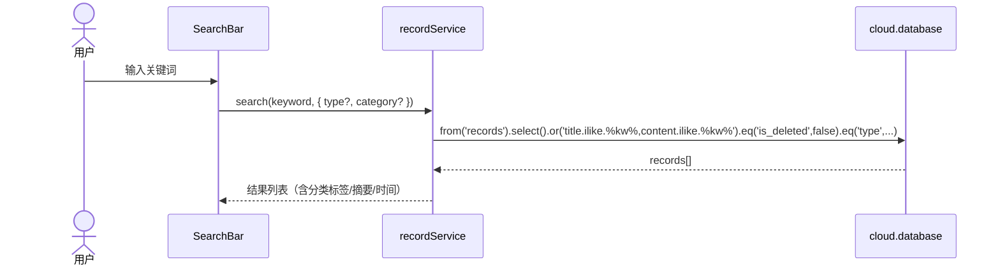
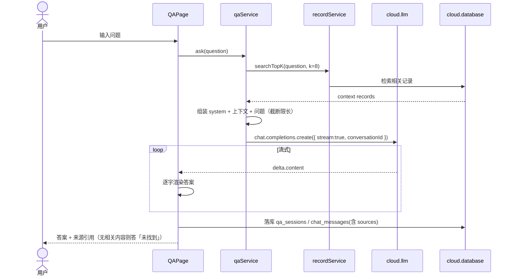
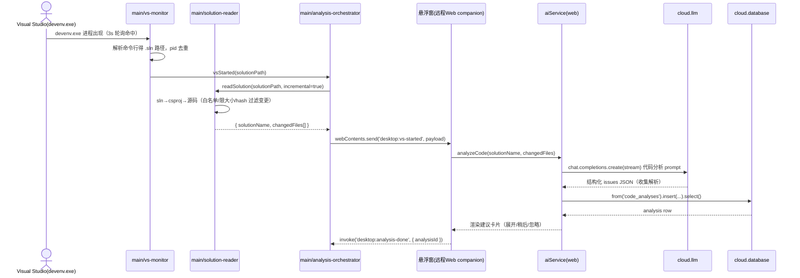
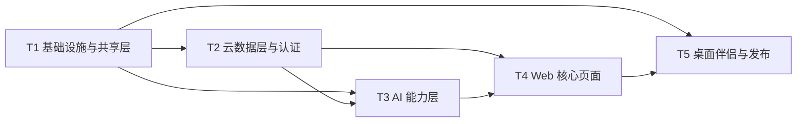

# 「个人信息管家 Agent」系统架构设计（ARCHITECTURE）

> 版本：v1.0（MVP）
> 作者：高见远（架构师）
> 状态：待工程师实现
> 上游输入：`docs/PRD.md`（v1.0）

---

## 0. 关键决策回顾（约束清单）

在开始阅读前，工程师需牢记以下已拍板决策（来自产品/主理人，不可擅自更改）：

| # | 决策 | 落地含义 |
|---|------|---------|
| D1 | VS 接入先做「桌面伴侣程序」 | 监听 `devenv.exe` → 自动唤醒 → 读解决方案/项目代码 → 云大模型分析 → 悬浮窗推送；**VSIX 插件本期不做（P1 预留）** |
| D2 | 桌面显示 = Electron 悬浮窗（always-on-top，默认右下角、可折叠/拖动/吸附边缘）+ 系统托盘 | 悬浮窗为无边框置顶小窗 |
| D3 | MVP 范围（P0）：登录 / 信息记录（想法·资料·待办）/ 自动分类 / 自动总结 / 智能关联 / 关键词检索 / 智能问答 / 桌面伴侣 / VS 监听 / 代码分析 / 建议推送 / 悬浮窗 / 云端同步 / 发布上线 | P1（阶段总结/行动建议/重点提取/待办整理/VSIX）本期仅预留设计，**不实现** |
| D4 | 全中文界面 | 所有文案中文 |
| D5 | 后端 = WorkBuddy 云服务（Serverless） | 无自建服务器；云数据库 + 用户认证 + 文件存储 + 免密钥大模型 |
| D6 | 云 SDK 前端初始化**必须**用 `publicConfig`（endpoint + publishableKey，Web 还需 oauthRelayBaseUrl），**禁止硬编码 endpoint** | `publicConfig` 由 engineer 调用 `workbuddy_cloud_service` 工具后填入 |
| D7 | 所有 AI 能力走云服务 LLM 模块（无密钥）+ prompt 工程 | 分类/总结/关联/问答/代码分析全部走 `cloud.llm` |

---

## 1. 整体架构

### 1.1 模块划分

项目为 **monorepo**，三个顶层目录：`shared/`（共享层）、`web/`（Web 应用）、`desktop/`（Electron 桌面伴侣）。两个前端应用**共用同一套云后端**——即同一个 WorkBuddy 云服务环境（同一个 `publicConfig`、同一套数据库表、同一套文件存储、同一个免密钥 LLM 通道），因此 Web 与桌面伴侣天然共享数据。

| 模块 | 目录 | 职责 | 运行环境 |
|------|------|------|---------|
| 共享层 | `shared/` | 领域类型、LLM prompt 常量、流式工具函数、publicConfig 注入 | 编译期被 web/desktop 引用 |
| Web 前端 | `web/` | 登录、信息记录、检索、问答、VS 分析结果展示、设置、回收站 | 浏览器 / 已发布 HTTPS 站点 |
| 桌面伴侣（Electron） | `desktop/` | 系统托盘、悬浮窗、VS 进程监听、本地源码读取、增量缓存、分析编排 | Windows 桌面 |
| 云后端 | （WorkBuddy 云服务，非本地代码） | 数据库/认证/存储/LLM | 云端 |

### 1.2 架构图



### 1.3 关键架构决策：Web 与 Electron 如何共享云后端与数据

**同一云环境 + 悬浮窗加载远程 Web 页面（companion 模式）**：

1. **同一 `publicConfig`**：`web/` 与 `desktop/` 引用 `shared/config/publicConfig.ts` 中同一份 `endpoint / publishableKey / oauthRelayBaseUrl`，指向同一个云应用环境，因此数据库/存储天然互通。
2. **悬浮窗 = 远程 Web 应用**：WorkBuddy 云服务在数据面强制执行 **精确 Origin 匹配**（`endpoint` 是应用专属域名；本地 `localhost`、`file://`、Electron 自定义 `app://` 协议均无法通过）。因此悬浮窗 BrowserWindow **加载已发布的 Web 应用 URL**（`https://<发布域名>/?mode=companion`），复用 Web 的登录、记录、问答、分析等全部能力，Origin 完全匹配，云服务可正常调用。
3. **桌面专属能力由主进程 + preload 桥接**：VS 进程监听、本地源码读取、托盘、置顶等「只有桌面能做」的事在主进程完成；主进程通过 `webContents.send()` 把事件（VS 启动、分析结果）推给悬浮窗页面，页面通过 preload 暴露的 `window.desktopBridge` 接收（浏览器中该对象为 `undefined`，桌面能力自动隐藏）。
4. **代码分析的大模型调用发生在 Web 侧**：主进程只负责「读本地源码 → 把源码文本通过 IPC 交给悬浮窗页面」，由 Web 的 `aiService.analyzeCode()` 调用 `cloud.llm` 完成分析并落库，再在悬浮窗渲染建议卡片。这样 LLM 调用与登录态、Origin 完全一致，主进程不触碰云凭证。

> 代价与替代方案见 §9「待明确事项」Q-A1。

---

## 2. 框架选型

### 2.1 各模块技术栈

| 模块 | 选型 | 理由 |
|------|------|------|
| Web 构建 | Vite 5 + React 18 + TypeScript 5 | 快、生态成熟、类型安全 |
| Web UI | MUI（Material UI）+ Tailwind CSS 3 | MUI 提供开箱组件（列表/对话框/菜单），Tailwind 做布局与细节；二者经 `theme` 打通 |
| Web 状态 | Zustand | 轻量、无模板样板，适合登录态 + 记录缓存 |
| Web 路由 | React Router 6 | 标准 SPA 路由 + 守卫 |
| 云 SDK | `@tencent-ai/workbuddy-cloud-sdk@dev` | 官方唯一 SDK，提供 auth/database/storage/llm |
| 桌面框架 | Electron 31 + electron-vite 2 | electron-vite 统一构建 main/preload/renderer 三端，TS 支持好 |
| 桌面打包 | electron-builder | 产出 Windows 安装包（NSIS）+ 轻量版 |
| VS 进程监听 | 主进程轮询 `devenv.exe`（详见 2.2） | 轻量、无需管理员权限、可靠 |
| 源码读取 | Node 内置 `fs/path/crypto` 解析 `.sln`/`.csproj` | 零额外依赖，`.sln` 与 `.csproj` 均为文本/XML |
| 本地偏好 | electron-store | 托盘/悬浮窗/VS 路径/代码上传开关等本地持久化 |

### 2.2 VS 进程监听方案（Windows 上检测 devenv.exe）

**推荐主方案：主进程定时轮询进程快照（每 3 秒）**

- 用 `@vscode/windows-process-tree`（或 `ps-list`）每 3s 拉取一次进程列表，检测名为 `devenv.exe` 的进程及其**命令行参数**。
- 从命令行解析 `.sln` 路径：`devenv.exe "C:\path\MySolution.sln"`（命令行通常带 `.sln` 绝对路径）。
- 3s 轮询开销可忽略（VS 启动频率低），且无需管理员权限、无需常驻 WMI 订阅。
- 维护 `Map<pid, solutionPath>` 去重：同一解决方案只触发一次「已监听 → 分析」。

**备选方案 A（精确、需管理员）：WMI `Win32_ProcessStartTrace` 事件订阅**——通过 PowerShell `Register-CimIndicationEvent` 订阅进程启动事件，实时性最好，但需管理员权限且常驻一个 PowerShell/WMI 查询进程，稳定性与打包复杂度高，仅作可选项。

**备选方案 B（兜底）：`tasklist /FI "IMAGENAME eq devenv.exe"`**——若 npm 原生依赖安装失败，用 `child_process.execFile` 调用系统 `tasklist` 解析，零依赖兜底。

**命令行解析规则**：正则提取 `.sln` 或 `.csproj` 绝对路径；若命令行未携带路径（如从开始菜单启动的 VS 无参数），则读取 VS 最近项目（`%USERPROFILE%\Documents\Visual Studio XXXX\` 或通过 `%APPDATA%\Microsoft\VisualStudio\...\MostRecentlyUsed`），作为兜底；仍找不到则提示「未检测到解决方案」。

### 2.3 源码读取方案（solution-reader）

1. 读 `.sln`（UTF-8 文本），正则匹配 `Project("{GUID}") = "名称", "相对路径\X.csproj", "{GUID}"`，解析出项目列表。
2. 对每个 `.csproj`（XML）解析 `<Compile Include="..."/>`（含 `None`/`Content` 中的源码），得到源文件列表。
3. 读取源码文件：仅白名单扩展名（`.cs .cpp .h .js .ts .py .java .go .rs .vue .tsx .jsx .sql .xml .json`），跳过目录 `bin/ obj/ node_modules/ .git/ .vs/ packages/` 及隐藏目录；单文件 ≤ 200KB；**总字节数 ≤ 2MB**，超限按文件列表截断/采样。
4. **增量分析**（对应 PRD Q-10）：本地 `electron-store` 缓存 `{ solutionPath → { fileRelPath → sha256 } }`，仅把**变更/新增**文件送分析，避免每次启动全量分析与重复推送。
5. **隐私开关**（对应 PRD Q-01）：`settings` 表 `code_upload_enabled` 为 `false` 时，主进程不读取、不推送源码，悬浮窗提示「代码上传已关闭」。

---

## 3. 文件列表及相对路径

> 根目录：`D:/司凤项目/personal-agent/`

### 3.1 共享层 `shared/`

| 相对路径 | 职责 |
|---------|------|
| `shared/config/publicConfig.ts` | 云服务 `publicConfig` 注入（engineer 从 `workbuddy_cloud_service` 工具回填，禁止手写 endpoint） |
| `shared/types/domain.ts` | 领域类型：`InfoRecord` / `RecordLink` / `CodeAnalysis` / `CodeIssue` / `QaSession` / `ChatMessage` / `UserSettings` 等 |
| `shared/types/ipc.ts` | 桌面 IPC 消息类型（与 `desktop/src/shared/ipc-contract.ts` 对齐） |
| `shared/constants/prompts.ts` | 全部 LLM system prompt 常量（分类/总结/关联/问答/代码分析） |
| `shared/constants/categories.ts` | 预置分类标签与标签色板 |
| `shared/utils/llm.ts` | LLM 流式收集工具：`collectStream()`、`parseJsonLoose()`（安全解析 JSON） |

### 3.2 Web 前端 `web/`

| 相对路径 | 职责 |
|---------|------|
| `web/package.json` | Web 依赖与脚本（dev/build/preview） |
| `web/vite.config.ts` | Vite 配置（React 插件、`@shared` 别名、tailwind） |
| `web/tsconfig.json` / `web/tsconfig.node.json` | TS 配置（含 `@shared/*` path 映射） |
| `web/tailwind.config.ts` / `web/postcss.config.js` | Tailwind + PostCSS 配置 |
| `web/index.html` | SPA 入口 HTML |
| `web/src/main.tsx` | React 挂载入口；**启动即执行 `handleWechatWebCallback` 后进入路由守卫** |
| `web/src/App.tsx` | 路由表 + 应用外壳（左侧导航 + 顶栏 + 内容区） |
| `web/src/theme.ts` | MUI 主题 + Tailwind 风格统一 |
| `web/src/index.css` | Tailwind 指令 + 全局样式（含悬浮窗拖拽区 `-webkit-app-region`） |
| `web/src/lib/cloud.ts` | **云 SDK 单例**：`createWorkBuddyCloud(publicConfig)` 导出 `cloud` |
| `web/src/lib/database.types.ts` | `Database` 泛型类型（供 `createWorkBuddyCloud<Database>` 强类型） |
| `web/src/lib/unwrap.ts` | `{data,error}` 包络 → 抛错工具 `unwrap()` |
| `web/src/services/authService.ts` | 登录/注册/登出/session（手机号 OTP + 微信 Web 登录） |
| `web/src/services/recordService.ts` | 记录 CRUD、检索、分类/类型筛选、软删除/恢复、待办状态 |
| `web/src/services/analysisService.ts` | VS 分析结果保存/查询 |
| `web/src/services/qaService.ts` | 智能问答（检索上下文 + 流式 + 落库） |
| `web/src/services/storageService.ts` | 资料文件上传/签名 URL 下载/删除 |
| `web/src/services/aiService.ts` | AI 能力：`classify/summarize/relate/answer/analyzeCode`（走 `cloud.llm`） |
| `web/src/store/authStore.ts` | 登录态（session/user）Zustand store |
| `web/src/store/recordStore.ts` | 记录列表/筛选/分页 Zustand store |
| `web/src/components/Layout.tsx` | 左侧导航 + 顶栏 + 快速记录入口 |
| `web/src/components/SearchBar.tsx` | 关键词检索 / AI 问答双模式输入框 |
| `web/src/components/RecordCard.tsx` | 记录卡片（分类标签、摘要、时间） |
| `web/src/components/RecordCreateDialog.tsx` | 快速新增弹窗（想法/资料/待办，资料可传文件/URL） |
| `web/src/components/RecordDetail.tsx` | 记录详情（全文、AI 摘要、编辑/删除、相关记录） |
| `web/src/components/RelatedRecords.tsx` | 智能关联记录列表 |
| `web/src/components/CompanionPanel.tsx` | **companion 模式**入口：窄条/置顶悬浮布局 + 建议卡片 + 快速记录（检测 `window.desktopBridge`） |
| `web/src/pages/LoginPage.tsx` | 登录页（手机号 OTP / 微信扫码） |
| `web/src/pages/HomePage.tsx` | 全部信息（列表 + 排序/筛选） |
| `web/src/pages/RecordsPage.tsx` | 想法 / 资料 / 分类标签视图 |
| `web/src/pages/TodoPage.tsx` | 待办视图（勾选完成、优先级、提醒） |
| `web/src/pages/AnalysisPage.tsx` | VS 代码分析历史（解决方案名、问题列表、建议、严重级别） |
| `web/src/pages/QAPage.tsx` | 智能问答（流式渲染 + 来源引用） |
| `web/src/pages/SettingsPage.tsx` | 账号、VS 路径、悬浮窗偏好、通知、代码上传开关 |
| `web/src/pages/RecyclePage.tsx` | 回收站（30 天内恢复/彻底删除） |
| `web/src/types/env.d.ts` | Vite 环境类型声明 |

### 3.3 桌面伴侣 `desktop/`

| 相对路径 | 职责 |
|---------|------|
| `desktop/package.json` | Electron 依赖与脚本（dev/build/pack） |
| `desktop/electron.vite.config.ts` | electron-vite 三端构建配置（main/preload/renderer） |
| `desktop/tsconfig.json` / `desktop/tsconfig.node.json` | TS 配置（含 `@shared/*` 映射） |
| `desktop/electron-builder.yml` | 打包配置（NSIS 安装包 + 轻量版、应用图标、开机自启） |
| `desktop/src/shared/ipc-contract.ts` | IPC 通道名与消息类型常量（单一事实来源） |
| `desktop/src/main/index.ts` | 主进程入口：app 生命周期、创建悬浮窗/托盘、单实例锁、开机自启 |
| `desktop/src/main/tray.ts` | 系统托盘菜单（显示/隐藏悬浮窗、打开主界面、立即分析、暂停/恢复监听、设置、退出） |
| `desktop/src/main/floating-window.ts` | 无边框置顶悬浮窗：加载 `WEB_APP_URL?mode=companion`、置顶/拖动/吸附边缘/折叠、默认右下角 |
| `desktop/src/main/vs-monitor.ts` | 轮询检测 `devenv.exe` + 解析 `.sln` 路径 + 去重 |
| `desktop/src/main/solution-reader.ts` | 解析 `.sln`/`.csproj`、读源码（白名单/大小限制/增量 hash） |
| `desktop/src/main/analysis-orchestrator.ts` | 编排：监听事件 → 读码 → IPC 推给悬浮窗 → 接收结果状态 |
| `desktop/src/main/store.ts` | `electron-store` 本地偏好（VS 路径、悬浮窗偏好、增量缓存、代码上传开关） |
| `desktop/src/main/ipc.ts` | 注册 `ipcMain.handle`（get-status/trigger-analysis/set-listening/open-main-app 等） |
| `desktop/src/preload/index.ts` | `contextBridge.exposeInMainWorld('desktopBridge', ...)` |
| `desktop/src/renderer/index.html` | 悬浮窗本地引导页（加载中/未发布/加载远程失败提示） |
| `desktop/src/renderer/main.ts` | 引导逻辑：重定向到远程 companion URL |

### 3.4 根目录与文档

| 相对路径 | 职责 |
|---------|------|
| `package.json` | 根 workspace/脚本聚合（可选） |
| `README.md` | 项目说明、启动/构建/发布步骤、publicConfig 回填步骤 |
| `docs/PRD.md` | 产品需求（已有） |
| `docs/ARCHITECTURE.md` | 本文档 |

---

## 4. 数据结构与接口

### 4.1 云数据库表结构（PostgreSQL，`public` schema）

> 表创建方式：engineer 通过内置工具 `workbuddy_cloudservice_db_exec_sql`（`mode: "migrate"`）**逐条**执行下面 DDL；app 代码**不执行 DDL**。所有表开启 RLS，数据按 `owner_id = auth.uid()` 隔离；客户端**永不发送 `owner_id`**。

#### 4.1.1 `records`（信息记录主表，统一存放想法/资料/待办）

| 字段 | 类型 | 约束/默认 | 说明 |
|------|------|-----------|------|
| `id` | BIGINT | IDENTITY PK | 主键 |
| `owner_id` | TEXT | NOT NULL DEFAULT `auth.uid()` | 属主（服务端填充） |
| `type` | TEXT | NOT NULL, CHECK in `('idea','material','todo')` | 类型 |
| `title` | TEXT | NOT NULL DEFAULT '' | 标题 |
| `content` | TEXT | NOT NULL DEFAULT '' | 正文 |
| `url` | TEXT | NULL | 资料链接 |
| `file_path` | TEXT | NULL | 云存储对象路径（资料附件） |
| `category` | TEXT | NULL | 自动分类（如 `技术/AI`） |
| `tags` | TEXT[] | NOT NULL DEFAULT `'{}'` | 标签数组 |
| `summary` | TEXT | NULL | AI 摘要 |
| `todo_status` | TEXT | CHECK in `('pending','done')` | 待办状态 |
| `priority` | TEXT | CHECK in `('high','medium','low')` | 优先级 |
| `remind_at` | TIMESTAMPTZ | NULL | 提醒时间 |
| `is_deleted` | BOOLEAN | NOT NULL DEFAULT false | 回收站软删除标记 |
| `deleted_at` | TIMESTAMPTZ | NULL | 删除时间（30 天可恢复） |
| `created_at` | TIMESTAMPTZ | NOT NULL DEFAULT now() | 创建时间 |
| `updated_at` | TIMESTAMPTZ | NOT NULL DEFAULT now() | 更新时间 |

索引：`(owner_id, type)`、`(owner_id, category)`、`(owner_id, created_at DESC)`、`(owner_id, is_deleted)`、`tags` 用 GIN。

#### 4.1.2 `record_links`（智能关联：记录↔记录）

| 字段 | 类型 | 说明 |
|------|------|------|
| `id` | BIGINT IDENTITY PK | 主键 |
| `owner_id` | TEXT NOT NULL DEFAULT `auth.uid()` | 属主 |
| `source_id` | BIGINT NOT NULL | 源记录 |
| `target_id` | BIGINT NOT NULL | 被关联记录 |
| `score` | REAL NOT NULL | 相关度（0~1） |
| `reason` | TEXT NULL | 关联理由 |
| `created_at` | TIMESTAMPTZ DEFAULT now() | 时间 |

索引：`(owner_id, source_id)`、`UNIQUE(owner_id, source_id, target_id)`。

#### 4.1.3 `code_analyses`（VS 代码分析结果）

| 字段 | 类型 | 说明 |
|------|------|------|
| `id` | BIGINT IDENTITY PK | 主键 |
| `owner_id` | TEXT NOT NULL DEFAULT `auth.uid()` | 属主 |
| `solution_name` | TEXT NOT NULL | 解决方案名 |
| `solution_path` | TEXT NULL | 解决方案本地路径（仅展示） |
| `project_name` | TEXT NULL | 项目名 |
| `issues` | JSONB NOT NULL DEFAULT `'[]'` | 结构化问题列表（见 `CodeIssue`） |
| `summary` | TEXT NULL | 整体建议摘要 |
| `status` | TEXT DEFAULT 'done' CHECK in `('pending','analyzing','done','failed')` | 状态 |
| `created_at` | TIMESTAMPTZ DEFAULT now() | 时间 |

索引：`(owner_id, solution_name, created_at DESC)`。

#### 4.1.4 `qa_sessions` / `chat_messages`（智能问答会话与消息）

`qa_sessions`：`id` PK、`owner_id` TEXT DEFAULT `auth.uid()`、`title` TEXT、`created_at` TIMESTAMPTZ。
`chat_messages`：`id` PK、`owner_id` TEXT、`session_id` BIGINT、`role` TEXT（`user`/`assistant`）、`content` TEXT、`sources` JSONB（引用来源记录 id 数组）、`created_at` TIMESTAMPTZ。
索引：`qa_sessions(owner_id, created_at DESC)`、`chat_messages(session_id, created_at)`。

#### 4.1.5 `settings`（用户共享设置，跨端一致）

| 字段 | 类型 | 说明 |
|------|------|------|
| `owner_id` | TEXT PK | 属主（每用户一行） |
| `vs_path` | TEXT NULL | VS 安装路径 |
| `code_upload_enabled` | BOOLEAN DEFAULT true | 代码上传开关（PRD Q-01） |
| `float_window_enabled` | BOOLEAN DEFAULT true | 悬浮窗启用（PRD Q-05） |
| `float_position` | JSONB NULL | 悬浮窗位置/尺寸偏好 |
| `notify_enabled` | BOOLEAN DEFAULT true | 通知开关 |
| `updated_at` | TIMESTAMPTZ DEFAULT now() | 时间 |

> 注：纯本地的悬浮窗折叠状态、吸附边、增量 hash 缓存存 `electron-store`（不联网）。

#### 4.1.6 RLS 策略模板（每张表同构执行，逐条 `migrate`）

```sql
-- 示例：records 表（其余表替换表名/策略名即可）
ALTER TABLE public.records ENABLE ROW LEVEL SECURITY;
GRANT SELECT, INSERT, UPDATE, DELETE ON TABLE public.records TO authenticated, anon;
DROP POLICY IF EXISTS records_select_own ON public.records;
CREATE POLICY records_select_own ON public.records FOR SELECT TO authenticated, anon
  USING (owner_id = auth.uid());
DROP POLICY IF EXISTS records_insert_own ON public.records;
CREATE POLICY records_insert_own ON public.records FOR INSERT TO authenticated, anon
  WITH CHECK (owner_id = auth.uid());
DROP POLICY IF EXISTS records_update_own ON public.records;
CREATE POLICY records_update_own ON public.records FOR UPDATE TO authenticated, anon
  USING (owner_id = auth.uid()) WITH CHECK (owner_id = auth.uid());
DROP POLICY IF EXISTS records_delete_own ON public.records;
CREATE POLICY records_delete_own ON public.records FOR DELETE TO authenticated, anon
  USING (owner_id = auth.uid());
```

### 4.2 关键 TypeScript 类型定义（`shared/types/domain.ts`）

```ts
export type RecordType = 'idea' | 'material' | 'todo';
export type TodoStatus = 'pending' | 'done';
export type Priority = 'high' | 'medium' | 'low';
export type AnalysisStatus = 'pending' | 'analyzing' | 'done' | 'failed';

export interface InfoRecord {
  id: number;
  type: RecordType;
  title: string;
  content: string;
  url?: string | null;
  filePath?: string | null;       // 云存储对象路径
  category?: string | null;
  tags: string[];
  summary?: string | null;
  todoStatus?: TodoStatus | null;
  priority?: Priority | null;
  remindAt?: string | null;
  isDeleted: boolean;
  deletedAt?: string | null;
  createdAt: string;
  updatedAt: string;
}

export interface RecordLink {
  id: number;
  sourceId: number;
  targetId: number;
  score: number;
  reason?: string | null;
}

export interface CodeIssue {
  severity: 'error' | 'warning' | 'suggestion';
  title: string;
  description: string;
  suggestion: string;
  file?: string;
  line?: number;
}

export interface CodeAnalysis {
  id: number;
  solutionName: string;
  solutionPath?: string | null;
  projectName?: string | null;
  issues: CodeIssue[];
  summary?: string | null;
  status: AnalysisStatus;
  createdAt: string;
}

export interface QaSession { id: number; title: string; createdAt: string; }
export interface ChatMessage {
  id: number; sessionId: number; role: 'user' | 'assistant';
  content: string; sources?: number[]; createdAt: string;
}
export interface UserSettings {
  vsPath?: string | null;
  codeUploadEnabled: boolean;
  floatWindowEnabled: boolean;
  floatPosition?: unknown;
  notifyEnabled: boolean;
}
```

### 4.3 云服务接口约定（前端 service 层封装）

**初始化单例（`web/src/lib/cloud.ts`）**：

```ts
import { createWorkBuddyCloud } from '@tencent-ai/workbuddy-cloud-sdk'
import { publicConfig } from '@shared/config/publicConfig'
import type { Database } from './database.types'

export const cloud = createWorkBuddyCloud<Database>({
  endpoint: publicConfig.endpoint,
  oauthRelayBaseUrl: publicConfig.oauthRelayBaseUrl,   // Web 必传（微信登录）
  publishableKey: publicConfig.publishableKey,
})
```

各 service 对 `cloud.*` 的封装约定（均返回 `{ data, error }`，由 `unwrap()` 统一抛错）：

| Service | 关键方法 | 底层调用 |
|---------|---------|---------|
| `authService` | `sendPhoneCode(phone)` | `cloud.auth.sendOtp({ phone })` |
| | `submitPhoneLogin(phone, code)` | `cloud.auth.verifyOtp({ phone, verificationId, isExistingUser, token })` |
| | `getSession()` / `signOut()` / `onAuthStateChange(cb)` | `cloud.auth.getSession()` 等 |
| | `startWechatLogin()` | `cloud.auth.signInWithOAuth({ provider:'wechat', redirectTo: location.origin })` → `location.assign(data.url)` |
| `recordService` | `createRecord(input)` | `cloud.database.from('records').insert({...}).select()` |
| | `listRecords({type,category,page,pageSize})` | `.select('*',{count:'exact'}).eq('type',...).eq('is_deleted',false).order('created_at',{ascending:false}).range(from,to)` |
| | `search(keyword, filter)` | `.or(\`title.ilike.%${kw}%,content.ilike.%${kw}%\`).eq('is_deleted',false)` |
| | `softDelete(id)` | `.update({ is_deleted:true, deleted_at: now }).eq('id', id).select()` |
| | `restore(id)` / `updateTodoStatus(id, status)` | `.update(...).eq('id', id).select()` |
| `aiService` | `classify(content)` / `summarize(content)` | `cloud.llm.chat.completions.create({ stream:true, messages:[system, user] })` + `collectStream()` |
| | `relate(target, candidates)` | LLM 打分 → 返回 `{targetId, score, reason}[]` |
| | `answer(question, context)` | 组装上下文 + 流式返回 |
| | `analyzeCode(solutionName, files)` | 代码分析 prompt → 解析 `CodeIssue[]` JSON |
| `analysisService` | `save/ list/ get` | `code_analyses` 表 CRUD |
| `qaService` | `ask(question)` / `history(sessionId)` | 检索 + LLM 流式 + `qa_sessions`/`chat_messages` 落库 |
| `storageService` | `uploadMaterial(file)` | `cloud.storage.upload(cloud.storage.userPath(session.user.id, \`materials/${uuid}.${ext}\`), file, { contentType })` |
| | `getSignedUrl(path)` | `cloud.storage.createSignedUrl(path, 600)` |

> LLM 硬约束（务必遵守）：① 每次调用 `messages[0]` 必须是 `system` 消息；② **只支持流式**（`stream: true`），一次性结果也要用 `collectStream()` 收集后自行 JSON 解析；③ 模型 id 从 `cloud.llm.models.list()` 动态取（`disabled !== true` 的第一个），**不写死**；④ 分类/总结等一次性调用**不传 `conversationId`**，问答才传应用自管理的 `conversationId`。

---

## 5. 程序调用流程（时序图）

### 5.1 用户登录（手机号 OTP）



### 5.2 新增记录 → 自动分类 / 总结 / 关联



### 5.3 关键词检索



### 5.4 智能问答



### 5.5 VS 启动 → 代码分析 → 建议推送



---

## 6. 任务列表（有序，含依赖）

> 分组原则：按「基础设施 → 数据/认证 → AI → 页面 → 桌面/发布」五个层次拆分，每任务含多个相关文件，可整任务交付与验收。

### T1 · 项目基础设施与共享层

- **目标**：搭好 monorepo 骨架，云 SDK 单例与共享类型/常量就绪，web/desktop 均可 `dev` 启动出空白页。
- **涉及文件**：
  - 根：`package.json`、`README.md`
  - `shared/`：`config/publicConfig.ts`、`types/domain.ts`、`types/ipc.ts`、`constants/prompts.ts`、`constants/categories.ts`、`utils/llm.ts`
  - `web/`：`package.json`、`vite.config.ts`、`tsconfig.json`、`tsconfig.node.json`、`tailwind.config.ts`、`postcss.config.js`、`index.html`、`src/main.tsx`、`src/App.tsx`、`src/theme.ts`、`src/index.css`、`src/lib/cloud.ts`、`src/lib/database.types.ts`、`src/lib/unwrap.ts`、`src/types/env.d.ts`
  - `desktop/`：`package.json`、`electron.vite.config.ts`、`tsconfig.json`、`tsconfig.node.json`、`electron-builder.yml`、`src/main/index.ts`、`src/preload/index.ts`、`src/renderer/index.html`、`src/renderer/main.ts`
- **依赖**：无
- **完成标准**：`npm run dev`（web）能起 Vite；`npm run dev`（desktop）能起 Electron 空悬浮窗与托盘占位；`shared` 类型可被两端 import；`cloud` 单例能从 `publicConfig` 初始化（不调用真实接口）。

### T2 · 云数据层与认证

- **目标**：建表 + RLS；完成登录/注册与记录 CRUD/检索/存储 service；登录页 + 路由守卫。
- **涉及文件**：
  - 数据库 DDL（经 `workbuddy_cloudservice_db_exec_sql` 建 `records/record_links/code_analyses/qa_sessions/chat_messages/settings` 及 RLS，**不落代码文件**，但产出 `docs/db-setup.sql` 存档）
  - `web/src/services/authService.ts`、`recordService.ts`、`analysisService.ts`、`qaService.ts`、`storageService.ts`
  - `web/src/store/authStore.ts`、`recordStore.ts`
  - `web/src/pages/LoginPage.tsx`、`web/src/pages/RecyclePage.tsx`（软删除/恢复逻辑）
- **依赖**：T1
- **完成标准**：手机号 OTP 登录/登出可用；`records` 增删改查、分页、检索（ilike）、软删除/恢复、待办状态切换通过云端验证（写后读回）；未登录访问受守卫拦截；跨用户数据不可见（RLS 生效）。

### T3 · AI 能力层（分类/总结/关联/问答/代码分析）

- **目标**：落地全部 prompt 工程与 `aiService`，五类 AI 能力可独立调用并回写 DB。
- **涉及文件**：
  - `shared/constants/prompts.ts`（细化各场景 system prompt 与输出 JSON schema）
  - `web/src/services/aiService.ts`
  - `web/src/services/qaService.ts`（问答检索 + 流式 + 落库）
  - `shared/utils/llm.ts`（`collectStream`/`parseJsonLoose` 完善）
- **依赖**：T1、T2
- **完成标准**：新建记录后自动得到 `category/tags/summary` 并回写；打开记录可见 `record_links` 相关记录；问答流式输出且无相关内容时明确回复「未找到」并引用来源；`analyzeCode` 能对给定源码输出合法 `CodeIssue[]` JSON；所有 `chat.completions.create` 调用均含 `system` 消息、`stream: true`、动态模型 id。

### T4 · Web 核心页面与交互

- **目标**：完整 Web 主站 UI，串联数据层与 AI 层，实现 companion 模式页面。
- **涉及文件**：
  - `web/src/components/`：`Layout.tsx`、`SearchBar.tsx`、`RecordCard.tsx`、`RecordCreateDialog.tsx`、`RecordDetail.tsx`、`RelatedRecords.tsx`、`CompanionPanel.tsx`
  - `web/src/pages/`：`HomePage.tsx`、`RecordsPage.tsx`、`TodoPage.tsx`、`AnalysisPage.tsx`、`QAPage.tsx`、`SettingsPage.tsx`
  - `web/src/index.css`（悬浮窗拖拽区样式）、`web/src/theme.ts`
- **依赖**：T2、T3
- **完成标准**：左侧导航 + 顶栏 + 快速记录弹窗可用；记录列表/详情/编辑/删除/待办勾选/检索/问答/VS 分析历史/设置/回收站页面全部可达且中文；`?mode=companion` 渲染紧凑悬浮布局，`window.desktopBridge` 存在时展示桌面专属入口，浏览器中隐藏。

### T5 · 桌面伴侣 + 发布上线

- **目标**：Electron 主进程完成托盘/悬浮窗/VS 监听/源码读取/增量缓存/IPC；接入 Web companion 页；完成打包与发布。
- **涉及文件**：
  - `desktop/src/main/`：`index.ts`（完善）、`tray.ts`、`floating-window.ts`、`vs-monitor.ts`、`solution-reader.ts`、`analysis-orchestrator.ts`、`store.ts`、`ipc.ts`
  - `desktop/src/preload/index.ts`（完善 `desktopBridge`）
  - `desktop/src/shared/ipc-contract.ts`
  - `shared/types/ipc.ts`（对齐）
  - 发布：web 经 `workbuddy_sites_deploy` 上线（与云服务同一 `applicationId`）；desktop 经 `electron-builder` 出安装包
- **依赖**：T1、T4
- **完成标准**：托盘菜单各入口可用；悬浮窗置顶、可拖动/折叠/吸附、默认右下角；启动 VS 后 ≤10s 触发分析，≤30s 收到首条建议（增量，仅变更文件）；建议卡片可展开/稍后/忽略；代码上传关闭开关生效；Web 已发布 HTTPS 可访问，桌面安装包可安装常驻。

### 任务依赖图



---

## 7. 依赖包列表

### 7.1 Web（`web/package.json`）

| 包 | 版本 | 用途 |
|----|------|------|
| `react` / `react-dom` | `^18.3` | UI 框架 |
| `react-router-dom` | `^6` | 路由 |
| `@mui/material` / `@mui/icons-material` | `^5` | 组件库 |
| `@emotion/react` / `@emotion/styled` | `^11` | MUI 样式依赖 |
| `tailwindcss` / `postcss` / `autoprefixer` | `^3` / `^8` / `^10` | 原子化样式 |
| `zustand` | `^4` | 轻量状态管理 |
| `@tencent-ai/workbuddy-cloud-sdk` | `@dev` | 云服务 SDK（auth/database/storage/llm） |
| `vite` / `@vitejs/plugin-react` / `typescript` / `@types/react` / `@types/react-dom` / `@types/node` | dev | 构建与类型 |

### 7.2 Desktop（`desktop/package.json`）

| 包 | 版本 | 用途 |
|----|------|------|
| `electron` | `^31` | 桌面运行时 |
| `electron-vite` | `^2` | main/preload/renderer 三端构建 |
| `electron-builder` | `^24` | 打包 Windows 安装包/轻量版 |
| `electron-store` | `^8` | 本地偏好与增量缓存持久化 |
| `@vscode/windows-process-tree`（或 `ps-list`） | `latest` | 进程检测（devenv.exe 监听） |
| `vite` / `typescript` / `@types/node` | dev | 构建与类型 |

> 说明：桌面 renderer 仅作引导页（远程加载 Web companion），**不引入 React**，减少重复依赖；源码解析用 Node 内置 `fs/path/crypto`，无额外依赖。

---

## 8. 共享知识（跨文件约定）

1. **类型共享**：所有领域类型集中在 `shared/types/domain.ts`；web 与 desktop 通过 tsconfig `paths` 的 `@shared/*` 别名引用；IPC 类型以 `desktop/src/shared/ipc-contract.ts` 为唯一事实来源，`shared/types/ipc.ts` 与其保持一致。
2. **云 SDK 初始化单例**：`cloud` 只在 `web/src/lib/cloud.ts` 创建一次；其余模块一律 `import { cloud } from '@/lib/cloud'`，**严禁**二次 `createWorkBuddyCloud`、严禁手写 `fetch` 拼 `/.cloud/**`、严禁手动传 token/owner_id。
3. **publicConfig 唯一来源**：`shared/config/publicConfig.ts` 是 endpoint/publishableKey/oauthRelayBaseUrl 的唯一注入点，禁止散落硬编码或从 `location`/环境变量推导。
4. **错误处理**：统一用 `unwrap({ data, error })` 抛错；写操作后 `.select()` 并判断返回数组长度，`length===0` 视为 RLS 拦截或不存在（提示「无权限或记录不存在」）；LLM 错误按 `error.code` 前缀分支（`quota_`/`gateway_`/`model_` 给「稍后重试/重新生成」提示），不展示后端堆栈；不打印 token/手机号/邮箱等敏感值。
5. **LLM 硬约定**：`messages[0]` 必须为 `system`；`stream: true` 强制；一次性结果用 `collectStream()` 收集；模型 id 动态获取不写死；分类/总结/关联不传 `conversationId`，问答传应用自管理 `conversationId`。
6. **中文文案**：所有界面文案、错误提示、按钮、空状态均为中文；错误提示风格「友好、可行动」。
7. **样式规范**：颜色/圆角/间距优先走 MUI `theme` + Tailwind；主色、危险色、成功色在 `theme.ts` 统一定义；悬浮窗拖拽区用 `-webkit-app-region: drag`，交互按钮用 `-webkit-app-region: no-drag`。
8. **数据隔离**：前端绝不发送 `owner_id`；安全边界在数据库 RLS；`owner_id` 仅用于 UI 展示判断。
9. **时间**：所有时间字段存 `TIMESTAMPTZ`（ISO 8601 UTC），前端展示时转本地时区。
10. **文件上传**：资料附件走 `cloud.storage.userPath(session.user.id, ...)`；单文件 ≤50MB；扩展名白名单（图片/PDF/常见文档）；不信任客户端文件名，统一用 `uuid + 白名单扩展名` 生成对象 key。
11. **回收站**：删除一律软删除（`is_deleted=true, deleted_at=now`），`deleted_at` 超 30 天的记录可在「彻底删除」入口物理删除。
12. **companion 模式**：桌面悬浮窗加载 `https://<发布域名>/?mode=companion`；Web 代码通过 `window.desktopBridge` 是否存在判断是否处于桌面环境，桌面专属能力（收 VS 事件、触发分析）在无桥环境下自动隐藏。

---

## 9. 待明确事项（附默认建议，不阻塞）

| 编号 | 风险/待拍板 | 默认建议 |
|------|------------|---------|
| Q-A1 | **Electron 悬浮窗 Origin 匹配**：云数据面强制精确 Origin 匹配，本地 renderer（`file://`/`app://`）无法直连云 SDK。 | 采用「悬浮窗加载已发布 Web companion 页」方案（本文案既定）。开发期可临时加载 `localhost` 验证 UI，但**云调用须在已发布 HTTPS 域名上验证**。若后续要求悬浮窗离线可用，需平台侧开通 Electron 自定义协议 Origin 白名单。 |
| Q-A2 | 微信登录在桌面端的回调域名限制（OAuth 回调仅接受已发布 HTTPS 域名，`localhost`/预览均被拒）。 | 桌面端登录**首期只提供手机号 OTP**；微信登录仅 Web 端提供，桌面「打开主界面」在浏览器中完成微信登录。 |
| Q-A3 | VS 无参数启动（开始菜单/双击图标）无法从命令行直接拿到 `.sln` 路径。 | 回退读 VS 最近项目（MRU）；仍失败则提示「未检测到解决方案，请手动分析」。 |
| Q-A4 | 代码上传隐私合规（PRD Q-01）。 | 默认 `code_upload_enabled=true`，设置页提供关闭开关；关闭后主进程不读取/不上传源码；分析 prompt 中不拼接任何密钥/配置类文件（已按白名单扩展名过滤）。 |
| Q-A5 | 增量分析缓存一致性（PRD Q-10）。 | 以「文件相对路径 → sha256」为缓存键，hash 变化才重分析；缓存仅存本地 `electron-store`，跨设备不共享。 |
| Q-A6 | 关键词检索精度（PRD 要求 <2s）。 | MVP 用 `ilike` 全文模糊匹配（标题+正文）；后续 P1 再上 `tsvector` + `textSearch` 或 RPC `search_records`。 |
| Q-A7 | 智能关联的召回方式。 | MVP 用「关键词/标签召回候选 + LLM 打分」；若效果不足，P1 引入 embedding 向量检索（需评估云 DB 是否支持向量列，当前不依赖）。 |
| Q-A8 | 大模型输出 JSON 的稳定性。 | `parseJsonLoose()` 容错解析（剥离 markdown 代码围栏、截取首个 `{...}`/`[...]`）；解析失败则降级为纯文本摘要，不阻塞记录保存。 |

---

*本文档为工程师施工蓝图；实现时如与云 SDK 实际行为有出入，以 SDK 运行时行为与 §8 共享知识为准，并回报架构师同步修订。*
