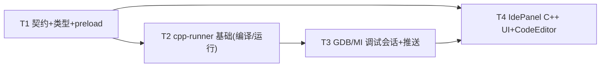

# 「个人信息管家」IDE 模式 C++ 真调试设计（CPP-DEBUG-DESIGN）

> 版本：v1.0（MVP）
> 作者：高见远（架构师）
> 状态：待工程师实现（只设计，不改代码）
> 范围：为「开发者工具箱 → IDE 模式」增加 C++ 本地编译 + gdb(MI) 真调试（断点/单步/继续/停止/变量/调用栈）
> 决策：走「本地工具链」——Electron 主进程调用本机 `g++` 编译、`gdb --interpreter=mi` 调试；**仅桌面端可用**，浏览器端降级提示。

---

## 0. 现状核对与结论

| 现状 | 结论 |
|------|------|
| `web/src/components/IdePanel.tsx`：纯浏览器 JS 沙箱（`new Function('console',...)`），`<textarea>` + 运行按钮 + 输出面板，无语言切换、无行号/断点 | 需新增「JS / C++」语言切换 + 行号 gutter 断点 + 调试控制 + 变量/调用栈/输出面板 |
| `web/src/pages/DevToolsPage.tsx`：把 IdePanel 放在「IDE 模式」卡片中 | 无需大改（降级逻辑在 IdePanel 内） |
| `desktop/src/shared/ipc-contract.ts` + `shared/types/ipc.ts` + `preload/index.ts` 已有多通道/多类型，`ipc.ts` 已注册 handler | 新增 cpp 相关通道/类型/`DesktopBridge` 方法，两处类型镜像同步 |
| 主进程可 spawn 子进程（已有 `vs-monitor.ts` 用 `execFile`、`selection-analyzer` 等） | 新增 `desktop/src/main/cpp-runner.ts` 用 `child_process.spawn` 做编译/运行/gdb 会话 |
| LLM 只走 cloud.llm 与本功能无关（本功能纯本地工具链，不涉及 AI） | 无云端依赖 |

---

## 1. 主进程新模块 `desktop/src/main/cpp-runner.ts`

### 1.1 职责

1. 工具链检测：`g++ --version` / `gdb --version`。
2. 编译：写临时 `.cpp` → `g++ -g -O0 -std=c++17 -o <bin> <src>`。
3. 运行：spawn 二进制，捕获 stdout/stderr，超时 kill。
4. 调试会话：spawn `gdb --interpreter=mi`，维护 MI 命令队列与异步事件解析，推送事件给发起方 renderer。
5. 生命周期：会话互斥、进程清理、`before-quit` 兜底。

### 1.2 类型与函数签名

```ts
// cpp-runner.ts
export interface ToolchainItem { ok: boolean; version?: string; error?: string }
export interface ToolchainStatus { gpp: ToolchainItem; gdb: ToolchainItem }

export interface CompileResult {
  ok: boolean
  output: string           // gcc 诊断（stdout+stderr 合并，含 file:line 错误）
  exitCode: number | null
  binaryPath?: string      // 编译产物绝对路径
  sourcePath?: string      // 写入的临时源文件绝对路径
}

export interface RunResult {
  ok: boolean
  output: string
  exitCode: number | null
  timedOut: boolean
}

export interface DebugFrame { level: number; func: string; file?: string; fullname?: string; line?: number }
export interface DebugVariable { name: string; value: string; type?: string }

export type CppDebugEvent =
  | { type: 'output'; stream: 'stdout' | 'stderr' | 'gdb'; text: string }
  | { type: 'running' }
  | { type: 'stopped'; reason: string; frame?: DebugFrame; message?: string }
  | { type: 'frames'; frames: DebugFrame[] }
  | { type: 'variables'; variables: DebugVariable[] }
  | { type: 'ended'; exitCode?: number }

export interface DebuggerEvents {
  onEvent: (evt: CppDebugEvent) => void
}

export class CppRunner {
  private activeDebug: DebugSession | null = null

  /** 检测 g++ / gdb（execFile + 3s 超时）。 */
  async detectToolchain(): Promise<ToolchainStatus>

  /** 编译：写临时 .cpp → g++。 */
  async compile(source: string): Promise<CompileResult>

  /** 运行已编译二进制（默认 10s 超时）。 */
  async run(binaryPath: string, timeoutMs = 10_000): Promise<RunResult>

  /** 启动调试会话（互斥；已有会话则拒绝）。 */
  async startDebug(args: {
    binaryPath: string
    sourcePath: string        // 供 -break-insert 用绝对路径
    breakpoints: number[]     // 行号数组
    events: DebuggerEvents
  }): Promise<{ ok: boolean; message?: string }>

  /** 发送任意 MI 命令（带 token，返回 ^done/^error 解析结果）。 */
  sendDebugCommand(command: string): Promise<{ ok: boolean; message?: string }>

  /** 结束调试：-gdb-exit + kill 兜底。 */
  async stopDebug(): Promise<void>

  getDebugActive(): boolean
  dispose(): void             // before-quit 时清理所有子进程
}
```

### 1.3 工具链检测

```ts
async function versionOf(bin: string): Promise<ToolchainItem> {
  try {
    const { stdout } = await execFileAsync(bin, ['--version'], { windowsHide: true, timeout: 3000 })
    return { ok: true, version: String(stdout).split('\n')[0] ?? '' }
  } catch (err) {
    return { ok: false, error: `${bin} 不可用（${(err as Error).message ?? '未知错误'}）` }
  }
}
async detectToolchain(): Promise<ToolchainStatus> {
  return { gpp: await versionOf('g++'), gdb: await versionOf('gdb') }
}
```

### 1.4 编译与运行

```ts
const CPP_TMP_DIR = join(os.tmpdir(), 'personal-agent-cpp')

async compile(source: string): Promise<CompileResult> {
  mkdirSync(CPP_TMP_DIR, { recursive: true })
  const id = randomUUID()
  const sourcePath = join(CPP_TMP_DIR, `${id}.cpp`)
  const binaryPath = join(CPP_TMP_DIR, `${id}.exe`)   // Windows
  writeFileSync(sourcePath, source, 'utf-8')

  const { code, stdout, stderr } = await spawnCapture('g++', [
    '-g', '-O0', '-std=c++17', '-o', binaryPath, sourcePath,
  ], { timeout: 30_000 })

  return {
    ok: code === 0,
    output: `${stdout}\n${stderr}`.trim(),
    exitCode: code,
    binaryPath: code === 0 ? binaryPath : undefined,
    sourcePath,
  }
}

async run(binaryPath: string, timeoutMs = 10_000): Promise<RunResult> {
  // spawn(binaryPath) → 捕获 stdout/stderr；setTimeout → kill('SIGKILL') → timedOut=true
}
```

> `spawnCapture` 为内部工具：`child_process.spawn` + Promise 化 + 超时 kill（`windowsHide:true`）。

### 1.5 调试会话（GDB/MI 核心）

**spawn**：`gdb --interpreter=mi --nx --quiet <binaryPath>`
- `--nx` 不读用户 init 文件（确定性）；`--quiet` 少打印。

**行解析**：按行读取 `child.stdout`，每行判定前缀：

| 前缀 | 类型 | 处理 |
|------|------|------|
| `^done,...` | 同步结果 | 用 token 匹配 pending Promise 并 resolve |
| `^error,msg="..."` | 同步错误 | resolve 为 `{ok:false, message}` |
| `^running` | 执行已启动 | resolve 对应 exec 命令 |
| `^exit` | gdb 退出 | 结束会话 |
| `*running,thread-id="all"` | 异步运行 | 推 `{type:'running'}` |
| `*stopped,reason="...",frame={...}` | 异步停止 | 推 `{type:'stopped', reason, frame}` 并自动补查 frames/vars |
| `~"..."` | 控制台流（gdb 消息） | 推 `{type:'output', stream:'gdb'}` |
| `@"..."` | 目标输出（程序 stdout） | 推 `{type:'output', stream:'stdout'}` |
| `&"..."` | 日志流 | 推 `{type:'output', stream:'stderr'}` |
| `=...` | 异步通知（breakpoint-modified 等） | 忽略/记录 |
| `(gdb)` | 提示符（空闲） | 从命令队列取下一个发送 |

**会话状态机（`DebugSession` 内部）**：

```ts
class DebugSession {
  private child: ChildProcess
  private pending = new Map<number, { resolve: (r) => void }>()
  private queue: string[] = []
  private token = 0
  private idle = true          // (gdb) 提示符后为 true

  send(cmd: string): Promise<MiResult> {
    const t = ++this.token
    this.queue.push(`${t}${cmd}`)
    this.drain()
    return new Promise((resolve) => this.pending.set(t, { resolve }))
  }

  private drain(): void {
    if (!this.idle || this.queue.length === 0) return
    this.idle = false
    this.child.stdin.write(this.queue.shift()! + '\n')
  }
  // 收到 (gdb) → idle=true → drain()；收到 ^done/^error/^running → 解析 token → pending.resolve
}
```

**`startDebug` 流程**（串行，全部经队列）：

```ts
await this.send('-break-insert <sourcePath>:<line>')  // 每个断点
const run = this.send('-exec-run')                     // 不 await 停止，靠 *stopped
```

**停止后自动补查**（收到 `*stopped` 且带 frame 时）：

```ts
// 在 onEvent 里：先推 stopped，再排队查 frames/vars，结果作为后续 push 事件
this.send('-stack-list-frames').then(r => onEvent({type:'frames', frames: parseFrames(r)}))
this.send('-stack-list-variables --simple-values').then(r => onEvent({type:'variables', variables: parseVars(r)}))
```

**`stopDebug`**：`-gdb-exit`；2s 后仍存活则 `child.kill('SIGKILL')`；`child.stdin.end()`。

---

## 2. GDB/MI 命令映射表

| 操作 | MI 命令 | 同步响应（token 匹配） | 异步事件 → UI 状态 |
|------|---------|----------------------|-------------------|
| 设断点 | `-break-insert <absPath>:<line>` | `^done,bkpt={number="1",...}` | — |
| 删断点 | `-break-delete <num>` | `^done` | — |
| 列断点 | `-break-list` | `^done,BreakpointTable=...` | — |
| 启动/运行 | `-exec-run` | `^running` | `*running` → running；`*stopped,reason="breakpoint-hit"` → paused@断点 |
| 单步跳过 | `-exec-next` | `^running` | `*stopped,reason="end-stepping-range"`（或 `breakpoint-hit`）→ paused@下一行 |
| 单步进入 | `-exec-step` | `^running` | `*stopped,reason="end-stepping-range"` → paused |
| 继续 | `-exec-continue` | `^running` | `*stopped,reason="breakpoint-hit"` / `"exited-normally"` |
| 停止/中断 | `-exec-interrupt` | `^done` | `*stopped,reason="signal-received",signal-name="SIGINT"` |
| 调用栈 | `-stack-list-frames` | `^done,stack=[frame={level,func,file,fullname,line},...]` | — |
| 局部变量 | `-stack-list-variables --simple-values` | `^done,variables=[{name,value,type?},...]` | — |
| 创建变量对象 | `-var-create - * <expr>` | `^done,name="var1",value="..."` | —（P2 复杂结构展开） |
| 表达式求值 | `-data-evaluate-expression <expr>` | `^done,value="..."` | — |
| 退出调试 | `-gdb-exit` | `^exit` | 会话结束 |

### 2.1 `*stopped` 的 `reason` 与 UI 映射（关键）

| `reason` | 含义 | UI 状态 |
|----------|------|---------|
| `breakpoint-hit` | 命中断点 | `paused`（断点高亮） |
| `end-stepping-range` | 单步完成 | `paused`（下一行高亮） |
| `exited-normally` / `exited` | 正常结束 | `ended`（显示退出码） |
| `exited-signalled` | 信号退出（如段错误） | `ended` + 信号名 |
| `signal-received` | 收到信号（含 `-exec-interrupt` 的 SIGINT） | `paused`（提示信号） |
| `exception-received` | C++ 异常 | `paused`（提示异常） |

### 2.2 `*stopped` 解析示例

```
*stopped,reason="breakpoint-hit",disp="keep",bkptno="1",
 frame={addr="0x4015b0",func="main",args=[],file="main.cpp",
        fullname="C:\\Users\\x\\AppData\\Local\\Temp\\personal-agent-cpp\\<id>.cpp",line="5"},
 thread-id="1",stopped-threads="all"
```

解析出 `frame.line=5` + `fullname` → UI 高亮第 5 行；随后自动补查 `-stack-list-frames` / `-stack-list-variables`。

### 2.3 异步事件可靠映射策略（核心要点，工程师务必遵守）

1. **不要用「命令 invoke 返回」判断执行是否停止**：`-exec-next` 等返回 `^running` 即 resolve，真正停止靠异步 `*stopped`。UI 的「单步完成/命中断点/运行结束」**只由 push 事件驱动**。
2. **串行化执行类命令**：主进程同一时刻只放一条会改变执行状态的命令（exec-run/next/step/continue/interrupt），其余命令排队，避免交错导致状态错乱。
3. **二元运行态**：收到 `*running` → `running`；收到 `*stopped` → `stopped`；`(gdb)` 提示符 = 空闲可发下一条。用这两个异步记录维护权威状态，而非本地猜测。
4. **停止后由主进程主动补查** frames/variables，把结果作为独立 push 事件，renderer 无需轮询，避免时序竞争。
5. **token 仅用于 `^` 结果匹配**，`*` 异步记录不带 token，不能靠 token 关联执行命令与停止事件。

---

## 3. IPC 契约新增

### 3.1 通道（`ipc-contract.ts`）

```ts
// renderer → main（invoke）
cppDetect: 'desktop:cpp-detect',
cppCompile: 'desktop:cpp-compile',
cppRun: 'desktop:cpp-run',
cppDebugStart: 'desktop:cpp-debug-start',
cppDebugCommand: 'desktop:cpp-debug-command',
cppDebugStop: 'desktop:cpp-debug-stop',
// main → renderer（webContents.send，定向到发起方 event.sender）
evtCppDebug: 'desktop:cpp-debug-event',
```

### 3.2 类型（`ipc-contract.ts` + `shared/types/ipc.ts` 双处镜像）

```ts
export interface ToolchainItem { ok: boolean; version?: string; error?: string }
export interface ToolchainStatus { gpp: ToolchainItem; gdb: ToolchainItem }

export interface CompileResult {
  ok: boolean; output: string; exitCode: number | null
  binaryPath?: string; sourcePath?: string
}
export interface RunResult {
  ok: boolean; output: string; exitCode: number | null; timedOut: boolean
}
export interface DebugFrame { level: number; func: string; file?: string; fullname?: string; line?: number }
export interface DebugVariable { name: string; value: string; type?: string }
export type CppDebugEvent =
  | { type: 'output'; stream: 'stdout' | 'stderr' | 'gdb'; text: string }
  | { type: 'running' }
  | { type: 'stopped'; reason: string; frame?: DebugFrame; message?: string }
  | { type: 'frames'; frames: DebugFrame[] }
  | { type: 'variables'; variables: DebugVariable[] }
  | { type: 'ended'; exitCode?: number }

export interface CppDebugStartInput {
  binaryPath: string
  sourcePath: string
  breakpoints: number[]
}
```

### 3.3 `preload/index.ts`（`DesktopBridge` 新增）

```ts
cppDetect(): Promise<ToolchainStatus>
cppCompile(source: string): Promise<CompileResult>
cppRun(binaryPath: string): Promise<RunResult>
cppDebugStart(input: CppDebugStartInput): Promise<{ ok: boolean; message?: string }>
cppDebugCommand(command: string): Promise<{ ok: boolean; message?: string }>
cppDebugStop(): Promise<{ ok: boolean }>
onCppDebug(cb: (evt: CppDebugEvent) => void): () => void   // ipcRenderer.on(evtCppDebug)
```

### 3.4 `ipc.ts` 注册要点

```ts
ipcMain.handle(IPC.cppDetect, () => cppRunner.detectToolchain())
ipcMain.handle(IPC.cppCompile, (_e, source: unknown) => cppRunner.compile(String(source ?? '')))
ipcMain.handle(IPC.cppRun, (_e, payload: { binaryPath: string }) => cppRunner.run(payload.binaryPath))

ipcMain.handle(IPC.cppDebugStart, (event, input: CppDebugStartInput) =>
  cppRunner.startDebug({ ...input, events: { onEvent: (evt) => event.sender.send(IPC.evtCppDebug, evt) } }))

ipcMain.handle(IPC.cppDebugCommand, (_e, cmd: unknown) => cppRunner.sendDebugCommand(String(cmd ?? '')))
ipcMain.handle(IPC.cppDebugStop, () => cppRunner.stopDebug().then(() => ({ ok: true })))
```

> **关键**：`cppDebugStart` 捕获 `event.sender`，后续所有异步事件定向推回**发起调试的那个 renderer**，避免多窗口串扰。

---

## 4. IdePanel C++ 模式 UI 状态机

### 4.1 组件结构

```
IdePanel
├─ 语言切换 Toggle（JS / C++）
├─ 工具链状态条（g++/gdb 版本 或 缺失提示）
├─ CodeEditor（gutter 行号 + 断点 + 当前行高亮 + 代码区）
├─ 控制按钮组（按阶段显隐/禁用）
│    JS：运行
│    C++：编译 / 运行 / 调试(启动) / 继续 / 单步跳过 / 单步进入 / 停止 / 结束调试
├─ 输出面板（编译诊断 / 程序 stdout/stderr / gdb 消息）
├─ 调用栈面板（frames 列表）
└─ 变量面板（locals 列表）
```

### 4.2 状态机（C++ 模式）

| phase | 含义 | 可用按钮 |
|-------|------|---------|
| `idle` | 未编译 | 编译（运行/调试禁用） |
| `compiling` | 编译中 | 无（全禁用） |
| `compiled` | 编译成功（有 binaryPath） | 运行、调试 |
| `run-running` | 运行中 | 停止（P2） |
| `debug-starting` | gdb 启动中 | 无 |
| `debug-running` | 程序执行中 | 停止（`-exec-interrupt`） |
| `debug-paused` | 命中断点/单步完成 | 继续、单步跳过、单步进入、停止、结束调试 |
| `debug-ended` | 程序结束 | 结束调试（清理会话）、重新调试 |

**状态流转（由 push 事件驱动）**：

```mermaid
stateDiagram-v2
    [*] --> idle
    idle --> compiling: 点编译
    compiling --> compiled: CompileResult.ok
    compiling --> idle: 编译失败(展示诊断)
    compiled --> run-running: 点运行
    run-running --> compiled: RunResult(超时/退出码)
    compiled --> debug-starting: 点调试(传 breakpoints)
    debug-starting --> debug-running: evt running
    debug-running --> debug-paused: evt stopped(breakpoint/end-step/signal)
    debug-running --> debug-ended: evt stopped(exited*)
    debug-paused --> debug-running: 继续/单步
    debug-paused --> debug-ended: evt stopped(exited*)
    debug-ended --> debug-starting: 重新调试
    debug-paused --> idle: 结束调试
    debug-running --> idle: 结束调试
```

### 4.3 行号断点（`web/src/components/CodeEditor.tsx` 新增）

- 自研「gutter + textarea」结构（零新增依赖）：左列行号/断点列，右侧 textarea，`white-space:pre`、等宽字体、固定行高、共享滚动。
- 点击 gutter 行号 → 切换断点（红点），维护 `breakpoints: number[]`。
- `pausedLine`（来自 `stopped.frame.line`）→ gutter 当前行高亮（黄条）且滚动到可见。
- P2 可换 CodeMirror 6 获得语法高亮/更稳的 gutter。

### 4.4 降级提示（无 desktopBridge / 工具链缺失）

| 场景 | 表现 |
|------|------|
| 浏览器（`window.desktopBridge === undefined`） | C++ 模式顶部横幅「C++ 编译与调试需在桌面伴侣中使用」；编译/运行/调试按钮禁用；JS 模式仍可用 |
| `g++` 缺失 | 「未检测到 g++，请安装 MinGW-w64 并加入 PATH」；编译/运行/调试禁用 |
| `gdb` 缺失 | 「未检测到 gdb，无法调试」；调试禁用（编译/运行仍可用） |

---

## 5. 错误处理

| 场景 | 处理 |
|------|------|
| 编译错误 | `CompileResult.ok=false`，`output` 含 gcc 诊断（`file:line: error: ...`）；UI 原样展示（P2 解析行号高亮） |
| gdb 缺失 | `detectToolchain().gdb.ok=false` → 调试按钮禁用 + 提示 |
| 运行超时 | `run()` 超时 `kill('SIGKILL')`，`timedOut=true`，提示「运行超时（10s）已终止」 |
| 程序读 stdin 挂起 | 超时兜底（MVP 不支持交互式输入，见 Q-C8） |
| 重复/并发调试 | `CppRunner.activeDebug` 互斥：已有会话时 `startDebug` 返回 `{ok:false, message:'已有调试会话，请先结束'}`；UI 侧在 `debug-*` 阶段禁用「调试」按钮 |
| 进程清理 | `stopDebug`：`-gdb-exit` → 2s 未退 kill；`CppRunner.dispose()` 在 `app.on('before-quit')` 统一 kill 所有子进程 |
| 临时文件 | 统一写 `os.tmpdir()/personal-agent-cpp/`，`dispose` 时 best-effort 清理 |
| 子进程异常退出（gdb 崩溃） | `child.on('exit')` 未收到 `^exit` 时推 `{type:'ended', message:'调试器异常退出'}` |

---

## 6. 有序任务列表（T1..T4）

### T1 · IPC 契约 + 类型 + preload

- **目标**：cpp 通道/类型/`DesktopBridge` 方法就绪（不含实现）。
- **涉及文件**：
  - `desktop/src/shared/ipc-contract.ts`（6 个 invoke 通道 + `evtCppDebug` + 全部 cpp 类型）
  - `shared/types/ipc.ts`（镜像类型 + `DesktopBridge` 新方法）
  - `desktop/src/preload/index.ts`（`cppDetect/cppCompile/cppRun/cppDebugStart/cppDebugCommand/cppDebugStop/onCppDebug`）
- **依赖**：无
- **完成标准**：两处类型一致（grep 校验）；preload 暴露新 API；`tsc --noEmit` 通过。

### T2 · cpp-runner 基础（检测 + 编译 + 运行）+ IPC handler

- **目标**：本机 g++ 编译、运行、工具链检测可跑通。
- **涉及文件**：
  - `desktop/src/main/cpp-runner.ts`（新建：`detectToolchain/compile/run/spawnCapture`）
  - `desktop/src/main/ipc.ts`（注册 `cppDetect/cppCompile/cppRun`）
- **依赖**：T1
- **完成标准**：`g++ --version`/`gdb --version` 返回正确状态；一段 C++ 源码能编译出 `.exe` 并运行拿到 stdout/exitCode；超时 kill 生效；编译错误诊断可读。

### T3 · GDB/MI 调试会话 + 事件推送 + 清理

- **目标**：断点/单步/继续/停止/变量/调用栈全链路。
- **涉及文件**：
  - `desktop/src/main/cpp-runner.ts`（`DebugSession`、MI 行解析、命令队列、`startDebug/sendDebugCommand/stopDebug/dispose`）
  - `desktop/src/main/ipc.ts`（注册 `cppDebugStart/cppDebugCommand/cppDebugStop`，`event.sender` 定向推送）
  - `desktop/src/main/index.ts`（`before-quit` 调 `cppRunner.dispose()`）
- **依赖**：T2
- **完成标准**：设断点后 `-exec-run` 命中 → 推 `stopped(breakpoint-hit,frame)` + frames + variables；next/step/continue/stop 正确推 `running`/`stopped`；程序结束推 `ended`；重复启动被拒绝；退出清理干净。

### T4 · IdePanel C++ UI + CodeEditor + 降级

- **目标**：语言切换、断点 gutter、调试控制、三面板、降级提示。
- **涉及文件**：
  - `web/src/components/IdePanel.tsx`（重写：JS/C++ 切换 + 状态机 + 控制按钮 + 输出/调用栈/变量面板）
  - `web/src/components/CodeEditor.tsx`（新建：gutter 行号 + 断点 + 当前行高亮）
- **依赖**：T1（bridge 类型）；调试联调依赖 T3
- **完成标准**：JS 模式功能不回退；C++ 模式编译/运行/调试全流程可用；gutter 点击设断点；单步时当前行高亮；变量/调用栈/输出实时更新；无 bridge 或工具链缺失时给出明确降级提示。

### 任务依赖图



---

## 7. 待明确事项（附默认建议，不阻塞）

| 编号 | 事项 | 默认建议 |
|------|------|---------|
| Q-C1 | 工具链来源 | 仅 MinGW-w64 的 `g++`/`gdb`（PATH 检测）；MSVC `cl.exe` 后续迭代 |
| Q-C2 | 临时文件目录/清理 | `os.tmpdir()/personal-agent-cpp/`，`dispose` best-effort 清理，不落敏感源码 |
| Q-C3 | 单文件 vs 多文件 | MVP 单文件（单翻译单元 `main.cpp`）；多文件 P2 |
| Q-C4 | 断点路径 | 用**绝对路径** `-break-insert <absPath>:<line>`，避免 gdb 工作目录歧义 |
| Q-C5 | 变量查看深度 | MVP `-stack-list-variables --simple-values`；复杂结构/指针展开 P2（`-var-create`） |
| Q-C6 | 运行超时 | 默认 10s（常量可调） |
| Q-C7 | 编辑器实现 | 自研 gutter+textarea（零依赖）；CodeMirror 6 作 P2 提升 |
| Q-C8 | 交互式 stdin | MVP 不支持（读 stdin 由超时兜底）；P2 加输入框 |

---

*本文档为 C++ 真调试施工蓝图；实现时如与 gdb/MI 实际输出、Electron 子进程行为有出入，以运行时行为为准，并回报架构师同步修订。*
