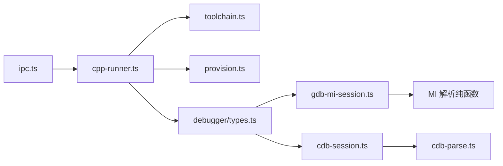
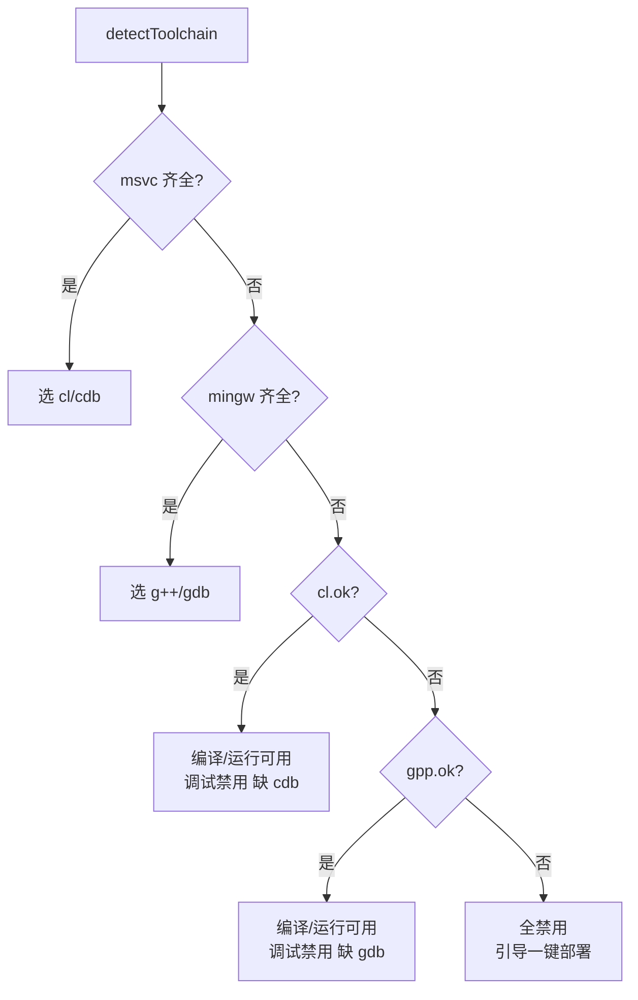
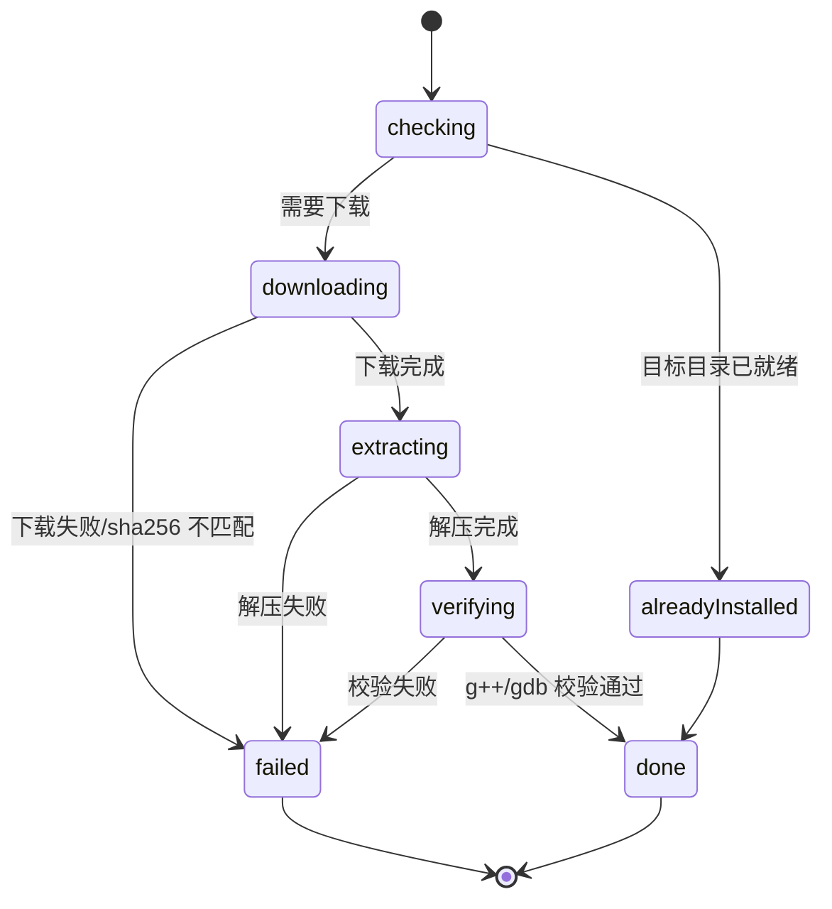
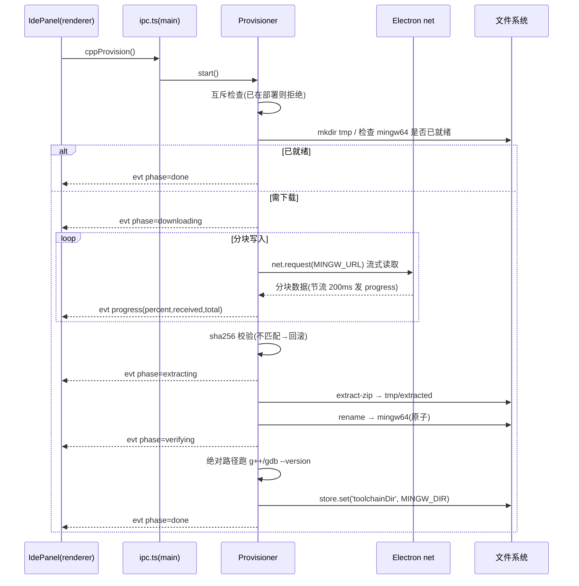
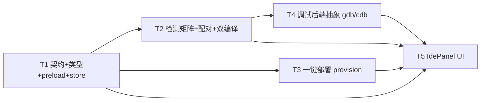

# 「个人信息管家」C++ 工具链替换与一键部署设计（CPP-TOOLCHAIN-DESIGN）

> 版本：v1.0（MVP）
> 作者：高见远（架构师）
> 状态：待工程师实现（只设计，不改代码）
> 范围：将「开发者工具箱 → IDE 模式」的 C++ 能力从「仅 PATH 检测 g++/gdb」升级为「MSVC(cl) 与 MinGW(g++) 双编译器 + Windows SDK(cdb) 与 GDB 双调试器」的检测矩阵，支持残缺场景降级，并新增「一键部署免安装 MinGW-w64」打通零配置体验。
> 决策：**LLM 调用仍只在 Web renderer 端（Origin 匹配）；主进程只做进程/文件/剪贴板操作**，本设计全部落在桌面主进程 + Web renderer，不新增任何云端/AI 依赖。

---

## 0. 现状核对与结论

| 现状 | 结论 |
|------|------|
| `desktop/src/main/cpp-runner.ts`：`detectToolchain()` 只 `versionOf('g++')`/`versionOf('gdb')`，走 PATH；`compile()` 硬编码 `g++ -g -O0 -std=c++17`；`DebugSession` 构造函数硬编码 `spawn('gdb', ...)` | 拆为「检测矩阵/配对选择/后端会话」三块；编译器与调试器路径改为运行时选择，不再硬编码 |
| `ipc-contract.ts`：`ToolchainStatus` 仅 `{ gpp, gdb }` 两字段 | 扩展为 `{ gpp, gdb, cl, cdb, selection }`（**纯增量，向后兼容**，IdePanel 现有 `toolchain.gpp/gdb` 读取不受影响） |
| `ipc.ts`：`cppRunner` 单例 + `event.sender` 定向推送 | 保留单例；新增 provision 通道，进度事件同样用 `event.sender` 定向推送防多窗口串扰 |
| `IdePanel.tsx`：已实现 CppPhase 状态机（idle/compiling/compiled/run-running/debug-*）+ 工具链 Chip + 降级提示；调试按钮直接发原始 MI 命令字符串 | 状态机保留；调试控制改为**语义化命令**（`continue/step-over/step-into/interrupt`），由主进程按后端翻译，使 UI 对 gdb/cdb 无感知；新增「一键部署」按钮 + 进度条 |
| `store.ts`：`JsonStore` 有 `LocalStoreSchema`，无工具链安装目录字段 | 新增 `toolchainDir: string`（部署后注册，使免 PATH 的便携工具链在重启后仍可被发现） |
| 已有 MI 解析纯函数（`miUnquote/extractQuoted/extractBalanced/splitTopLevel/parseFrame/parseStopped/parseFrames/parseVariables`） | **全部保留**，迁移到 `debugger/gdb-mi-session.ts` 继续供单元测试 |

---

## 1. 总体架构与模块划分

主进程 C++ 能力从「单文件」重排为「检测 / 部署 / 调试后端」三块，保持职责单一、便于单测：

```
desktop/src/main/
├─ toolchain.ts                    # 新增：检测矩阵 + 配对选择（纯函数 + fs）
├─ provision.ts                    # 新增：一键部署 MinGW（下载/校验/解压/注册/回滚/进度）
├─ cpp-runner.ts                   # 改造：编排层（detect→toolchain；compile→按选择；run；startDebug→选后端）
├─ debugger/
│  ├─ types.ts                     # 新增：DebuggerSession 抽象接口 + 共享类型
│  ├─ gdb-mi-session.ts            # 新增：现有 DebugSession + MI 解析纯函数迁入（逻辑不变）
│  └─ cdb-session.ts               # 新增：cdb 命令行后端
│  └─ cdb-parse.ts                 # 新增：cdb 输出解析纯函数（供单测）
```

依赖方向：`cpp-runner.ts` → `toolchain.ts` / `provision.ts` / `debugger/*`；`debugger/*` 不反向依赖 `cpp-runner`。



---

## 2. 工具链检测矩阵

### 2.1 检测项

| 检测项 | 可执行文件 | 检测方式 | `ok=true` 判定 | `version` 提取 | `source` |
|--------|-----------|---------|----------------|----------------|----------|
| `g++`（MinGW 编译器） | `bin/g++.exe` | ① 注册目录 `store.toolchainDir/bin/g++.exe` ② PATH `g++ --version` | 任一 `--version` 成功 | 版本首行 | `registered` / `path` |
| `gdb`（MinGW 调试器） | `bin/gdb.exe` | 同上 ①注册目录 ② PATH `gdb --version` | 同上 | 版本首行 | `registered` / `path` |
| `cl`（MSVC 编译器） | `VC\Tools\MSVC\<ver>\bin\Hostx64\x64\cl.exe` | `vswhere.exe -latest -requires Microsoft.VisualStudio.Component.VC.Tools.x86.x64 -find VC\Tools\MSVC\**\bin\Hostx64\x64\cl.exe` | 找到 cl.exe 文件 | 目录名 `14.xx` → `MSVC 19.xx` | `vswhere` |
| `cdb`（Windows SDK 调试器） | `%ProgramFiles(x86)%\Windows Kits\10\Debuggers\x64\cdb.exe` | 固定路径文件存在 + `cdb -version` | 存在 | 版本首行 | `sdk` |

> **`cl` 版本不通过 spawn 运行获取**：cl 需要 vcvars64.bat 注入 INCLUDE/LIB/PATH 才能启动，裸 spawn 必然失败。版本号改从 MSVC 目录名 `14.39.33519` 解析（`19.39`），检测阶段只判「文件存在」即可，无需载入环境。

### 2.2 关键定位函数（`toolchain.ts`）

```ts
/** vswhere.exe 标准安装位置（VS Installer）。 */
function vswherePath(): string
/** 用 vswhere 定位 cl.exe；无 VS 时返回 null。 */
async function locateClExe(): Promise<string | null>
/** 由 cl.exe 绝对路径反推 vcvars64.bat（VC\Auxiliary\Build\vcvars64.bat）。 */
export function locateVcvars(clPath: string): string
/** 由 cl.exe 目录名解析 MSVC 版本号（14.xx → 19.xx）。 */
export function msvcVersionOf(clPath: string): string
/** Windows SDK cdb.exe 固定路径。 */
export function sdkCdbPath(): string
/** 检测单个 MinGW 可执行（先注册目录后 PATH），返回带 path 的 ToolchainItem。 */
async function detectMingwBin(kind: 'g++' | 'gdb'): Promise<ToolchainItem>
```

### 2.3 类型扩展（`ToolchainItem` / `ToolchainStatus`）

```ts
/** 单一工具链（g++/gdb/cl/cdb）检测结果。 */
export interface ToolchainItem {
  ok: boolean
  version?: string
  /** 实际可执行文件绝对路径（spawn 用；PATH 命中的话为可执行名本身）。 */
  path?: string
  error?: string
  /** 检测来源，用于诊断文案：'path' | 'vswhere' | 'sdk' | 'registered'。 */
  source?: 'path' | 'vswhere' | 'sdk' | 'registered'
}

/** 本机 C++ 工具链状态（原 gpp/gdb 保留，新增 cl/cdb/selection）。 */
export interface ToolchainStatus {
  gpp: ToolchainItem
  gdb: ToolchainItem
  cl: ToolchainItem
  cdb: ToolchainItem
  /** 配对选择结果（详见 §3）。 */
  selection: ToolchainSelection
}
```

> `source` 字段让 IdePanel 能区分「PATH 命中」与「部署目录命中」，便于展示「已由本应用部署」标签，语义清晰且不影响既有 `gpp/gdb` 字段。

---

## 3. 编译器/调试器配对选择算法

### 3.1 配对表（编译器 ↔ 调试器，不可混用）

| 优先级 | 编译器 | 调试器 | 后端 | 说明 |
|--------|--------|--------|------|------|
| 1 | MSVC `cl` | Windows SDK `cdb` | cdb 命令行（新增） | 首选：面向已装 VS 的用户，与本机 VS 工程/生成工具链一致 |
| 2 | MinGW `g++` | MinGW `gdb` | GDB/MI（现有，成熟） | 次选/兜底：免管理员、便携可部署、MI 解析已实现且 9 项单测覆盖 |

> **两者都完整时默认选 MSVC（VS 优先）**：与用户本机 Visual Studio 工程体验一致；MinGW 作为兜底，且可被「一键部署」补齐。该默认可在 `selectPairing` 入参覆盖（见 Q-T2）。

### 3.2 配对结果类型

```ts
export interface ToolchainSelection {
  compiler: 'gpp' | 'cl' | null     // null = 无可用编译器
  debugger: 'gdb' | 'cdb' | null    // null = 无可用调试器
  ready: boolean                    // 编译器可用（编译/运行可用）
  canDebug: boolean                 // 编译器 + 调试器配对齐全
  reason?: string                   // 残缺/缺失的人类可读提示
}
```

### 3.3 选择算法（含残缺降级）

```ts
export function selectPairing(s: {
  gpp: ToolchainItem; gdb: ToolchainItem; cl: ToolchainItem; cdb: ToolchainItem
}): ToolchainSelection {
  const msvcFull = s.cl.ok && s.cdb.ok
  const mingwFull = s.gpp.ok && s.gdb.ok
  if (msvcFull)   return { compiler: 'cl',  debugger: 'cdb', ready: true, canDebug: true }
  if (mingwFull)  return { compiler: 'gpp', debugger: 'gdb', ready: true, canDebug: true }

  // —— 以下为残缺场景，逐级降级 ——
  if (s.cl.ok && !s.cdb.ok)
    return { compiler: 'cl',  debugger: null, ready: true,  canDebug: false, reason: '缺失 Windows SDK 调试器 cdb，或可一键部署 MinGW' }
  if (s.gpp.ok && !s.gdb.ok)
    return { compiler: 'gpp', debugger: null, ready: true,  canDebug: false, reason: '缺失 gdb，可一键部署 MinGW 或安装 gdb' }
  if (!s.gpp.ok && !s.cl.ok && (s.gdb.ok || s.cdb.ok))
    return { compiler: null,  debugger: null, ready: false, canDebug: false, reason: '缺少编译器（只有调试器），可一键部署 MinGW' }
  return { compiler: null, debugger: null, ready: false, canDebug: false, reason: '未检测到 C++ 工具链，可一键部署 MinGW' }
}
```

### 3.4 降级矩阵（面向 UI 的表现）

| 场景 | 编译 | 运行 | 调试 | IdePanel 提示 |
|------|------|------|------|---------------|
| cl + cdb 齐全（VS 优先） | ✅ | ✅ | ✅（cdb） | 展示「MSVC cl + cdb」 |
| g++ + gdb 齐全 | ✅ | ✅ | ✅（GDB/MI） | 展示「MinGW g++ + gdb」 |
| 仅 cl（缺 cdb） | ✅ | ✅ | ❌ | 「缺失 cdb，无法调试」+ 一键部署按钮 |
| 仅 g++（缺 gdb） | ✅ | ✅ | ❌ | 「缺失 gdb，无法调试」+ 一键部署按钮 |
| 仅 gdb / 仅 cdb（缺编译器） | ❌ | ❌ | ❌ | 「缺少编译器」+ 一键部署按钮 |
| 全缺失 | ❌ | ❌ | ❌ | 「未检测到工具链」+ 一键部署按钮 |



---

## 4. 一键部署（provision）

### 4.1 目标与原则

- **默认目标**：免安装 MinGW-w64 解压到 `%APPDATA%\personal-agent\toolchains\mingw64\`，**免管理员、免重启、不写 PATH**（通过 `store.toolchainDir` 注册）。
- **原子性**：先解压到临时目录，校验通过后整体 `rename` 到最终目录，失败不影响既有可用工具链。
- **幂等**：若 `mingw64` 已存在且 `g++/gdb` 校验通过，则跳过下载直接注册。

### 4.2 下载源 URL（候选，实现期固化）

| 优先级 | 用途 | URL | 备注 |
|--------|------|-----|------|
| 主选 | MinGW-w64（含 gcc/g++/gdb） | `https://github.com/brechtsanders/winlibs_mingw/releases/download/<TAG>/winlibs-x86_64-posix-seh-gcc-<VER>-mingw-w64ucrt-<RUNTIME>-r<REV>.zip` | UCRT 运行时；zip 可用 `extract-zip` 流式解压；**TAG/VER 与 sha256 实现期固化** |
| 备选 | 同上（SourceForge 镜像） | `https://sourceforge.net/projects/winlibs-mingw/files/...` | GitHub 被墙/限速时回退 |
| 常量 | 便于升级 | 见下 | 版本号单一常量，后续升级只改常量 |

```ts
// provision.ts 常量（实现期填入真实值）
const TOOLCHAIN_ROOT = join(app.getPath('appData'), 'personal-agent', 'toolchains')
const MINGW_DIR      = join(TOOLCHAIN_ROOT, 'mingw64')
const MINGW_URL      = 'https://github.com/brechtsanders/winlibs_mingw/releases/download/<TAG>/<winlibs-...>.zip'
const MINGW_SHA256   = '<从 release 页复制的真实 sha256，实现期必须填入，未填前禁止启用自动部署>'
```

> **校验和必须实现期固化**：本设计不虚构 sha256。工程师从 WinLibs release 页 `.sha256` 附件或发布说明中复制真实值填为 `MINGW_SHA256`；若官方未提供，则首次下载后本地计算并固化。未固化前部署功能灰度关闭。

### 4.3 部署流程





### 4.4 步骤细则

| 步骤 | 实现要点 |
|------|---------|
| 下载 | Electron 主进程 `net.request`（**自动跟随重定向、遵循系统代理**）；流式写 `tmp/<id>.zip`；`content-length` 存在则算百分比，否则 `percent` 用 `-1` 表示不确定；每 200ms 节流发一次 progress |
| 校验 | `crypto.createHash('sha256')` 边写边算（或下载后整体算）；与 `MINGW_SHA256` 比对，不匹配 → 删除 zip → `failed('下载校验失败')` |
| 解压 | `extract-zip`（CJS、流式、无原生依赖，避免大包全内存 OOM）解压到 `tmp/extracted`；解压后**递归定位** `bin/g++.exe` / `bin/gdb.exe`（允许一级子目录包裹） |
| 注册 | 校验通过后 `store.set('toolchainDir', MINGW_DIR)`；`toolchain.ts` 检测时优先读该目录，从而重启后无需 PATH |
| 回滚 | 任一步失败：删除 `tmp/<id>.zip`、`tmp/extracted`；若 `mingw64` 是本次新建且校验未通过则一并删除；`store.toolchainDir` 仅在成功后写入 |
| 清理 | 成功后删除 `tmp`；保留 `mingw64` |

### 4.5 进度事件与结果类型

```ts
export type CppProvisionPhase = 'checking' | 'downloading' | 'extracting' | 'verifying' | 'done' | 'failed'

export type CppProvisionEvent =
  | { type: 'phase'; phase: CppProvisionPhase; message?: string }
  | { type: 'progress'; percent: number; receivedBytes: number; totalBytes: number | null }

export interface CppProvisionResult {
  ok: boolean
  message?: string
  toolchainDir?: string
}
```

---

## 5. 调试器后端抽象（GDB/MI + cdb 两套）

### 5.1 统一接口

```ts
// debugger/types.ts
export interface DebuggerSession {
  readonly backend: 'gdb' | 'cdb'
  /** 建会话 + 初始化（gdb: mi-async/pagination；cdb: 忽略初始断点选项）。 */
  start(): Promise<{ ok: boolean; message?: string }>
  /** 语义化动作（非原始命令字符串），由后端翻译。 */
  execute(action: CppDebugAction): Promise<{ ok: boolean; message?: string }>
  /** 运行中暂停；cdb 后端 MVP 为空实现（见 Q-T4）。 */
  interrupt(): Promise<void>
  /** 结束会话：优雅退出 + 2s 兜底 kill。 */
  dispose(): Promise<void>
}

export type CppDebugAction = 'continue' | 'step-over' | 'step-into' | 'interrupt'
```

> **为什么改成语义化命令**：现在 UI 直发 `-exec-continue/-exec-next/...` 原始 MI 字符串，换成 cdb 后字符串完全不通。语义化 `CppDebugAction` 让 IdePanel 对后端无感知，翻译收敛在主进程。

### 5.2 命令映射表（两套）

| 动作 | GDB/MI（`gdb-mi-session.ts`） | cdb（`cdb-session.ts`） | 同步响应 / 异步事件 → UI |
|------|------------------------------|--------------------------|--------------------------|
| 设断点（start 时） | `-break-insert "<absPath>:<line>"` | `bp <absPath>:<line>` | GDB：`^done`；cdb：无输出即成功 |
| 启动/运行 | `-exec-run` | `g` | GDB：`*running`→running；`*stopped,reason="breakpoint-hit"`→paused；cdb：`Breakpoint 0 hit`→paused |
| 单步跳过 | `-exec-next` | `p` | GDB：`*stopped,reason="end-stepping-range"`；cdb：输出寄存器后回提示符→paused |
| 单步进入 | `-exec-step` | `t` | 同上 |
| 继续 | `-exec-continue` | `g` | GDB：`*stopped`(breakpoint/exited)；cdb：断点命中/进程退出 |
| 中断 | `-exec-interrupt` | （P2）`GenerateConsoleCtrlEvent(CTRL_BREAK)` | GDB：`*stopped,reason="signal-received"`；cdb：P2 |
| 调用栈 | `-stack-list-frames` | `k`（`kn`） | 解析后推 `frames` |
| 局部变量 | `-stack-list-variables --simple-values` | `dv` | 解析后推 `variables` |
| 退出调试 | `-gdb-exit` | `q` | GDB：`^exit`；cdb：进程退出 |

### 5.3 GdbMiSession（现状迁移，逻辑不变）

`gdb-mi-session.ts` 即现有 `DebugSession` 原样迁出，唯一变化：

```ts
constructor(args: {
  gdbPath: string        // 运行时选择，不再硬编码 'gdb'
  binaryPath: string
  onEvent: (evt: CppDebugEvent) => void
})
```

内部 `spawn(args.gdbPath, ['--interpreter=mi', '--nx', '--quiet', binaryPath])`；`send()` 保留为**私有**（原始 MI 命令仅在内部使用），对外暴露 `execute(action)` 做动作翻译。现有 8 个 MI 解析纯函数保持 `export` 供单测。

### 5.4 CdbSession（新增）

```ts
// cdb-session.ts
export class CdbSession implements DebuggerSession {
  readonly backend = 'cdb' as const
  constructor(args: {
    cdbPath: string       // sdkCdbPath()
    binaryPath: string
    onEvent: (evt: CppDebugEvent) => void
  })
  start(): Promise<{ ok: boolean; message?: string }>     // spawn cdb.exe <binary>；置初始断点（-g 忽略初始断点）
  execute(action: CppDebugAction): Promise<{ ok: boolean; message?: string }>
  interrupt(): Promise<void>                               // MVP 空实现
  dispose(): Promise<void>                                 // 写 'q' + kill 兜底
}
```

**spawn 形态**：`spawn(cdbPath, [binaryPath], { windowsHide: true })`，交互式命令循环（stdin 写命令，stdout 逐行读）。

**行解析（非 MI，独立实现）**：cdb 无 token/结构前缀，改为「提示符分隔」：
- 提示符形如 `0:000>`，行尾含 `>` 且符合 `<进程>:<线程>` 格式 → 判定为空闲，取队列下一命令发送。
- 断点命中：输出含 `Breakpoint 0 hit`；进程退出：`ntdll!... ExitThread` 后 `The process has exited` → 推 `ended`。
- 程序 stdout 与 cdb 消息在同一流内混杂，MVP 统一推 `{ type:'output', stream:'cdb', text }`（**已知降级**，见风险 R5）。

### 5.5 cdb 输出解析纯函数（`cdb-parse.ts`，供单测）

```ts
/** 判定是否为 cdb 提示符行（如 0:000>）。 */
export function isCdbPrompt(line: string): boolean
/** 判定断点命中（含 "Breakpoint N hit"）。 */
export function parseCdbBreakpointHit(text: string): { hit: boolean; bpNo?: number } | null
/** 解析 `k` 输出 → DebugFrame[]（best-effort，匹配 `NN addr ret module!func [file @ line]`）。 */
export function parseCdbFrames(text: string): DebugFrame[]
/** 解析 `dv` 输出 → DebugVariable[]（匹配 `name = value`）。 */
export function parseCdbLocals(text: string): DebugVariable[]
/** 判定进程已退出（含 "process has exited" / "exit code"）。 */
export function parseCdbExited(text: string): { exited: boolean; exitCode?: number }
```

> cdb 的 `k` 符号格式随版本/加载模块波动，`parseCdbFrames` 为 best-effort；解析不出 `fullname/line` 时降级为 `{ level, func }` 并保留原始文本由 UI 直接展示。

---

## 6. IPC 契约变更

### 6.1 通道（`ipc-contract.ts`）

```ts
// renderer → main（invoke）——新增/变更项
cppDetect: 'desktop:cpp-detect',            // 不变（返回类型扩展）
cppProvision: 'desktop:cpp-provision',      // 新增：一键部署
cppCancelProvision: 'desktop:cpp-cancel-provision', // 新增：取消部署（P2，可选）
cppCompile: 'desktop:cpp-compile',          // 不变
cppRun: 'desktop:cpp-run',                  // 不变
cppDebugStart: 'desktop:cpp-debug-start',   // 不变（主进程按 selection 选后端）
cppDebugAction: 'desktop:cpp-debug-action', // 改名（原 cppDebugCommand，载荷改枚举）
cppDebugStop: 'desktop:cpp-debug-stop',     // 不变
// main → renderer（webContents.send）
evtCppDebug: 'desktop:cpp-debug-event',     // 不变（stream 新增 'cdb'）
evtCppProvision: 'desktop:cpp-provision-event', // 新增：部署进度推送
```

### 6.2 类型（`ipc-contract.ts` + `shared/types/ipc.ts` 双处镜像）

```ts
// —— 扩展 ——
export interface ToolchainItem { ok: boolean; version?: string; path?: string; error?: string; source?: 'path' | 'vswhere' | 'sdk' | 'registered' }
export interface ToolchainSelection { compiler: 'gpp' | 'cl' | null; debugger: 'gdb' | 'cdb' | null; ready: boolean; canDebug: boolean; reason?: string }
export interface ToolchainStatus { gpp: ToolchainItem; gdb: ToolchainItem; cl: ToolchainItem; cdb: ToolchainItem; selection: ToolchainSelection }

// —— 新增 ——
export type CppDebugAction = 'continue' | 'step-over' | 'step-into' | 'interrupt'
export type CppProvisionPhase = 'checking' | 'downloading' | 'extracting' | 'verifying' | 'done' | 'failed'
export type CppProvisionEvent =
  | { type: 'phase'; phase: CppProvisionPhase; message?: string }
  | { type: 'progress'; percent: number; receivedBytes: number; totalBytes: number | null }
export interface CppProvisionResult { ok: boolean; message?: string; toolchainDir?: string }

// —— 微调 ——
export type CppDebugEvent =
  | { type: 'output'; stream: 'stdout' | 'stderr' | 'gdb' | 'cdb'; text: string }   // 新增 'cdb'
  | { type: 'running' }
  | { type: 'stopped'; reason: string; frame?: DebugFrame; message?: string }
  | { type: 'frames'; frames: DebugFrame[] }
  | { type: 'variables'; variables: DebugVariable[] }
  | { type: 'ended'; exitCode?: number }
```

### 6.3 `preload/index.ts`（`DesktopBridge` 新增/变更）

```ts
cppDetect(): Promise<ToolchainStatus>                       // 返回类型扩展
cppProvision(): Promise<CppProvisionResult>                 // 新增
cppCancelProvision(): Promise<{ ok: boolean }>              // 新增（P2）
cppCompile(source: string): Promise<CompileResult>
cppRun(binaryPath: string): Promise<RunResult>
cppDebugStart(input: CppDebugStartInput): Promise<{ ok: boolean; message?: string }>
cppDebugAction(action: CppDebugAction): Promise<{ ok: boolean; message?: string }>  // 改名+枚举
cppDebugStop(): Promise<{ ok: boolean }>
onCppDebug(cb: (evt: CppDebugEvent) => void): () => void
onCppProvision(cb: (evt: CppProvisionEvent) => void): () => void  // 新增
```

### 6.4 `ipc.ts` 注册要点

```ts
ipcMain.handle(IPC.cppDetect, () => cppRunner.detectToolchain())
ipcMain.handle(IPC.cppProvision, (event) => cppRunner.provision({ events: { onEvent: (evt) => event.sender.send(IPC.evtCppProvision, evt) } }))
ipcMain.handle(IPC.cppCancelProvision, () => cppRunner.cancelProvision())
ipcMain.handle(IPC.cppCompile, (_e, source: unknown) => cppRunner.compile(String(source ?? '')))
ipcMain.handle(IPC.cppRun, (_e, payload: { binaryPath: string }) => cppRunner.run(payload.binaryPath))
ipcMain.handle(IPC.cppDebugStart, (event, input: CppDebugStartInput) =>
  cppRunner.startDebug({ ...input, events: { onEvent: (evt) => event.sender.send(IPC.evtCppDebug, evt) } }))
ipcMain.handle(IPC.cppDebugAction, (_e, action: CppDebugAction) => cppRunner.sendDebugAction(action))
ipcMain.handle(IPC.cppDebugStop, () => cppRunner.stopDebug().then(() => ({ ok: true })))
```

> **关键**：`cppProvision` 与 `cppDebugStart` 同样捕获 `event.sender`，进度/调试事件定向推回发起方 renderer，防多窗口串扰。

### 6.5 `store.ts` 变更

```ts
export interface LocalStoreSchema {
  // ... 既有字段
  /** 一键部署的 MinGW 工具链目录（空 = 未部署）。 */
  toolchainDir: string
}
// DEFAULTS 增加 toolchainDir: ''
```

---

## 7. IdePanel 状态机扩展

### 7.1 组件结构（增量）

```
IdePanel
├─ 语言切换 Toggle（JS / C++）
├─ 工具链状态条（选中配对 + 各工具 Chip + 来源标签）
├─ 「一键部署 MinGW」按钮 + 进度条（缺失/残缺时显示）
├─ CodeEditor（不变）
├─ 控制按钮组（调试按钮改走 CppDebugAction）
├─ 输出面板 / 调用栈面板 / 变量面板（不变）
```

### 7.2 新增 provision 状态（与 CppPhase 正交）

```ts
type ProvisionState =
  | { phase: 'idle' }
  | { phase: 'running'; percent: number; message?: string }
  | { phase: 'done' }
  | { phase: 'failed'; message: string }
```

`CppPhase` 八态保持不变；`provision` 独立管理，部署完成 → 重新 `cppDetect()` 刷新工具链。

### 7.3 按钮改造（语义化）

| 按钮 | 旧（原始 MI） | 新（语义化） |
|------|--------------|--------------|
| 继续 | `cppDebugCommand('-exec-continue')` | `cppDebugAction('continue')` |
| 单步跳过 | `cppDebugCommand('-exec-next')` | `cppDebugAction('step-over')` |
| 单步进入 | `cppDebugCommand('-exec-step')` | `cppDebugAction('step-into')` |
| 中断 | `cppDebugCommand('-exec-interrupt')` | `cppDebugAction('interrupt')`（cdb 后端禁用） |

### 7.4 降级提示（扩展）

| 场景 | 表现 |
|------|------|
| 浏览器（无 `desktopBridge`） | 横幅「C++ 编译与调试需在桌面伴侣中使用」；JS 模式可用 |
| `selection.ready=false` | 「未检测到 C++ 工具链」+「一键部署 MinGW」按钮 + 进度条 |
| `selection.ready=true && !selection.canDebug` | 「缺失 {gdb/cdb}，无法调试」；编译/运行可用；调试禁用 + 部署按钮 |
| 部署中 / 部署失败 | 进度条 / 失败原因 + 重试 |
| `selection.compiler='cl'` | 调试「中断」按钮禁用（cdb 后端 P2）并给出 tooltip |

```mermaid
stateDiagram-v2
    [*] --> idle
    idle --> compiling: 点编译
    compiling --> compiled: CompileResult.ok
    compiling --> idle: 编译失败
    compiled --> run-running: 点运行
    run-running --> compiled: RunResult
    compiled --> debug-starting: 点调试
    debug-starting --> debug-running: evt running
    debug-running --> debug-paused: evt stopped(断点/单步/信号)
    debug-running --> debug-ended: evt stopped(exited)
    debug-paused --> debug-running: continue/step-over/step-into
    debug-paused --> debug-ended: evt stopped(exited)
    debug-ended --> debug-starting: 重新调试
    debug-paused --> idle: 结束调试
    debug-running --> idle: 结束调试
    note right of idle: provision 状态正交：<br/>idle/running/done/failed<br/>部署完成后重新 cppDetect
```

---

## 8. 单元测试点

| 编号 | 测试对象 | 用例要点 |
|------|---------|---------|
| U1 | `selectPairing` | 6 组合：mingw 全 / msvc 全 / 仅 g++ / 仅 cl / 仅 gdb / 全缺，断言 `compiler/debugger/ready/canDebug/reason` |
| U2 | `locateVcvars` | cl 路径 `...\VC\Tools\MSVC\14.39.33519\bin\Hostx64\x64\cl.exe` → `...\VC\Auxiliary\Build\vcvars64.bat` |
| U3 | `msvcVersionOf` | `14.39.33519` → `19.39` |
| U4 | `parseCdbLocals` | `dv` 输出 → `DebugVariable[]`（`argc = 0n1` 等） |
| U5 | `parseCdbFrames` | `k` 输出 → `DebugFrame[]`；无符号时降级 `{level,func}` |
| U6 | `parseCdbBreakpointHit` / `parseCdbExited` | 命中 / 退出 / 无事件三态 |
| U7 | `isCdbPrompt` | `0:000>` 识别；普通输出误判防护 |
| U8 | provision 状态机 | 注入 fake 下载/解压：成功 / 下载失败 / sha256 不匹配 / 解压失败 / 已就绪 五路径；断言回滚不残留 `tmp`/半成品 `mingw64` |
| U9 | sha256 校验 | 正确通过 / 不匹配拒绝 |
| U10 | **保留 MI 解析纯函数**（`gdb-mi-session.ts`） | `miUnquote/extractQuoted/extractBalanced/splitTopLevel/parseFrame/parseStopped/parseFrames/parseVariables` 共 8 函数，覆盖 ≥9 用例（引号转义、嵌套 {}、顶层逗号切分、frame 解析、`*stopped` 带 frame、stack/variables 列表解析） |

---

## 9. 风险与兜底

| 编号 | 风险 | 影响 | 兜底 |
|------|------|------|------|
| R1 | 下载源 URL 失效/被墙/限速 | 部署失败 | 常量可配置；SourceForge 备选镜像；失败回滚 + 提示手动安装 |
| R2 | sha256 未固化即上线 | 下载到被篡改包 | `MINGW_SHA256` 为空时 `provision` 直接 `failed('校验和未配置')`，灰度关闭 |
| R3 | 大 zip 全内存解压 OOM | 主进程崩溃 | 用流式 `extract-zip`（非 `adm-zip`）；下载流式写盘 |
| R4 | cl 编译缺 vcvars 环境 | cl 启动失败 | `cmd /c ""<vcvars64.bat>" >nul 2>&1 && cl ..."` 包装，环境隔离在子 shell |
| R5 | cdb 输出混杂（程序 stdout 与调试消息同流）+ 无结构化 token | 输出/变量解析不够精确 | MVP 统一 `stream='cdb'`；解析 best-effort；GDB/MI 仍是主推后端 |
| R6 | cdb 运行中无法轻易中断（需 CTRL_BREAK 控制台事件） | 「中断」失效 | cdb 后端下「中断」按钮禁用（tooltip 说明），列为 P2（`GenerateConsoleCtrlEvent`） |
| R7 | 已部署目录损坏 / 版本过旧 | 检测失败 | 检测回退 PATH；`mingw64` 校验失败可删除重部署（幂等） |
| R8 | 多窗口同时点部署 | 并发写同一目录 | `Provisioner` 互斥锁，二次调用返回 `{ok:false,message:'正在部署中'}` |
| R9 | 磁盘空间不足 | 解压失败 | 下载前粗略检查可用空间（`fs.statfs`），不足则提前失败 |
| R10 | 断点/单步在 cdb 下的符号行号不稳定 | 高亮偏差 | 编译统一带调试信息（cl 用 `/Zi`，g++ 用 `-g -O0`）；cdb 断点用绝对路径 + 行号 |

---

## 10. 有序任务列表（T1..T5）

### T1 · IPC 契约 + 类型 + preload + store 字段

- **目标**：契约层就绪（不改实现）。
- **涉及文件**：
  - `desktop/src/shared/ipc-contract.ts`（新增通道 + 类型扩展/新增）
  - `shared/types/ipc.ts`（双处镜像）
  - `desktop/src/preload/index.ts`（`cppProvision/cppCancelProvision/cppDebugAction/onCppProvision`，`cppDetect` 返回类型扩展）
  - `desktop/src/main/store.ts`（`toolchainDir` 字段 + 默认值）
- **依赖**：无
- **完成标准**：两处类型一致（grep 校验）；`tsc --noEmit` 通过；preload 暴露新 API。

### T2 · 检测矩阵 + 配对选择 + 双编译器编译

- **目标**：`detectToolchain` 覆盖 4 项、`selectPairing` 正确、`compile` 支持 g++/cl。
- **涉及文件**：
  - `desktop/src/main/toolchain.ts`（新建：检测矩阵 + vswhere/vcvars/sdk 定位 + `selectPairing`）
  - `desktop/src/main/cpp-runner.ts`（改造：`detectToolchain/compile` 接入 toolchain；`run` 不变）
  - `desktop/src/main/ipc.ts`（`cppDetect/cppCompile` 已注册，微调）
  - `desktop/src/main/toolchain.test.ts`（新建：U1–U3）
- **依赖**：T1
- **完成标准**：MSVC 机器上 `cl`/`cdb` 正确识别；MinGW 机器上 `g++/gdb` 正确识别；**两者齐全时 VS/MSVC 优先配对**；残缺组合降级文案正确；cl 编译产物可运行（`/Zi /EHsc /std:c++17`）。

### T3 · 一键部署（provision）

- **目标**：下载→校验→解压→注册→进度→回滚全链路。
- **涉及文件**：
  - `desktop/src/main/provision.ts`（新建：`Provisioner` + 互斥 + 下载/校验/解压/回滚）
  - `desktop/src/main/ipc.ts`（注册 `cppProvision/cppCancelProvision` + `event.sender` 推送）
  - `desktop/src/main/provision.test.ts`（新建：U8、U9）
- **依赖**：T1
- **完成标准**：能一键部署便携 MinGW 到 `%APPDATA%\personal-agent\toolchains\mingw64\`；`g++/gdb` 绝对路径可跑；进度事件按阶段/百分比推送；失败回滚不残留半成品。

### T4 · 调试后端抽象（GDB/MI 迁移 + cdb 新增）

- **目标**：`DebuggerSession` 两套实现 + 语义化命令 + cdb 解析。
- **涉及文件**：
  - `desktop/src/main/debugger/types.ts`（新建：接口 + `CppDebugAction`）
  - `desktop/src/main/debugger/gdb-mi-session.ts`（迁移现有 `DebugSession` + MI 纯函数，`gdbPath` 参数化）
  - `desktop/src/main/debugger/cdb-session.ts`（新建）
  - `desktop/src/main/debugger/cdb-parse.ts`（新建：U4–U7）
  - `desktop/src/main/cpp-runner.ts`（改造：`startDebug` 按 `selection` 选后端；`sendDebugCommand` → `sendDebugAction`；`stopDebug/dispose`）
  - `desktop/src/main/ipc.ts`（`cppDebugAction` 注册）
  - `desktop/src/main/debugger/cdb-parse.test.ts`（新建：U4–U7）
- **依赖**：T2（需 selection 选择后端）
- **完成标准**：gdb 路径下断点/单步/继续/停止/变量/栈全链路不回退（原功能）；cdb 路径下断点/单步/继续/变量/栈可用（中断除外）；9 项 MI 解析测试仍通过；cdb 解析单测通过。

### T5 · IdePanel UI（状态机 + 一键部署 + 语义命令 + 降级）

- **目标**：UI 全流程打通。
- **涉及文件**：
  - `web/src/components/IdePanel.tsx`（改造：工具链状态条 + 部署按钮/进度 + 语义命令 + 降级）
  - `web/src/components/ToolchainStatusBar.tsx`（新建：配对/版本/来源展示）
  - `web/src/components/ProvisionProgress.tsx`（新建：进度条 + 失败重试）
- **依赖**：T1（类型）；联调依赖 T2/T3/T4
- **完成标准**：JS 模式不回退；C++ 模式自动检测并展示配对；缺失时一键部署 → 部署完成自动刷新工具链；gdb/cdb 两后端下调试按钮正确映射；cdb 下「中断」禁用并有提示；浏览器/缺失场景降级文案明确。

### 任务依赖图



---

## 11. 待明确事项（附默认建议，不阻塞）

| 编号 | 事项 | 默认建议 |
|------|------|---------|
| Q-T1 | 下载源最终版本 + sha256 | 实现期从 WinLibs release 固化；未固化前部署灰度关闭（R2） |
| Q-T2 | g++ 与 cl 都完整时默认选谁 | 默认 MSVC（VS 优先，与本机 VS 工程体验一致）；MinGW 兜底；`selectPairing` 入参可覆盖 |
| Q-T3 | 部署路径是否可自定义 | MVP 固定 `%APPDATA%\personal-agent\toolchains\mingw64\`；P2 加入设置项 |
| Q-T4 | cdb「运行中中断」 | MVP 不支持（空实现 + 按钮禁用）；P2 用 `GenerateConsoleCtrlEvent` |
| Q-T5 | cdb 输出分离精度 | MVP 统一 `stream='cdb'` 降级；GDB/MI 为主推后端 |
| Q-T6 | 部署「取消」按钮 | P2（`cppCancelProvision` 通道已预留） |
| Q-T7 | 多文件 C++ 工程 | 仍为单文件单翻译单元；多文件 P2（本次不扩展） |

---

*本文档为 C++ 工具链替换与一键部署的施工蓝图；实现时如与 vswhere/vcvars/cdb/electron net 实际行为有出入，以运行时行为为准，并回报架构师同步修订。*
