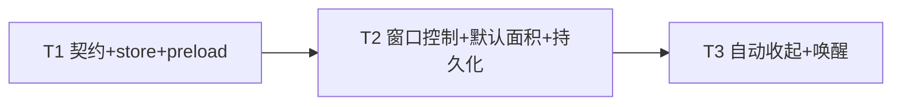

# 「个人信息管家」悬浮窗增强 · 增量设计（FLOATING-WINDOW-DESIGN）

> 版本：v1.0（增量）
> 作者：高见远（架构师）
> 状态：待工程师实现
> 范围：悬浮窗窗口控制 / 缩小默认面积 / 5 秒无交互自动收起

---

## 0. 现状核对结论（设计基线）

| 模块 | 现状 | 本增量 |
|------|------|--------|
| `desktop/src/main/floating-window.ts` | 单窗口 `frame:false, alwaysOnTop:true, resizable:true, skipTaskbar:true`；硬编码 `360×560` 默认右下角；`toggleFloatingWindow()` 仅 hide/show；无控制按钮、无持久化、无自动收起 | 默认 `300×480`；窗口控制（缩放/最小化/关闭）；`floatPosition` 持久化；自动收起 dock/wake |
| `desktop/src/main/ipc.ts` | `IPC.windowControl` 只操作 `getMainWindow()`（主窗口） | 新增悬浮窗专用通道 `floating-window-control` + `floating-activity` |
| `web/src/components/CompanionPanel.tsx` | 顶部 `companion-drag` 拖拽区 + 折叠按钮（220↔360 宽度）+ 状态 Chip；**无窗口控制按钮**；内容 `width: collapsed?220:360`（窗口仍是 360，折叠后有空白间隙） | 顶部加「缩放/最小化/关闭」三按钮；内容区 `width:100%` 自适应窗口；移除旧折叠按钮（被缩放取代） |
| `store.ts` | 已有 `floatPosition`（未用）、`collapsed` | 激活 `floatPosition` 持久化；新增 `autoCollapseEnabled` |
| `main-window.ts` | 已有「关闭=隐藏」「bounds 防抖持久化」模式可参考 | 复用其模式到悬浮窗 |

---

## 1. 特性一：窗口控制

### 1.1 语义拍板（采纳主理人倾向，一处调整）

| 按钮 | 语义 | 说明 |
|------|------|------|
| 缩放 | **大/小两档切换**（非系统 maximize） | 见下方理由 |
| 最小化 | 隐藏到托盘（`hide()`，托盘「显示悬浮窗」可恢复） | 采纳 |
| 关闭 | 隐藏到托盘（与主窗口「关闭=隐藏」一致，监听不中断） | 采纳 |

**为何缩放用「大/小两档」而非 `maximize()`**：悬浮窗是 always-on-top 置顶小窗，`maximize()` 会铺满整个屏幕（多显示器/任务栏行为突兀），违背「无感陪伴」定位；两档尺寸（small `300×480` / large `480×640`）可控、不打断工作区，且还原目标明确。

> 说明：MVP 中「最小化」与「关闭」语义相同（均隐藏到托盘，靠托盘「显示/隐藏悬浮窗」恢复），保留两个按钮符合用户习惯；P2 可细分为「最小化=收起到边缘、关闭=隐藏到托盘」。见 §4 Q-F2。

### 1.2 两档尺寸与缩放锚点

```ts
const FLOAT_SMALL = { width: 300, height: 480 }   // 默认（即特性二「缩小默认面积」）
const FLOAT_LARGE = { width: 480, height: 640 }   // 大档
const FLOAT_MIN   = { width: 280, height: 400 }   // 拖边缩放下限
const FLOAT_MAX   = { width: 600, height: 800 }   // 拖边缩放上限
```

缩放实现（贴右/贴下锚定，避免放大时溢出屏幕）：

```ts
function resizeKeepAnchor(win: BrowserWindow, width: number, height: number): void {
  const b = win.getBounds()
  const { workArea } = screen.getDisplayMatching(b)
  const newX = clamp(b.x + b.width - width, workArea.x, workArea.x + workArea.width - width)
  const newY = clamp(b.y + b.height - height, workArea.y, workArea.y + workArea.height - height)
  win.setBounds({ x: newX, y: newY, width, height })
}

function toggleFloatingScale(win: BrowserWindow): void {
  const [w] = win.getSize()
  const target = w >= FLOAT_LARGE.width - 40 ? FLOAT_SMALL : FLOAT_LARGE
  resizeKeepAnchor(win, target.width, target.height)
  sendFloatingState()
}
```

### 1.3 IPC 拍板：新增悬浮窗专用通道（而非给 `windowControl` 加 target）

**新增 `desktop:floating-window-control`**。理由：
1. 现有 `windowControl` 与主窗口强绑定（`maximize-toggle` 用系统 maximize、操作对象 `getMainWindow()`），加 target 会引入「action 集合因 target 而异」的隐式分叉（`scale-toggle` 只对悬浮窗、`maximize-toggle` 只对主窗口）。
2. 独立通道让悬浮窗的「缩放/收起/唤醒」内聚在 floating-window 模块，不污染主窗口 handler。

**`ipc-contract.ts` 新增**：

```ts
// renderer → main（invoke）
floatingWindowControl: 'desktop:floating-window-control',
// renderer → main（send，活动心跳，节流）
floatingActivity: 'desktop:floating-activity',
// main → renderer（webContents.send）
evtFloatingWindowStateChanged: 'desktop:floating-window-state-changed',

export type FloatingWindowControlAction = 'scale-toggle' | 'minimize' | 'close'
export interface FloatingWindowStatePayload {
  scale: 'small' | 'large'
  docked: boolean
}
```

**`ipc.ts` handler**：

```ts
ipcMain.handle(IPC.floatingWindowControl, (_e, action: FloatingWindowControlAction) => {
  const win = getFloatingWindow()
  if (!win || win.isDestroyed()) return { ok: false, message: '悬浮窗未就绪' }
  if (action === 'scale-toggle') toggleFloatingScale(win)
  else if (action === 'minimize') hideFloatingToTray()   // hide()
  else if (action === 'close') hideFloatingToTray()      // hide()
  return { ok: true }
})
```

**`preload/index.ts` 新增**：`floatingWindowControl(action)`、`notifyFloatingActivity()`（节流）、`onFloatingWindowStateChanged(cb)`。

**`CompanionPanel.tsx`**：顶部右侧按钮组 `[缩放][最小化][关闭]`（均 `companion-no-drag`），缩放图标随 `FloatingWindowStatePayload.scale` 切换（`OpenInFullIcon`/`CloseFullscreenIcon`）；复用主窗口 `WindowControls` 的 hover/pressed 样式（红关闭、灰悬停）。

---

## 2. 特性二：缩小默认面积 + 尺寸持久化

### 2.1 默认面积

`360×560 → 300×480`（`FLOAT_SMALL`），右下角默认位置不变（`right/bottom` 留 16px）。最小 `280×400`、最大 `600×800` 约束拖边缩放。

### 2.2 持久化（激活 `store.floatPosition`）

复用主窗口模式：`resize`/`move` 防抖 500ms 写 `store.floatPosition`；创建时若保存 bounds 落在当前屏幕工作区内则恢复，否则回退默认右下角。

```ts
// floating-window.ts
export function createFloatingWindow(): BrowserWindow {
  const saved = store.get('floatPosition')
  const { workArea } = screen.getPrimaryDisplay()
  const width  = clamp(saved.width  ?? FLOAT_SMALL.width,  FLOAT_MIN.width,  FLOAT_MAX.width)
  const height = clamp(saved.height ?? FLOAT_SMALL.height, FLOAT_MIN.height, FLOAT_MAX.height)
  const useSaved = isValidBounds(saved, workArea)
  const x = useSaved ? (saved.x as number) : workArea.x + workArea.width - width - 16
  const y = useSaved ? (saved.y as number) : workArea.y + workArea.height - height - 16

  floatingWindow = new BrowserWindow({
    x, y, width, height,
    frame: false, resizable: true, alwaysOnTop: true, skipTaskbar: true, show: true,
    minWidth: FLOAT_MIN.width, minHeight: FLOAT_MIN.height,
    maxWidth: FLOAT_MAX.width, maxHeight: FLOAT_MAX.height,
    backgroundColor: '#ffffff',
    webPreferences: { preload, contextIsolation: true, nodeIntegration: false },
  })

  const persist = debounce(() => {
    if (floatingWindow && !docked) store.patch({ floatPosition: floatingWindow.getBounds() })
  }, 500)
  floatingWindow.on('resize', persist)
  floatingWindow.on('move', persist)
  // ...
}
```

> 注：`docked`（已自动收起）时不把「收起后的越界位置」写入 `floatPosition`，避免重启后停在屏幕外。

---

## 3. 特性三：自动收起（重点）

### 3.1 状态机

`expanded`（正常展开）/ `docked`（收起、仅露 8px 窄边）/ `hidden`（托盘隐藏）三态，与「缩放 small/large」正交。

```ts
let docked = false
let dockedX = 0, dockedY = 0        // 收起前位置
let autoCollapseTimer: NodeJS.Timeout | null = null
const IDLE_MS = 5000
const EDGE_VISIBLE = 8              // 收起后露出的窄边宽度
const DOCK_DURATION = 180           // 动画时长 ms
```

### 3.2 闲置检测（事件来源 + 防抖）

**主进程 5s 计时器**，以下任一事件都 `touch()` 重置计时：

| 来源 | 事件 | 说明 |
|------|------|------|
| 主进程 | `win.on('focus')` | 窗口获得焦点 |
| 主进程 | `win.on('blur')` | 失焦即开始计「无交互」 |
| 主进程 | `win.on('move')` | 用户拖动窗口 |
| preload → main | `floating-activity`（DOM `mousemove` 节流 300ms / `mousedown` / `keydown` / `wheel`） | 覆盖「鼠标进入/移动/点击/键盘」等页面内交互 |
| 业务事件 | 收到 `vs-started` / 选区分析等 | 分析中保持展开（见 Q-F6） |

**preload 侧（`preload/index.ts`）**：注入节流 DOM 监听，向主进程发 `floating-activity`（由 `ipcMain.on(floatingActivity)` 按 `event.sender === floatingWindow.webContents` 过滤，避免主窗口误触发）：

```ts
// preload 内（对两个窗口都注入，主进程按 sender 过滤）
let lastSent = 0
const notify = () => {
  const now = Date.now()
  if (now - lastSent < 300) return
  lastSent = now
  ipcRenderer.send(IPC.floatingActivity)
}
window.addEventListener('mousemove', notify)
window.addEventListener('mousedown', notify)
window.addEventListener('keydown', notify)
window.addEventListener('wheel', notify)
```

**防抖**：`mousemove` 高频 → preload 300ms 节流；主进程 `touch()` 仅重置 5s 计时（幂等、极轻）。

### 3.3 收起与唤醒动画

```ts
function touch(): void {
  resetTimer()
  if (docked) wake()                 // 收起态下任何活动都唤醒
}

function resetTimer(): void {
  if (autoCollapseTimer) clearTimeout(autoCollapseTimer)
  if (!store.get('autoCollapseEnabled')) return
  autoCollapseTimer = setTimeout(dock, IDLE_MS)
}

function dock(): void {
  const win = floatingWindow
  if (!win || docked || !win.isVisible() || win.isMinimized()) return
  const b = win.getBounds()
  const { workArea } = screen.getDisplayMatching(b)
  dockedX = b.x; dockedY = b.y
  docked = true
  // 默认右侧；窗口偏左屏则收进左边缘
  const nearLeft = b.x + b.width / 2 < workArea.x + workArea.width / 2
  const targetX = nearLeft
    ? workArea.x - (b.width - EDGE_VISIBLE)
    : workArea.x + workArea.width - EDGE_VISIBLE
  animateX(win, b.x, targetX, DOCK_DURATION)
  sendFloatingState()
}

function wake(): void {
  const win = floatingWindow
  if (!win || !docked) return
  docked = false
  const b = win.getBounds()
  const { workArea } = screen.getDisplayMatching(b)
  const x = clamp(dockedX, workArea.x, workArea.x + workArea.width - b.width)
  animateX(win, b.x, x, DOCK_DURATION)
  sendFloatingState()
}

function animateX(win: BrowserWindow, fromX: number, toX: number, duration: number): void {
  const start = Date.now()
  const step = () => {
    const t = Math.min(1, (Date.now() - start) / duration)
    win.setPosition(Math.round(fromX + (toX - fromX) * t), win.getBounds().y)
    if (t < 1) setTimeout(step, 15)
  }
  step()
}
```

### 3.4 唤醒通道

- **窄边悬停/点击**：收起后仍露 8px，鼠标移入即触发 preload `mousemove` → `floating-activity` → `touch()` → `wake()`。零额外逻辑，唤醒与活动重置统一。
- **托盘「显示悬浮窗」**：`toggleFloatingWindow()` 在 show 分支先 `wake()` 再 `show()` + `focus()`。
- **主进程 `focus`**：`win.on('focus')` → `touch()`（唤醒）。

### 3.5 与现有能力不冲突

- **手动缩放/拖动**：`move`/`resize` 均 `touch()` 重置计时，交互中永不收起。
- **最小化/关闭**：二者把窗口 `hide()` 后，`dock()` 内 `isVisible()`/`isMinimized()` 判断直接跳过，不会对隐藏窗口做动画。
- **分析中**：收到 `vs-started` / 选区分析触发 `touch()`（见 Q-F6），分析期间保持展开，结束后恢复计时。

---

## 4. 待明确事项（附默认建议，不阻塞）

| 编号 | 事项 | 默认建议 |
|------|------|---------|
| Q-F1 | 缩放语义 | 大/小两档（small 300×480 / large 480×640），**不用系统 maximize**（置顶小窗全屏突兀） |
| Q-F2 | 最小化与关闭 MVP 语义相同（均隐藏到托盘） | 保留两个按钮；P2 细分：最小化=收起到边缘、关闭=隐藏 |
| Q-F3 | 旧「220/360 内容折叠」按钮 | 移除（有空白间隙 bug + 与缩放/自动收起重叠），内容区 `width:100%` 自适应窗口 |
| Q-F4 | 自动收起边缘选择 | 动态判断：窗口偏左屏收进左边缘、否则右边缘（默认右下角→右侧）；多显示器用 `screen.getDisplayMatching(bounds)` |
| Q-F5 | 闲置检测事件来源 | preload 注入 DOM 事件（mousemove 节流 300ms/mousedown/keydown/wheel）+ 主进程 focus/blur/move + 业务事件；5s 计时在主进程 |
| Q-F6 | 分析进行中是否也自动收起 | 「分析中暂停自动收起」（收到 vs-started 即 `touch()`，分析完成后再计时），避免错过建议 |
| Q-F7 | 收起动画参数 | 时长 180ms、露出 8px，常量集中在 floating-window.ts 顶部可调 |
| Q-F8 | 「关闭自动收起」开关 | `store.autoCollapseEnabled` 默认 true；MVP 仅字段生效，设置页开关 P2 |

---

## 5. 有序任务列表（T1..T3）

### T1 · 契约层 + store + preload

- **目标**：新增 IPC 通道/类型、store 字段、preload 活动心跳，为 T2/T3 铺底座。
- **涉及文件**：
  - `desktop/src/shared/ipc-contract.ts`（`floatingWindowControl`/`floatingActivity`/`evtFloatingWindowStateChanged` + `FloatingWindowControlAction`/`FloatingWindowStatePayload`）
  - `shared/types/ipc.ts`（镜像 + `DesktopBridge` 新方法）
  - `desktop/src/main/store.ts`（`autoCollapseEnabled`，`floatPosition` 已有）
  - `desktop/src/preload/index.ts`（`floatingWindowControl`/`notifyFloatingActivity`（节流 DOM 监听）/`onFloatingWindowStateChanged`）
- **依赖**：无
- **完成标准**：两处 IPC 类型一致（grep 校验）；preload 暴露新 API 且 DOM 事件节流发 activity；store 新字段有默认值；`tsc --noEmit` 通过。

### T2 · 窗口控制 + 默认面积 + 尺寸持久化

- **目标**：落地特性一、二。
- **涉及文件**：
  - `desktop/src/main/floating-window.ts`（默认 300×480、`floatPosition` 恢复/防抖持久化、`toggleFloatingScale`/`hideFloatingToTray`/`sendFloatingState`、`resizeKeepAnchor`）
  - `desktop/src/main/ipc.ts`（`floatingWindowControl` handler）
  - `web/src/components/CompanionPanel.tsx`（顶部加「缩放/最小化/关闭」三按钮 + 缩放图标随状态切换 + 移除旧折叠按钮 + 内容区 `width:100%`）
- **依赖**：T1
- **完成标准**：默认 300×480；缩放在大/小两档间切换且不溢出屏幕；最小化/关闭隐藏到托盘、托盘可恢复；拖边缩放后重启恢复尺寸位置；按钮 hover/pressed 有反馈、主题一致。

### T3 · 自动收起 + 唤醒

- **目标**：落地特性三。
- **涉及文件**：
  - `desktop/src/main/floating-window.ts`（`touch`/`resetTimer`/`dock`/`wake`/`animateX`/`EDGE_VISIBLE`/边缘判断、`docked` 时不持久化、focus/blur/move 事件）
  - `desktop/src/main/ipc.ts`（`floatingActivity` handler，按 sender 过滤）
  - `desktop/src/main/tray.ts`（「显示悬浮窗」唤醒）或经 `toggleFloatingWindow` 改造
  - `desktop/src/main/index.ts`（`before-quit` 清理计时器）
- **依赖**：T1、T2
- **完成标准**：连续 5s 无交互后收起、仅露 8px 窄边；悬停/点击窄边或托盘「显示悬浮窗」唤醒回原位；交互中永不收起；分析中暂停收起；与缩放/最小化不冲突。

### 任务依赖图



---

*本文档为悬浮窗增强施工蓝图；实现时如与现有代码/Electron 实际行为有出入，以现有代码与运行时行为为准，并回报架构师同步修订。*
