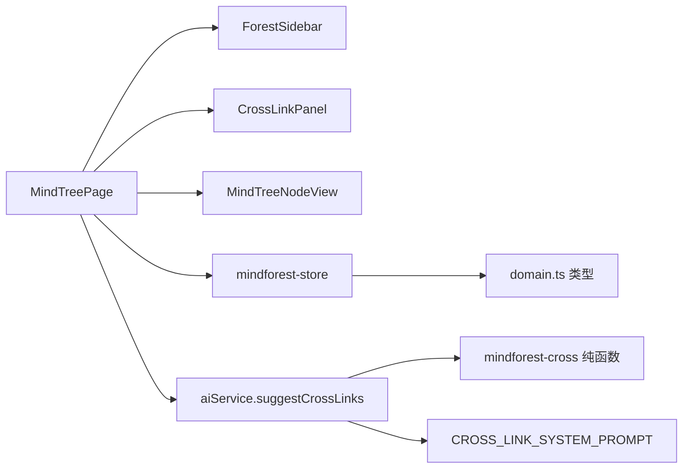
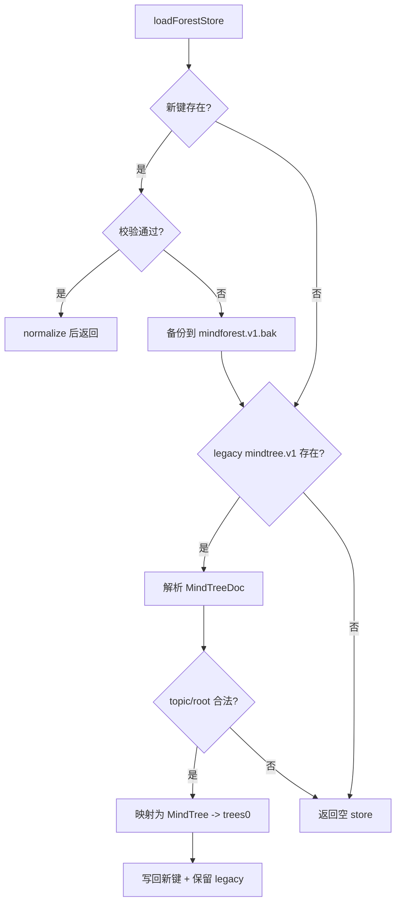
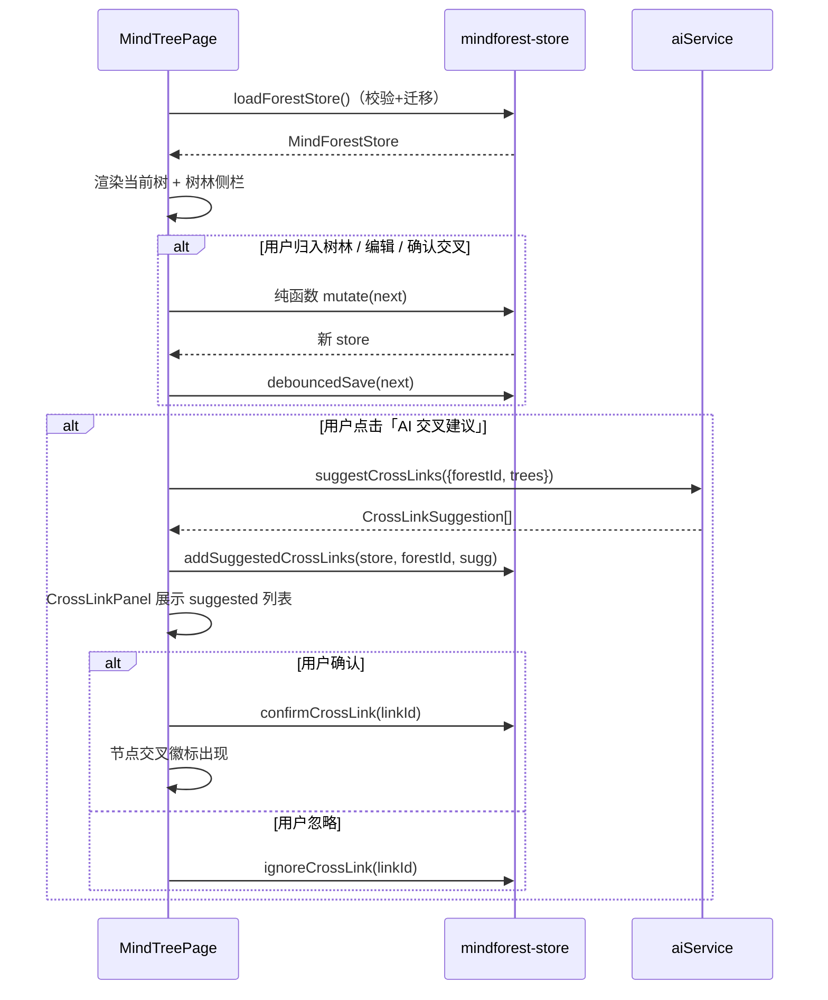
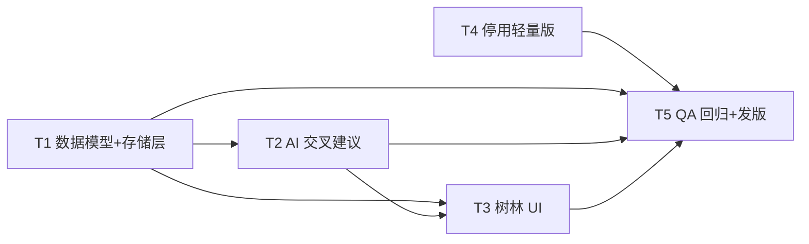

# 「个人信息管家」思维树林 + 停用轻量版设计（MIND-FOREST-DESIGN）

> 版本：v2.7.0
> 作者：高见远（架构师）
> 状态：待工程师实现（只设计，不改实现代码）
> 范围：① 思维树从「单树」升级为「多树共存 + 思维树林组群 + AI 交叉建议」；② 停用轻量版，完整版成为唯一版本。
> 约束：LLM 调用只在 Web renderer 端（Origin 匹配）；思维树/树林为**纯 Web 端 localStorage 数据**，不涉及桌面主进程与云数据库。

---

## 0. 现状核对与结论

| 现状（已读代码） | 结论 |
|------|------|
| `shared/types/domain.ts`：单树 `MindTreeDoc { id, topic, root, createdAt, updatedAt }`；节点 `MindTreeNode { id, text, dimension?, collapsed, loading, children[], strokes? }` | 新增 `MindTree/MindForest/CrossLink/CrossLinkSuggestion/MindForestStore`；`MindTreeDoc` 更名 `MindTree`（`topic → name`），节点结构复用 |
| `web/src/components/mindtree/dimensions.ts`：`createNode/nextId/normalizeNode(私有)/createDoc/loadDoc/saveDoc/clearDoc` + `MIND_TREE_STORAGE_KEY='personal-agent.mindtree.v1'` | 保留 `createNode/nextId/normalizeNode/dimensionColor/fallbackDimensions`；doc 级函数由新 `mindforest-store.ts` 接管，legacy 键仅用于一次性迁移 |
| `web/src/pages/MindTreePage.tsx`：单树状态 `doc`，挂载 `loadDoc()`、变更即 `saveDoc()`，`updateTree/removeFromTree` 不可变更新 | 改造为「树林状态持有者」：多树 + 树林 + 交叉，debounce 持久化；树的不可变更新逻辑复用 |
| `web/src/components/mindtree/MindTreeNodeView.tsx`：递归节点卡片，props 无交叉概念 | 新增可选 prop `crossPartners?` 渲染交叉徽标 + 伙伴列表 |
| `web/src/services/aiService.ts`：`generateMindTree`（fast 模型 + 缓存 + 流式增量）；`mindtree-parse.ts` 独立纯函数解析 | 新增 `suggestCrossLinks`（fast 模型）；纯函数解析独立成 `mindforest-cross.ts` |
| `shared/constants/prompts.ts`：已有 `MIND_TREE_SYSTEM_PROMPT` | 新增 `CROSS_LINK_SYSTEM_PROMPT` |
| 轻量版：`index.lite.ts` / `electron.vite.config.ts(LITE_BUILD/__LITE__)` / `preload(liteBridge/isLite)` / `ipc.ts(__LITE__ 分支)` / `tray.ts(__LITE__)` / `floating-window.ts(&lite=1)` / `globals.d.ts` / `web lib/lite.ts(isLiteMode)` / `CompanionShell.tsx` / `App.tsx` / `SettingsPage.tsx` / `DevToolsPage.tsx` / `shared/types/ipc.ts(isLite? + 14 可选方法)` / `electron-builder.yml(portable+轻量版)` / `qa/lite-build.test.ts` | 全部删除/还原为完整版唯一路径（精确清单见 §5） |

---

## 1. 目标与总体架构

### 1.1 模块划分（新增/改造，纯 Web 端）

```
web/src/
├─ pages/MindTreePage.tsx              # 改造：树林状态持有者 + 树切换 + 交叉联动
├─ services/
│  ├─ mindforest-store.ts             # 新增：持久化/迁移/校验 + 领域纯函数（CRUD/级联）
│  ├─ mindforest-cross.ts             # 新增：展平/编号/解析交叉建议（纯函数，供单测）
│  └─ aiService.ts                    # 改造：suggestCrossLinks（fast 模型）
├─ components/
│  ├─ mindtree/MindTreeNodeView.tsx   # 改造：交叉徽标 + 伙伴列表
│  ├─ mindtree/dimensions.ts          # 改造：导出 normalizeNode，doc 函数退役
│  └─ mindforest/
│     ├─ ForestSidebar.tsx            # 新增：树/树林列表 + 归组/命名/移除
│     └─ CrossLinkPanel.tsx           # 新增：AI 建议列表 + 逐条确认/忽略
shared/
├─ types/domain.ts                    # 改造：新增 MindTree/MindForest/CrossLink 等
└─ constants/prompts.ts               # 改造：新增 CROSS_LINK_SYSTEM_PROMPT
```



### 1.2 核心语义（对齐主理人基线，细化不推翻）

1. **树独立发展**：`MindForest.treeIds` 只存引用（id），树本体仍在 `trees[]` 中独立编辑；树林不拷贝树。
2. **交叉独立存储**：交叉关系存 `CrossLink[]`，不内嵌进节点（避免 `a↔b` 循环引用与删除级联混乱）。
3. **交叉 = 确认后才生效**：AI 产出 `suggested`，用户确认 → `confirmed`；`suggested` 不参与「交叉节点」判定。
4. **组群门槛**：`trees.length >= 2` 时才开放「归入树林」入口。

---

## 2. 精确 TS 类型定义（`shared/types/domain.ts` 新增/调整）

```ts
/* ------------------------------------------------------------------ *
 * 思维树（多树共存）
 * ------------------------------------------------------------------ */

/** 思维树（单棵）：替代原 MindTreeDoc，name 即主题/标题（原 topic）。 */
export interface MindTree {
  id: string
  name: string
  root: MindTreeNode
  createdAt: string
  updatedAt: string
}

/** 思维树林：多棵思维树的组群（仅引用 treeId，树本体独立发展）。 */
export interface MindForest {
  id: string
  /** 用户自定义名称。 */
  name: string
  treeIds: string[]
  createdAt: string
  updatedAt: string
}

/** 交叉节点定位（跨树端点）。 */
export interface CrossNodeRef {
  treeId: string
  nodeId: string
}

/** 交叉关系：两条（跨树）节点的关联。 */
export interface CrossLink {
  id: string
  forestId: string
  a: CrossNodeRef
  b: CrossNodeRef
  /** suggested = AI 建议待确认；confirmed = 用户已确认，节点据此显示交叉徽标。 */
  status: 'suggested' | 'confirmed'
  reason?: string
  createdAt: string
}

/** AI 交叉建议候选（未落库原始形态，由 suggestCrossLinks 返回）。 */
export interface CrossLinkSuggestion {
  a: CrossNodeRef
  b: CrossNodeRef
  reason: string
}

/** 交叉节点渲染所需的「伙伴节点」信息（由 store 派生）。 */
export interface CrossPartner {
  treeId: string
  treeName: string
  nodeId: string
  nodeText: string
  reason?: string
}

/** 思维树林持久化文档（localStorage）。 */
export interface MindForestStore {
  version: 1
  trees: MindTree[]
  forests: MindForest[]
  crossLinks: CrossLink[]
}
```

> **迁移说明**：`MindTreeDoc` 更名 `MindTree`、`topic → name`。为避免残留引用，工程师应 `grep "MindTreeDoc"` 全量替换（当前仅 `MindTreePage.tsx` 与 `dimensions.ts` 使用）；可临时保留 `export type MindTreeDoc = MindTree` 作为过渡别名，本版末删除。

---

## 3. 交叉节点标识与渲染方案

### 3.1 交叉节点判定（纯函数，store 派生）

**判定规则**：某节点（`treeId`+`nodeId`）在某树林内，参与 ≥1 条 `status === 'confirmed'` 且 `forestId` 匹配的 `CrossLink`，即为该树林下的「交叉节点」。

```ts
// mindforest-store.ts（纯函数，供单测）
/** 过滤某树林下已确认的交叉关系。 */
export function confirmedLinksOf(store: MindForestStore, forestId: string): CrossLink[]

/** 判定节点是否为交叉节点。 */
export function isCrossNode(store: MindForestStore, forestId: string, treeId: string, nodeId: string): boolean

/** 取节点的伙伴列表（含树名/节点文本/理由）。 */
export function crossPartnersOf(
  store: MindForestStore,
  forestId: string,
  treeId: string,
  nodeId: string,
): CrossPartner[]

/** 某树林下全部「交叉节点键」集合（`${treeId}/${nodeId}`），供 UI 一次性构图。 */
export function crossNodeKeysOf(store: MindForestStore, forestId: string): Set<string>
```

> 伙伴节点文本需按 `treeId → tree.name`、`nodeId → 节点 text` 反查；节点可能已被删除，反查不到时**跳过该伙伴**（store 在删除节点时已级联清链接，此为双保险）。

### 3.2 渲染方案（`MindTreeNodeView` 增量）

新增可选 prop：

```ts
export interface MindTreeNodeViewProps {
  // ... 既有 props
  /** 交叉伙伴列表；非空即交叉节点，渲染徽标 + 伙伴列表。 */
  crossPartners?: CrossPartner[]
  /** 交叉伙伴点击回调（跳转到对应树并高亮；P2 可空实现）。 */
  onCrossPartnerClick?: (partner: CrossPartner) => void
}
```

**视觉呈现**：
1. 节点头部在「维度 Chip」旁追加交叉徽标：`LinkIcon` + `N`（伙伴数），`title` 提示「交叉节点，N 个跨树伙伴」。
2. 节点卡片 `borderColor` 由维度色切换为「虚线强调色」——维度色竖线保留，卡片加一条浅色虚线边框以区分普通节点。
3. 徽标 `onClick`（或 hover 展开）列出伙伴：`树名 · 节点文本 · 理由`；点击条目触发 `onCrossPartnerClick`。

**跨树连线（不画线）**：MVP **不绘制跨树物理连线**（两棵树分属不同视图，画线成本高、易乱）。交叉关系以「徽标 + 伙伴列表 + 跳转」表达；真正画线列为 P2（见 Q-M6）。


---

## 4. 保存 / 恢复 + 从 v1 单树迁移的完整机制

### 4.1 存储键与结构

| 键 | 用途 | 生命周期 |
|----|------|---------|
| `personal-agent.mindforest.v1` | 树林文档（唯一权威） | 读写 |
| `personal-agent.mindtree.v1` | 旧单树（legacy） | 仅迁移时读，**迁移后保留作备份**（P2 可清理） |

```ts
// mindforest-store.ts
export const MIND_FOREST_STORAGE_KEY = 'personal-agent.mindforest.v1'
const LEGACY_MIND_TREE_KEY = 'personal-agent.mindtree.v1'
```

### 4.2 加载 + 校验 + 迁移（`loadForestStore`）

```ts
/** 加载树林：优先新键；缺失则迁移 legacy 单树；结构非法则备份后回空。 */
export function loadForestStore(): MindForestStore
```

流程：



**迁移映射**：

```ts
function migrateLegacyDoc(doc: MindTreeDoc): MindTree {
  return {
    id: doc.id,
    name: doc.topic,            // topic → name
    root: normalizeNode(doc.root),
    createdAt: doc.createdAt,
    updatedAt: doc.updatedAt,
  }
}
// 结果：{ version:1, trees:[migratedTree], forests:[], crossLinks:[] }
```

**Schema 校验要点**（`validateForestStore`，全部失败即返回 null 走备份+回空）：
- `version === 1`
- `trees`：数组，每项 `id:string / name:string / root:{id:string,text:string}`；`root.children` 归一化（`normalizeNode`：children 数组、`collapsed` 布尔、`loading` 复位 false）
- `forests`：数组，每项 `id:string / name:string / treeIds:string[]`；过滤不存在的 treeId（防脏引用）
- `crossLinks`：数组，每项 `id/forestId` + `a/b:{treeId,nodeId}` 且 `status ∈ {'suggested','confirmed'}`；过滤 `a.treeId===b.treeId` 与引用已删树/节点/树林的悬挂链接

### 4.3 保存（debounce）

```ts
/** 立即持久化（写失败静默）。 */
export function saveForestStore(store: MindForestStore): void
/** debounce 持久化（默认 400ms；返回取消函数）。 */
export function createDebouncedSaver(waitMs?: number): (store: MindForestStore) => void
```

- MindTreePage 持有 store，所有 mutate 后调用 `debouncedSave(next)`；卸载时 `flush` 一次。
- 沿用「写失败不阻塞交互」原则。

### 4.4 领域纯函数（CRUD + 级联，供单测）

```ts
export function emptyForestStore(): MindForestStore
export function createTree(name: string): MindTree
export function createForest(name: string, treeIds: string[]): MindForest

/** 树的增删改（改=更新 name 或 root）。 */
export function upsertTree(store: MindForestStore, tree: MindTree): MindForestStore
export function renameTree(store: MindForestStore, treeId: string, name: string): MindForestStore
export function deleteTree(store: MindForestStore, treeId: string): MindForestStore
// 级联：从所有 forest.treeIds 移除；删除引用该树的所有 crossLinks；若 forest 变空则删 forest

/** 树林的增删改 + 树归组/移出。 */
export function addTreeToForest(store: MindForestStore, forestId: string, treeId: string): MindForestStore
export function removeTreeFromForest(store: MindForestStore, forestId: string, treeId: string): MindForestStore
export function renameForest(store: MindForestStore, forestId: string, name: string): MindForestStore
export function deleteForest(store: MindForestStore, forestId: string): MindForestStore  // 只删组群与它的 crossLinks，不删树

/** 交叉链接生命周期。 */
export function addSuggestedCrossLinks(store: MindForestStore, forestId: string, sugg: CrossLinkSuggestion[]): MindForestStore
export function confirmCrossLink(store: MindForestStore, linkId: string): MindForestStore
export function ignoreCrossLink(store: MindForestStore, linkId: string): MindForestStore  // 删除
export function pruneNodeCrossLinks(store: MindForestStore, treeId: string, nodeId: string): MindForestStore
```

> **去重**：`addSuggestedCrossLinks` 对无序端点对 `{a,b}` 去重（`a.treeId+b.nodeId` 与 `b.treeId+a.nodeId` 视为同一对），不重复插入。

---

## 5. 停用轻量版：精确文件级删除清单

### 5.1 删除（整文件）

| 文件 | 说明 |
|------|------|
| `desktop/src/main/index.lite.ts` | 轻量版主进程入口 |
| `web/src/components/CompanionShell.tsx` | 轻量版整合式悬浮窗 UI |
| `web/src/lib/lite.ts` | `isLiteMode()` 判定 |
| `qa/lite-build.test.ts` | 轻量版构建行为测试 |
| `desktop/src/shared/globals.d.ts` | 仅声明 `__LITE__`（确认无其他内容后删除） |

> 构建产物 `desktop/out/**`、`desktop/dist/**`、`web/dist/**`、`qa/dist/**` 为生成物，重新构建即覆盖，无需手工处理。

### 5.2 修改（还原为完整版唯一路径）

| 文件 | 具体改动 |
|------|---------|
| `desktop/electron.vite.config.ts` | 删除 `LITE` 常量、`define:{__LITE__}`；`main.build.rollupOptions.input` 恢复为单一字符串 `resolve(__dirname,'src/main/index.ts')`（去掉对象式输入与注释） |
| `desktop/src/main/ipc.ts` | 删除 `RegisterIpcDeps` 与全部 `__LITE__` 分支；`registerIpc(orchestrator, vsMonitor)` 恢复为**必需参数**；移除因 lite tree-shaking 引入的 `import('./main-window'/'selection-analyzer'/'analysis-exporter')` 动态 import，恢复顶部静态 import（可选但推荐，见 Q-L1） |
| `desktop/src/main/tray.ts` | 删除 `statusLabel()` 与 `buildMenu()` 中的 `__LITE__` 分支，仅保留完整版菜单模板；`TrayOptions` 的 `onTriggerAnalysis/onToggleListening/listening` 可恢复必需 |
| `desktop/src/main/floating-window.ts` | `loadRemote()` 中 `${__LITE__ ? '&lite=1' : ''}` 删除，固定 `loadURL(\`${WEB_APP_URL}?mode=companion\`)` |
| `desktop/src/preload/index.ts` | 删除 `liteBridge`，仅保留 `fullBridge`；删除 `isLite` 字段；`desktopBridge = fullBridge`（去掉 `__LITE__` 三元） |
| `desktop/src/shared/globals.d.ts` | 若保留文件则删除 `declare const __LITE__: boolean`（见 5.1，建议直接删文件） |
| `shared/types/ipc.ts` | `DesktopBridge` 删除 `isLite?` 与 **14 个可选方法标记**（见下方清单），全部恢复必需；更新注释 |
| `web/src/App.tsx` | 删除 `CompanionShell`、`isLiteMode` import 与 `lite` useMemo；`{lite ? <CompanionShell/> : <CompanionPanel/>}` → `<CompanionPanel/>` |
| `web/src/pages/SettingsPage.tsx` | 删除 `isLiteMode` import 与 `lite`；去掉全部 `!lite &&`（AI 分析卡、VS 路径、代码上传开关恒显）；`window.desktopBridge.setCodeUploadEnabled?.(...)` → 直接调用 |
| `web/src/pages/DevToolsPage.tsx` | 删除 `isLiteMode` import；`tools` 数组去掉 `...(isLiteMode() ? [] : [...])`，恒包含「读取选区」 |
| `desktop/electron-builder.yml` | `win.target` 移除 `portable`（仅留 `nsis`）；删除 `portable.artifactName`（轻量版命名） |
| `qa/run-tests.mjs` | 删除 `lite-build.test.ts` 的 target 条目 |
| `qa/README.md` | 删除 lite 测试行（文档） |

**14 个可选方法（恢复必需）**：`getStatus` / `triggerAnalysis` / `setListening` / `setCodeUploadEnabled` / `openMainApp` / `windowControl` / `readSelection` / `setExportDir` / `notifyAnalysisDone` / `onVsStarted` / `onAnalysisResult` / `onStatusChanged` / `onWindowStateChanged` / `onSelectionRead`。

> 说明：主理人基线写「13 个可选方法」，实测为 **14 个 + `isLite` 字段**，本清单以代码为准。

### 5.3 回归风险点

| 风险 | 影响 | 兜底 |
|------|------|------|
| 删除 `CompanionShell` 后，悬浮窗回到 `CompanionPanel`（快速记录/选区/代码生成/速查库 + 打开主界面），**悬浮窗不再内嵌思维树/回顾/设置 Tab** | 功能入口变化 | 这是「完整版唯一版本」的预期语义：完整功能在主窗口；需在发版说明中明示，避免用户困惑 |
| `DesktopBridge` 可选→必需后，浏览器直开 `?mode=companion`（无 bridge）仍应降级 | 浏览器访问 companion 时 NPE | 现有 `CompanionPanel`/`SelectionSection` 已用 `if(!bridge)` 兜底，保持即可 |
| 删除 `portable` 产物后，原「轻量版」用户如何升级 | 旧轻量版用户无新便携包 | NSIS 安装包覆盖；云端数据与 localStorage（web origin）不受影响，本地偏好见 5.4 |
| 动态 import 还原为静态 import | 产物变大（主进程重含 main-window 等） | 这是完整版本来形态，接受；若担心体积可保留动态 import（Q-L1） |
| QA `lite-build.test.ts` 删除后 `run-tests.mjs` 遗漏清理 | 测试脚本报找不到 entry | 同步删 target 条目（已在 5.2 列明） |

### 5.4 是否需要版本迁移（轻量版 → 完整版）

- **云端数据**（记录/待办/设置）：同一账号、同一云服务，无需迁移。
- **思维树 localStorage**：属 web origin，与桌面形态无关，无需迁移（轻量版与完整版共用同一 Web 站）。
- **桌面本地偏好**（`preferences.json`：floatPosition 等）：完整版 NSIS 与轻量版 portable 的 userData 目录可能不同（portable 常就近存放），轻量版本地偏好**不自动迁移**——影响仅限悬浮窗位置/缩放等可重设项，可接受，发版说明注明即可。

**结论：停用轻量版本体无需数据版本迁移**；唯一数据迁移是 §4 的 `mindtree.v1 → mindforest.v1`（思维树功能自身升级）。

---

## 6. `suggestCrossLinks` 接口签名与 prompt 设计

### 6.1 纯函数（`web/src/services/mindforest-cross.ts`，供单测）

```ts
/** 展平后的节点（带树/节点定位 + 编号索引）。 */
export interface FlatCrossNode {
  treeId: string
  nodeId: string
  label: string       // node.text，截断到 80 字
  treeIndex: number   // 树在列表中的序号
  nodeIndex: number   // 节点在树内前序遍历序号
}

/** 展平树林全部节点（前序，含根；按树顺序稳定编号）。 */
export function flattenForestNodes(trees: MindTree[]): FlatCrossNode[]

/** 构造 LLM user 文本（编号清单）。 */
export function buildCrossUserPrompt(trees: MindTree[], nodes: FlatCrossNode[]): string

/** 解析 LLM 输出为候选（容错：丢弃非法编号/同树端点/未知编号）。 */
export function parseCrossLinkSuggestions(raw: string, nodes: FlatCrossNode[]): CrossLinkSuggestion[]
```

编号规则：`t${treeIndex}-n${nodeIndex}`（如 `t0-n3`），客户端持 `treeIndex/nodeIndex → treeId/nodeId` 映射，LLM 只回编号，**不回 id**，避免 id 泄漏与幻觉 id。

### 6.2 `aiService` 新方法

```ts
export interface CrossLinkSuggestInput {
  forestId: string
  trees: MindTree[]
}

/** AI 交叉建议：展平节点 → fast 模型 → 解析候选（返回去重后的 {a,b,reason}）。 */
async suggestCrossLinks(
  input: CrossLinkSuggestInput,
  opts?: { max?: number },
): Promise<CrossLinkSuggestion[]>
```

实现要点（复用 `generateMindTree` 的模型/错误处理风格）：
- `getModelId('fast')`；`cloud.llm.chat.completions.create({ model, messages:[{role:'system',content:CROSS_LINK_SYSTEM_PROMPT},{role:'user',content:userText}], stream:true })` → `collectStream` → `parseJsonLoose` → `parseCrossLinkSuggestions`。
- `max` 默认 10；`wrapLlmError` 包装中文错误。
- **去重**：无序对去重（同一对只保留一条）。
- **上限保护**：节点总数截断到 200，超限时按「每树取前 N 层」或均匀抽样（见 Q-M3）。

### 6.3 `CROSS_LINK_SYSTEM_PROMPT`

```
你是一名思维关联助手。用户会给出一个「思维树林」中多棵思维树的节点清单（节点已编号，前缀 tN 表示第 N 棵树）。请找出**不同树之间**语义相关、值得交叉关联的节点对。

要求：
1. 只输出 JSON 数组，元素形如 {"a":"t0-n3","b":"t1-n2","reason":"一句中文关联理由"}。
2. a、b 必须来自**不同树**（t 前缀不同），且必须使用清单中给出的编号，不得自行编造编号。
3. 仅保留语义真正相关、能相互补充或印证的节点对；明显无关的不要输出；最多 10 条。
4. reason 简洁说明关联点，不超过 40 字。
5. 语言与输入一致（默认中文）；不要输出任何解释或 markdown 代码围栏。
```

**user 文本示例**：

```
树林中的节点清单（编号 → 节点内容）：
t0: 树「要不要做副业」
  t0-n0: 要不要做副业
  t0-n1: 核心概念有哪些
  t0-n2: 最大的风险是什么
t1: 树「时间管理」
  t1-n0: 时间管理
  t1-n1: 如何用最小成本验证方向
  t1-n2: 本周能完成哪一小步
```

---

## 7. UI 交互与数据流

### 7.1 MindTreePage 状态与流程



### 7.2 页面结构

```
MindTreePage（/mindtree）
├─ ForestSidebar（左/上栏）：树列表（新建/重命名/删除/切换）+ 树林列表（新建/重命名/删除/归组/移出）
│    - trees.length >= 2 时才显示「归入树林」
├─ 当前树编辑区：复用 MindTreeNodeView（root + 维度分支 Grid）
│    - crossPartners 由 crossPartnersOf(store, activeForestId, treeId, nodeId) 派生
└─ CrossLinkPanel（右下/侧栏）：当前树林的 AI 建议（suggested）+ 已确认（confirmed）列表
     - 「生成交叉建议」按钮 → suggestCrossLinks
     - 逐条「确认」/「忽略」
```

### 7.3 交叉建议的状态语义

| 状态 | 含义 | 交叉徽标 | 可操作 |
|------|------|---------|--------|
| `suggested` | AI 建议待确认 | ❌ 不显示 | 确认 / 忽略 |
| `confirmed` | 用户已确认 | ✅ 显示 | 忽略（断开交叉） |

---

## 8. 任务分解（T1..T5，供工程师照做）

> 遵循「每任务 ≥3 文件、按层次分组、依赖最小化」；T4（停用轻量版）与 T1~T3 互不依赖，可并行。

### T1 · 数据模型 + 存储层（迁移/校验/CRUD）

- **目标**：类型就绪 + 树林存储/迁移/级联纯函数可跑。
- **涉及文件**：
  - `shared/types/domain.ts`（新增 MindTree/MindForest/CrossLink/CrossLinkSuggestion/CrossPartner/MindForestStore/CrossNodeRef；MindTreeDoc→MindTree）
  - `web/src/services/mindforest-store.ts`（新建：load/save/validate/migrate/debounce + CRUD 纯函数）
  - `web/src/components/mindtree/dimensions.ts`（导出 `normalizeNode`；doc 级函数退役/改造）
  - `qa/mindforest-store.test.ts`（新建：迁移/校验/级联/交叉判定）
- **依赖**：无
- **完成标准**：`tsc --noEmit` 通过；单树 legacy 能迁移为 `trees[0]`；删树/删节点级联清理 forests+crossLinks；确认后 `isCrossNode` 为 true。

### T2 · AI 交叉建议（prompt + 纯函数 + service）

- **目标**：`suggestCrossLinks` 返回合法 `{a,b,reason}` 候选。
- **涉及文件**：
  - `shared/constants/prompts.ts`（新增 `CROSS_LINK_SYSTEM_PROMPT`）
  - `web/src/services/mindforest-cross.ts`（新建：flatten/buildPrompt/parse 纯函数）
  - `web/src/services/aiService.ts`（新增 `suggestCrossLinks`）
  - `qa/mindforest-cross.test.ts`（新建：展平编号/解析/去重/非法编号丢弃）
- **依赖**：T1（类型）
- **完成标准**：mock cloud 下解析出正确候选；同树端点被丢弃；未知/越界编号被丢弃；输出 JSON 容错。

### T3 · 思维树林 UI（页面改造 + 侧栏 + 交叉面板 + 节点徽标）

- **目标**：多树/树林/交叉全流程可用。
- **涉及文件**：
  - `web/src/pages/MindTreePage.tsx`（改造：store 持有 + 树切换 + 交叉联动 + 归组门槛）
  - `web/src/components/mindforest/ForestSidebar.tsx`（新建：树/树林列表 + 归组管理）
  - `web/src/components/mindforest/CrossLinkPanel.tsx`（新建：生成建议 + 逐条确认/忽略）
  - `web/src/components/mindtree/MindTreeNodeView.tsx`（交叉徽标 + 伙伴列表）
- **依赖**：T1、T2
- **完成标准**：≥2 树时可归组/命名/移除；AI 建议可确认/忽略；确认后节点出现交叉徽标并列出伙伴；单树/无树林时不显示交叉；JS 无桥场景正常。

### T4 · 停用轻量版（删除 + 还原完整版唯一路径）

- **目标**：完整版唯一版本，lite 构建路径与 UI 全部移除。
- **涉及文件**：见 §5.1（5 个删除）+ §5.2（12 个修改）
- **依赖**：无（与 T1~T3 并行）
- **完成标准**：`grep -r "__LITE__\|LITE_BUILD\|isLiteMode\|CompanionShell\|index.lite"`（排除 node_modules/dist/out）返回空；`build:desktop` 仅产出 NSIS；`test:qa` 无 lite 目标；companion 模式渲染 CompanionPanel。

### T5 · QA 回归 + 发版准备

- **目标**：全量回归 + 文档更新。
- **涉及文件**：
  - `qa/`（补交叉/树林边界测试；跑通 `run-tests.mjs`）
  - `docs/版本说明.md`（v2.7.0 条目）
  - `README.md` / `docs/使用指南.md`（移除轻量版/portable 描述）
- **依赖**：T1~T4
- **完成标准**：单测全绿；完整版打包安装、悬浮窗/主窗口/思维树林全流程手测通过；文档一致。

### 任务依赖图



---

## 9. 关键测试点

| 编号 | 对象 | 用例要点 |
|------|------|---------|
| M1 | 迁移 | legacy `mindtree.v1` → `trees[0]`，`topic→name`；无 legacy 回空；新键非法 → 备份 + 回空 |
| M2 | 校验 | 悬挂 crossLink（树/节点/树林已删）被过滤；`a.treeId===b.treeId` 被过滤；`loading` 复位 false |
| M3 | 级联 | `deleteTree` 清理 forests.treeIds + 该树 crossLinks + 空 forest；`deleteNode` 清理相关 crossLinks |
| M4 | 交叉判定 | `suggested` 不算交叉、`confirmed` 才算；`crossPartnersOf` 反查树名/节点文本；节点已删时伙伴跳过 |
| M5 | 去重 | 无序对去重；`addSuggestedCrossLinks` 不重复插入 |
| M6 | AI 解析 | `flattenForestNodes` 编号稳定；`parseCrossLinkSuggestions` 丢弃同树/越界/未知编号；JSON 容错 |
| M7 | UI | ≥2 树才显示归组；确认/忽略后徽标与列表正确；无树林不显示交叉；浏览器无桥降级 |
| M8 | 停用轻量版 | 全仓无 `__LITE__/LITE_BUILD/isLiteMode/CompanionShell/index.lite`；NSIS 打包成功；companion 渲染 CompanionPanel |

---

## 10. 待确认问题（附默认建议，不阻塞）

| 编号 | 事项 | 默认建议 |
|------|------|---------|
| Q-M1 | 交叉节点是否支持**手动创建**（不靠 AI 建议） | MVP 仅 AI 建议→确认；手动建交叉列 P2 |
| Q-M2 | 一棵树能否同时属于多个树林 | 允许（forests 只存 treeId 引用）；交叉按 forestId 隔离 |
| Q-M3 | 节点数量过多时 prompt 截断策略 | 全节点截断到 200，超出按每树均匀抽样；label ≤80 字 |
| Q-M4 | 交叉伙伴点击「跳转高亮」 | P2（MVP 仅徽标 + 伙伴列表，跳转可选） |
| Q-M5 | legacy 键 `mindtree.v1` 迁移后是否删除 | 保留作备份；P2 提供清理 |
| Q-M6 | 是否绘制跨树物理连线 | P2（MVP 用徽标 + 伙伴列表表达） |
| Q-L1 | 停用 lite 后 ipc.ts 动态 import 是否还原静态 | 推荐还原静态（更简洁）；若担心产物体积可保留动态 import，两者均不影响正确性 |
| Q-L2 | 轻量版便携包下架后旧用户提示 | 发版说明 + 托盘/安装包引导到 NSIS 完整版 |

---

*本文档为 v2.7.0 思维树林 + 停用轻量版的施工蓝图；实现时如与 localStorage 迁移、AI 输出格式有出入，以运行时行为为准，并回报架构师同步修订。*
