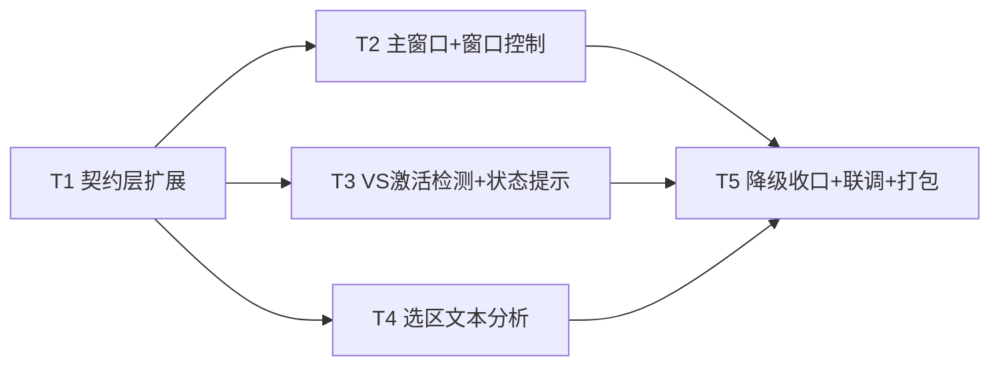

# 「个人信息管家」桌面伴侣 · 三方面优化增量设计（OPTIMIZATION-DESIGN）

> 版本：v1.0（增量）
> 作者：高见远（架构师）
> 状态：待工程师实现
> 上游：`docs/ARCHITECTURE.md` + 已实现代码现状
> 硬约束（务必遵守）：LLM 调用只能在 Web renderer 端（Origin 匹配）；主进程只做进程监听 / 文件 / 剪贴板读取，经 IPC 交 Web 分析。

---

## 0. 现状核对结论（设计基线）

| 模块 | 现状 | 本增量要做的事 |
|------|------|---------------|
| 窗口 | 仅 `floating-window.ts` 一个无边框置顶悬浮窗（360×560 硬编码右下角），`frame:false, alwaysOnTop:true, resizable:true, skipTaskbar:true`；"打开主界面"走 `shell.openExternal` 开浏览器 | 新增无边框**主窗口**（加载完整 Web 首页 `?desktop=1`），Web 端渲染自定义标题栏（最小化/最大化-还原/关闭），边缘缩放 + 最小尺寸，位置尺寸持久化到 store |
| VS 监听 | `vs-monitor.ts` 每 3s 轮询 devenv.exe（ps-list + PowerShell 兜底），按 pid 去重 emit `vs-started`；**不检测窗口激活** | 增加「前台窗口是否为 VS」检测，新增 `vs-activated` 事件；orchestrator 按 (solutionPath + 30s 冷却) 去重 |
| 编排 | `analysis-orchestrator.ts` 监听 vs-started → `solution-reader` 增量读码 → `evtVsStarted`；状态含 listening/vsRunning/currentSolution/analyzing/codeUploadEnabled/windowVisible | 扩展状态（vsInstalled / lastAnalysisAt / lastIssueCount / lastTriggerReason），接收分析结果并回填，托盘动态提示 |
| IPC | `ipc-contract.ts` + `shared/types/ipc.ts` 双处镜像；`ipc.ts` handler；`preload/index.ts` desktopBridge | 新增 window-control / read-selection / 窗口状态事件 / 选区读取事件 |
| UI | `CompanionPanel.tsx` 顶部 `companion-drag` 拖拽区 + 折叠 + 快速记录 + 快捷问答 + 建议卡片；`Layout.tsx` 主站 AppBar+Drawer；`theme.ts` indigo 主色 | 新增 `TitleBar`/`WindowControls`、选区分析结果卡；Layout 在 desktop 模式渲染标题栏并调整偏移 |
| AI | `aiService.ts` 已有 classify/summarize/relate/answer/analyzeCode；`prompts.ts` 5 条 prompt；`domain.ts` `CodeIssue(severity: error|warning|suggestion)` | 新增 `analyzeSelection` + 选区分析 prompt + `SelectionIssue` 类型（语法/缺陷/风格三类） |

---

## 1. 特性一：窗口控制 + 缩放 + 尺寸位置记忆

### 1.1 方案与拍板

**采纳主理人倾向：新增无边框主窗口，悬浮窗保留为 companion。**

理由：
1. 「窗口控制按钮 + 边缘缩放 + 记住尺寸位置」天然属于**可最大化/最小化、在任务栏可见的主窗口**语义；悬浮窗是 360×560 的常驻置顶小窗，加窗口按钮与记忆尺寸反而破坏其「无感陪伴」定位。
2. 主窗口与悬浮窗同源（都加载 `WEB_APP_URL` 同 origin）+ 同一默认 session partition，**登录态/云数据天然共享**，无需额外鉴权打通。
3. 主窗口由 Web 端渲染自定义标题栏（与 indigo 主题一致），窗口控制经 `desktopBridge.windowControl()` 调主进程；边缘缩放用 Electron 原生（`frame:false, resizable:true, thickFrame:true`，Windows 下 `thickFrame` 保留厚边框与阴影、去掉标题栏）。

### 1.2 主窗口创建（新增 `desktop/src/main/main-window.ts`）

```ts
const MAIN_MIN_W = 960
const MAIN_MIN_H = 640

export function createMainWindow(): BrowserWindow {
  const saved = store.get('mainWindowPosition')   // {x?,y?,width?,height?}
  const { workArea } = screen.getPrimaryDisplay()
  const width  = clamp(saved.width  ?? 1200, MAIN_MIN_W, workArea.width)
  const height = clamp(saved.height ?? 800, MAIN_MIN_H, workArea.height)
  // x/y 越界（换显示器/改分辨率）时回退居中
  const x = isValid(saved.x, workArea) ? saved.x : workArea.x + Math.round((workArea.width - width) / 2)
  const y = isValid(saved.y, workArea) ? saved.y : workArea.y + Math.round((workArea.height - height) / 2)

  mainWindow = new BrowserWindow({
    x, y, width, height,
    frame: false,            // 无系统标题栏，由 Web 渲染标题栏
    thickFrame: true,        // Windows：保留可拖拽缩放的厚边框与阴影
    resizable: true,         // 边缘缩放
    minWidth: MAIN_MIN_W,
    minHeight: MAIN_MIN_H,
    show: false,             // ready-to-show 后再 show，避免白屏闪烁
    backgroundColor: '#f5f6f8',
    webPreferences: { preload, contextIsolation: true, nodeIntegration: false },
  })

  // 尺寸/位置持久化（防抖 500ms，最大化时只记 maximize 标记、不覆盖还原前 bounds）
  const persistBounds = debounce(() => {
    if (mainWindow?.isMaximized()) return
    store.patch({ mainWindowPosition: mainWindow.getBounds() })
  }, 500)
  mainWindow.on('resize', persistBounds)
  mainWindow.on('move', persistBounds)
  mainWindow.on('maximize', () => { store.patch({ mainWindowMaximized: true }); sendState() })
  mainWindow.on('unmaximize', () => { store.patch({ mainWindowMaximized: false }); sendState() })

  // 关闭 = 隐藏（托盘常驻语义），真正退出走托盘「退出」
  mainWindow.on('close', (e) => {
    if (!quitting) { e.preventDefault(); mainWindow?.hide() }
  })

  mainWindow.loadURL(`${WEB_APP_URL}?desktop=1`)
  mainWindow.once('ready-to-show', () => mainWindow?.show())
  return mainWindow
}
```

要点：
- `isValid(x, workArea)`：判断保存坐标是否仍落在当前屏幕工作区内（跨屏/分辨率变化时回退居中，避免窗口跑到屏幕外不可见）。
- `quitting` 为模块级标志，`before-quit` 时置 true，使「退出」能真正关闭窗口。
- 保存 `mainWindowPosition` 存 **未最大化时的 bounds**；`mainWindowMaximized` 单独记录，下次启动若为 true 则 `maximize()`。

### 1.3 Web 端自定义标题栏（新增 `web/src/components/TitleBar.tsx`）

`App.tsx` 增加 `isDesktopMainMode()`（`?desktop=1`）；`Layout.tsx` 在 desktop 模式于最顶部渲染 `<TitleBar/>`，并把固定偏移从 `64px` 调整为 `64 + TITLE_BAR_HEIGHT`。

```ts
const TITLE_BAR_HEIGHT = 36

export default function TitleBar() {
  const bridge = window.desktopBridge
  const [maximized, setMaximized] = useState(false)
  useEffect(() => {
    if (!bridge) return
    return bridge.onWindowStateChanged((s) => setMaximized(s.isMaximized))
  }, [bridge])
  if (!bridge) return null

  return (
    <Box className="titlebar-drag"
      sx={{ height: TITLE_BAR_HEIGHT, display:'flex', alignItems:'center',
            bgcolor:'background.paper', borderBottom:'1px solid', borderColor:'divider',
            pl:1.5, userSelect:'none' }}
      onDoubleClick={() => bridge.windowControl('maximize-toggle')}>
      <Typography variant="caption" fontWeight={600} color="text.secondary">个人信息管家</Typography>
      <Box sx={{ ml:'auto' }} className="titlebar-no-drag">
        <WindowControls maximized={maximized} bridge={bridge} />
      </Box>
    </Box>
  )
}
```

`WindowControls.tsx`（三按钮，hover/pressed 状态与主题一致）：

| 按钮 | 图标 | action | hover | pressed(:active) |
|------|------|--------|-------|------------------|
| 最小化 | `MinimizeIcon` | `minimize` | `action.hover` 浅灰 | 更深一档 `rgba(0,0,0,0.16)` |
| 最大化/还原 | `maximized ? FilterNoneIcon : CropSquareIcon` | `maximize-toggle` | 同上 | 同上 |
| 关闭 | `CloseIcon` | `close` | `error.main` + 白色图标 | `error.dark` |

实现用 MUI `IconButton` + `sx` 的 `'&:hover'` / `'&:active'`，尺寸 46×36 无圆角（贴边）；外层容器 `-webkit-app-region: no-drag`（`.titlebar-no-drag`），标题栏其余区域 `.titlebar-drag` 可拖动。

> 语义说明：关闭按钮 = **隐藏主窗口到托盘**（与托盘常驻一致，数据/监听不中断）；真正退出走托盘「退出」。若产品后续要求「关闭即退出」，仅改 `main-window.ts` 的 `close` 分支一处即可。

### 1.4 新增 IPC / store / 类型

**`ipc-contract.ts` 新增通道**：

```ts
// renderer → main（invoke）
windowControl: 'desktop:window-control',
// main → renderer（webContents.send）
evtWindowStateChanged: 'desktop:window-state-changed',
```

```ts
export type WindowControlAction = 'minimize' | 'maximize-toggle' | 'close'
export interface WindowStatePayload { isMaximized: boolean }
```

**`store.ts` 新增字段**（`LocalStoreSchema`）：

```ts
mainWindowPosition: { x?: number; y?: number; width?: number; height?: number }  // 默认 {}
mainWindowMaximized: boolean                                                    // 默认 false
selectionShortcut: string                                                       // 默认 'CommandOrControl+Shift+A'（P1 可配）
```

**`preload/index.ts` 新增**：

```ts
windowControl: (action: WindowControlAction) => ipcRenderer.invoke(IPC.windowControl, action),
onWindowStateChanged: (cb) => { /* ipcRenderer.on(evtWindowStateChanged) 返回取消函数 */ },
```

**`ipc.ts` 新增 handler**：

```ts
ipcMain.handle(IPC.windowControl, (_e, action: WindowControlAction) => {
  const win = getMainWindow()
  if (!win) return { ok: false, message: '主窗口未就绪' }
  if (action === 'minimize') win.minimize()
  else if (action === 'maximize-toggle') win.isMaximized() ? win.unmaximize() : win.maximize()
  else if (action === 'close') win.close()   // 触发 close 事件 → 隐藏
  return { ok: true }
})
```

### 1.5 完成标准（特性一）

1. 主窗口无边框、可边缘缩放、不小于 960×640。
2. 标题栏三按钮 hover/pressed 有反馈、主题一致；最大化↔还原图标正确切换。
3. 关闭按钮隐藏窗口（监听/托盘不退出）；重启后恢复上次尺寸与位置（含最大化态）。
4. "打开主界面"（托盘 + 悬浮窗按钮）改为显示**原生主窗口**；托盘另留「在浏览器打开」兜底。

---

## 2. 特性二：自动触发分析（进程启动**或**窗口激活）+ 状态/结果提示

### 2.1 方案与拍板

**采纳主理人倾向：在 3s 轮询里增加「前台窗口是否为 VS」检测。**

理由：
- 沿用现有轮询骨架，改动最小、无需常驻 WMI；VS 已运行时用户 Alt-Tab 切回即可触发，符合「窗口激活即分析」。
- 仅当检测到 devenv.exe 存在时才执行前台检测，避免 VS 未运行时空耗。
- 触发后用「solutionPath + 30s 冷却」去重，避免反复切窗重复分析（对应 PRD Q-10 的防重复）。

### 2.2 前台窗口检测（Windows）

新增 `detectForegroundPid(): Promise<number | null>`（PowerShell + user32 P/Invoke，零新增原生依赖）：

```powershell
$ErrorActionPreference='SilentlyContinue'
Add-Type -TypeDefinition 'using System;using System.Runtime.InteropServices;public class Fg{[DllImport("user32.dll")]public static extern IntPtr GetForegroundWindow();[DllImport("user32.dll")]public static extern uint GetWindowThreadProcessId(IntPtr h,out uint p);}'
$h=[Fg]::GetForegroundWindow();$p=0;[Fg]::GetWindowThreadProcessId($h,[ref]$p)|Out-Null;$p
```

开销与稳定性评估：
- 每个 3s 轮询多一次 PowerShell（Add-Type 每进程重新编译约 100~200ms）；**仅在 `detections.length > 0`（VS 在运行）时才执行**，闲置期零额外开销。
- 稳定降级：`detectForegroundPid` 失败/超时 → 返回 `null`，**回退为仅进程启动检测**，不影响现有功能；不静默——首次失败后记录状态，托盘提示「前台检测不可用，仅进程启动触发」。

### 2.3 `vs-monitor.ts` 改造

1. `poll()` 逻辑扩展：

```ts
async poll(): Promise<void> {
  if (!this.enabled) return
  let detections = await detectViaPsList()
  if (detections.length === 0) detections = await detectViaPowerShell()

  const seen = new Set<number>()
  for (const d of detections) {
    seen.add(d.pid)
    if (!this.known.has(d.pid)) {
      this.known.set(d.pid, d.solutionPath ?? '')
      this.emit('vs-started', d)                       // 进程启动（原有）
    }
  }
  for (const pid of [...this.known.keys()]) if (!seen.has(pid)) this.known.delete(pid)

  // 新增：窗口激活检测（仅 VS 运行中才做）
  if (detections.length > 0) {
    const fgPid = await detectForegroundPid()
    if (fgPid && this.known.has(fgPid)) {
      const solutionPath = this.known.get(fgPid) || this.firstKnownSolution()
      this.emit('vs-activated', { pid: fgPid, solutionPath })
    }
  }
  this.emit('status-changed', { vsRunning: this.known.size > 0 })
}
```

2. 新增「VS 是否安装」探测（启动时一次性，异步非阻塞）：

```ts
export async function detectVsInstalled(): Promise<boolean> {
  // 1) where.exe devenv（PATH 命中）
  // 2) 常见安装目录通配：%ProgramFiles%\Microsoft Visual Studio\*\Common7\IDE\devenv.exe
  //    %ProgramFiles(x86)% 同理
  // 任一命中 → true；异常 → false（不抛）
}
```

### 2.4 `analysis-orchestrator.ts` 改造（去重 + 状态 + 结果回填）

```ts
private lastTriggerAt = new Map<string, number>()
private COOLDOWN_MS = 30_000

start(): void {
  this.deps.vsMonitor.on('vs-started',  (p) => void this.triggerSolution(p.solutionPath, 'start'))
  this.deps.vsMonitor.on('vs-activated',(p) => void this.triggerSolution(p.solutionPath, 'activate'))
  ...
}

private async triggerSolution(solutionPath: string | null, reason: 'start'|'activate'|'manual') {
  if (!solutionPath) {
    this.status.currentSolution = null
    this.broadcast(); return
  }
  // 去重：窗口激活受 30s 冷却约束；进程启动/手动不受冷却（但复用同一分析流程）
  if (reason === 'activate') {
    const last = this.lastTriggerAt.get(solutionPath)
    if (last && Date.now() - last < this.COOLDOWN_MS) return   // 冷却期内静默跳过
  }
  this.lastTriggerAt.set(solutionPath, Date.now())
  this.status.currentSolution = solutionPath
  this.status.lastTriggerReason = reason
  // ...（沿用现有读码 + evtVsStarted 流程，此处不变）
}

markAnalysisDone(payload: AnalysisDonePayload) {
  this.status.analyzing = false
  this.status.lastAnalysisAt = new Date().toISOString()
  this.status.lastIssueCount = payload.issueCount
  this.broadcast()
  refreshTrayStatus(this.getStatus())      // 结果提示 → 托盘
}
```

`DesktopStatus` 扩展（`ipc-contract.ts` + `shared/types/ipc.ts` 同步）：

```ts
export interface DesktopStatus {
  listening: boolean
  vsRunning: boolean
  vsInstalled: boolean | null          // null=探测中
  currentSolution: string | null
  analyzing: boolean
  codeUploadEnabled: boolean
  windowVisible: boolean
  lastAnalysisAt: string | null
  lastIssueCount: number | null
  lastTriggerReason: 'start' | 'activate' | 'manual' | null
}
```

### 2.5 托盘动态状态（`tray.ts`）

- `setToolTip` 动态：`个人信息管家 · 分析中…` / `已监听 VS` / `未检测到 Visual Studio` / `空闲`。
- 菜单顶部加一条**禁用态**状态行：`状态：{分析中…|已监听 VS|未检测到 VS|监听已暂停}`。
- 新增 `updateTrayStatus(status: DesktopStatus)`，由 orchestrator `broadcast()` 后调用（或 orchestrator 直接持有该回调注入）。

### 2.6 完成标准（特性二）

1. VS 进程启动 **或** 切换到 VS 前台窗口（冷却期外）均触发分析。
2. 同一 solution 30s 内重复激活不重复分析；不同 solution 正常各自触发。
3. companion 面板与托盘均显示「分析中/已监听/未检测到 VS/结果数」状态。
4. 未安装 VS 或 devenv.exe 未运行时不静默：托盘/手动触发给出明确中文提示。

---

## 3. 特性三：选区文本分析（剪贴板读取 + 全局快捷键）

### 3.1 方案与拍板

**采纳主理人倾向：Electron `clipboard` + `globalShortcut`（Ctrl+Shift+A），零新增原生依赖。**

交互约定：用户在任意应用内选中文本并 **Ctrl+C 复制** → 按 `Ctrl+Shift+A`（或点 companion「读取选区」按钮）→ 主进程读剪贴板文本 → IPC 交 Web renderer → `aiService.analyzeSelection()` 调用 cloud.llm → 按三类问题（语法错误/潜在缺陷/风格与规范建议）结构化展示。

### 3.2 主进程（新增 `desktop/src/main/selection-analyzer.ts`）

```ts
export function registerSelectionShortcut(opts: {
  getTargetWindow: () => BrowserWindow | null
}): { ok: boolean; message?: string } {
  const accel = store.get('selectionShortcut')           // 默认 'CommandOrControl+Shift+A'
  const ok = globalShortcut.register(accel, () => {
    const result = readClipboardSelection()
    const win = opts.getTargetWindow()
    if (win) {
      if (win.isDestroyed()) return
      if (!win.isVisible()) win.show()
      win.webContents.send(IPC.evtSelectionRead, result)
    }
  })
  return ok ? { ok: true } : { ok: false, message: `全局快捷键 ${accel} 注册失败（可能被占用）` }
}

export function readClipboardSelection(): SelectionReadResult {
  try {
    const text = clipboard.readText()
    if (text && text.trim()) {
      return { status: 'ok', text: text.slice(0, 20000), capturedAt: new Date().toISOString() }
    }
    const formats = clipboard.availableFormats()
    const hasNonText = formats.some((f) => f.startsWith('image/') || /png|bitmap|file/i.test(f))
    return hasNonText
      ? { status: 'non-text', message: '剪贴板内容不是文本，无法进行代码分析' }
      : { status: 'empty', message: '剪贴板为空，请先复制要分析的文本（Ctrl+C）' }
  } catch {
    return { status: 'error', message: '读取剪贴板失败，请重试或重新复制' }
  }
}
```

**目标窗口选择**（`index.ts` 注入 `getTargetWindow`）：优先悬浮窗（若 `floatWindowEnabled` 且存在）→ 否则主窗口（显示之）。二者同源，desktopBridge 都在。

### 3.3 新增 IPC / 类型 / prompt / AI 方法

**`ipc-contract.ts`**：

```ts
// renderer → main（invoke）
readSelection: 'desktop:read-selection',
// main → renderer（webContents.send）
evtSelectionRead: 'desktop:selection-read',
```

```ts
export interface SelectionReadResult {
  status: 'ok' | 'empty' | 'non-text' | 'error'
  text?: string
  message?: string
  capturedAt?: string
}
```

**`preload`**：

```ts
readSelection: (): Promise<SelectionReadResult> => ipcRenderer.invoke(IPC.readSelection),
onSelectionRead: (cb: (r: SelectionReadResult) => void) => { /* on evtSelectionRead */ },
```

**`ipc.ts`**：

```ts
ipcMain.handle(IPC.readSelection, () => readClipboardSelection())
```

**`shared/types/domain.ts` 新增**：

```ts
export type SelectionIssueCategory = 'syntax' | 'defect' | 'style'
export interface SelectionIssue {
  category: SelectionIssueCategory
  title: string
  description: string
  suggestion: string
  line?: number
  snippet?: string
}
export interface SelectionAnalysisResult {
  summary: string
  issues: SelectionIssue[]
}
```

**`shared/constants/prompts.ts` 新增**：

```ts
export const ANALYZE_SELECTION_SYSTEM_PROMPT = `你是一名代码分析专家。用户会粘贴一段选中的文本（可能是代码片段、报错信息或包含上下文），请分析并按三类问题输出结论：
1. syntax = 语法错误；
2. defect = 潜在缺陷（逻辑错误、空指针、资源泄漏、边界条件等）；
3. style = 风格与规范建议（命名、格式、可读性、重复代码等）。

要求：
- 只输出一个 JSON 对象，格式：{"summary":"一句话总体结论","issues":[{"category":"syntax|defect|style","title":"问题标题","description":"问题描述","suggestion":"修改建议","line":可选行号,"snippet":"可选片段"}]}
- 若内容不是代码或无需修改，issues 可为空数组，summary 说明即可。
- 不要输出任何解释或 markdown 代码围栏。`
```

**`aiService.ts` 新增**：

```ts
async analyzeSelection(text: string): Promise<SelectionAnalysisResult> {
  const model = await getModelId()
  const stream = cloud.llm.chat.completions.create({
    model,
    messages: [
      { role: 'system', content: ANALYZE_SELECTION_SYSTEM_PROMPT },
      { role: 'user', content: text.slice(0, 20000) },
    ],
    stream: true,
  })
  const raw = await collectStream(stream)
  const parsed = parseJsonLoose<SelectionAnalysisResult>(raw)
  if (parsed && Array.isArray(parsed.issues)) {
    return { summary: parsed.summary ?? '分析完成', issues: parsed.issues.slice(0, 30) }
  }
  return { summary: raw.trim() || '未能解析分析结果', issues: [] }
}
```

### 3.4 UI（`SelectionAnalysisCard.tsx` + `CompanionPanel.tsx`）

- 新增 `web/src/components/SelectionAnalysisCard.tsx`：按三类分组渲染，标题色与严重级一致（syntax→error 红、defect→warning 橙、style→info 蓝），可折叠每类、展示 snippet/line。
- `CompanionPanel.tsx`：
  - 顶部新增「读取选区」按钮（`bridge.readSelection()`）；订阅 `bridge.onSelectionRead()` 处理快捷键推送结果。
  - 结果处理统一：`status==='ok'` → `aiService.analyzeSelection(text)`（期间显示「选区分析中…」）→ 渲染 `SelectionAnalysisCard`；`status!=='ok'` → `showToast(message)` 明确提示。
  - 去重：用 `capturedAt` 作为结果 key，避免重复触发重复渲染。

### 3.5 完成标准（特性三）

1. `Ctrl+Shift+A` 全局触发读剪贴板；companion「读取选区」按钮同样可用。
2. 剪贴板为空 / 非文本 / 读取失败 三类情况均有明确中文 toast（非静默）。
3. 文本经 LLM 按「语法错误 / 潜在缺陷 / 风格与规范建议」三类结构化展示，含 summary。
4. 快捷键注册失败（被占用）不静默：托盘 tooltip 提示，手动按钮仍可用。

---

## 4. 失败降级与提示策略（汇总）

| 场景 | 检测点 | 降级行为 | 用户提示（中文） |
|------|--------|---------|-----------------|
| VS 未安装 | 启动时 `detectVsInstalled()` | `status.vsInstalled=false`，托盘 tooltip/菜单显示 | 「未检测到 Visual Studio」 |
| VS 已安装但未运行 | devenv.exe 轮询为空 | 状态「等待 VS 启动…」；手动触发返回明确错误 | 「未检测到正在运行的 Visual Studio，请先启动」 |
| 前台窗口检测失败/超时 | `detectForegroundPid()` 抛错 | 回退为仅进程启动检测，功能不中断 | 托盘 tooltip 追加「前台检测不可用」 |
| 重复激活 | orchestrator 30s 冷却 | 冷却期内静默跳过（不弹重复卡片） | 无（正常去重，非错误） |
| 剪贴板为空 | `clipboard.readText()` 空白 | `status:'empty'` | 「剪贴板为空，请先复制要分析的文本（Ctrl+C）」 |
| 剪贴板非文本 | `availableFormats()` 含 image/bitmap | `status:'non-text'` | 「剪贴板内容不是文本，无法进行代码分析」 |
| 剪贴板读取异常 | try/catch | `status:'error'` | 「读取剪贴板失败，请重试或重新复制」 |
| 全局快捷键被占用 | `globalShortcut.register` 返回 false | 不注册；手动按钮兜底 | 托盘 tooltip「选区快捷键注册失败」，UI 按钮仍可用 |
| 监听阻塞启动（硬要求） | 见下 | 启动路径全部非阻塞 | — |

**监听不阻塞启动（硬要求落地）**：

```ts
app.whenReady().then(() => {
  createMainWindow()                 // 先出主窗口（同步快）
  createFloatingWindow()             // 再出悬浮窗
  createTray(...)
  registerIpc(...)
  orchestrator.start()
  if (store.get('listening')) vsMonitor.start()   // 后台监听，不 await
  void detectVsInstalled().then((ok) => orchestrator.setVsInstalled(ok))  // 异步探测
  const reg = registerSelectionShortcut(...)      // 失败仅记录 + 托盘提示
})
```

原则：窗口创建与 `app.whenReady` 不 await 任何监听/探测；`poll()` 内部 `void this.poll()`、`detectForegroundPid` 仅在 poll 内异步执行；`readSolution` 虽为同步 `readFileSync`，但仅在 VS 事件触发时运行（非启动路径），不影响启动。

---

## 5. 有序任务列表（T1..T5）

### T1 · 契约层扩展（三特性共用底座）

- **目标**：先铺好 IPC 契约 / preload / store / 共享类型 / prompt，三特性后续只增不改契约。
- **涉及文件**：
  - `desktop/src/shared/ipc-contract.ts`（新增通道 + `WindowControlAction`/`WindowStatePayload`/`SelectionReadResult` + `DesktopStatus` 扩展）
  - `shared/types/ipc.ts`（镜像同步 + `DesktopBridge` 新方法）
  - `shared/types/domain.ts`（`SelectionIssueCategory`/`SelectionIssue`/`SelectionAnalysisResult`）
  - `shared/constants/prompts.ts`（`ANALYZE_SELECTION_SYSTEM_PROMPT`）
  - `desktop/src/main/store.ts`（`mainWindowPosition`/`mainWindowMaximized`/`selectionShortcut`）
  - `desktop/src/preload/index.ts`（`windowControl`/`readSelection`/`onWindowStateChanged`/`onSelectionRead`）
- **依赖**：无
- **完成标准**：`ipc-contract.ts` 与 `shared/types/ipc.ts` 两处一致（grep 校验）；preload 暴露新 API；store 新字段有默认值且可读写；`ANALYZE_SELECTION_SYSTEM_PROMPT` 就绪；`tsc --noEmit` 通过。

### T2 · 主窗口 + 窗口控制 + 尺寸位置记忆

- **目标**：落地特性一。
- **涉及文件**：
  - `desktop/src/main/main-window.ts`（新建）
  - `desktop/src/main/ipc.ts`（`windowControl` handler）
  - `desktop/src/main/index.ts`（创建主窗口、`openMainApp` 改为显示主窗口、窗口状态事件、close-to-tray、`second-instance` 聚焦主窗口）
  - `desktop/src/main/tray.ts`（「打开主界面」→主窗口，新增「在浏览器打开」）
  - `web/src/components/TitleBar.tsx`、`web/src/components/WindowControls.tsx`（新建）
  - `web/src/components/Layout.tsx`（desktop 模式渲染标题栏 + 偏移调整）
  - `web/src/App.tsx`（`?desktop=1` 检测）
  - `web/src/index.css`（`.titlebar-drag`/`.titlebar-no-drag` + 按钮 hover/active 样式）
- **依赖**：T1
- **完成标准**：见 §1.5。

### T3 · VS 激活检测 + 分析状态/结果提示 + VS 未安装降级

- **目标**：落地特性二。
- **涉及文件**：
  - `desktop/src/main/vs-monitor.ts`（`detectForegroundPid` + `vs-activated` + `detectVsInstalled`）
  - `desktop/src/main/analysis-orchestrator.ts`（冷却去重 + `vsInstalled`/`lastAnalysisAt`/`lastIssueCount`/`lastTriggerReason` + `markAnalysisDone` 回填）
  - `desktop/src/main/tray.ts`（动态 tooltip + 状态菜单行 + `updateTrayStatus`）
  - `desktop/src/main/index.ts`（非阻塞启动强化 + 探测接入）
  - `web/src/components/CompanionPanel.tsx`（状态 chip 与「分析完成：N 个建议」toast，**仅状态/结果区**）
- **依赖**：T1
- **完成标准**：见 §2.6。

### T4 · 选区文本分析

- **目标**：落地特性三。
- **涉及文件**：
  - `desktop/src/main/selection-analyzer.ts`（新建）
  - `desktop/src/main/ipc.ts`（`readSelection` handler）
  - `desktop/src/main/index.ts`（注册/注销全局快捷键 + 目标窗口注入）
  - `web/src/services/aiService.ts`（`analyzeSelection`）
  - `web/src/components/SelectionAnalysisCard.tsx`（新建）
  - `web/src/components/CompanionPanel.tsx`（「读取选区」按钮 + `onSelectionRead` 订阅 + 结果卡，**仅选区分析区**）
- **依赖**：T1（`analyzeSelection` 依赖 T1 的 prompt/类型）
- **完成标准**：见 §3.5。

### T5 · 失败降级收口 + 联调 + 打包

- **目标**：全量降级路径校验、启动非阻塞确认、打包可安装。
- **涉及文件**：
  - `desktop/src/main/index.ts`、`desktop/src/main/tray.ts`（快捷键失败提示、监听不阻塞最终确认）
  - `desktop/src/main/vs-monitor.ts`、`desktop/src/main/analysis-orchestrator.ts`（降级分支收口）
  - `README.md`（更新快捷键、主窗口、托盘说明）
  - `desktop/package.json` / `desktop/electron-builder.yml`（如需）
- **依赖**：T2、T3、T4
- **完成标准**：§4 全部降级场景有中文提示；冷启动窗口先于监听就绪（无阻塞）；`npm run pack` 产出可运行包；QA 三特性验收通过。

### 任务依赖图



> 注：`CompanionPanel.tsx` 同时被 T3（状态/结果区）与 T4（选区分析区）修改，二者互不重叠，工程师按 T3→T4 顺序施工即可；若并行开发需注意同一文件合并。

---

## 6. 待明确事项（附默认建议，不阻塞）

| 编号 | 事项 | 默认建议 |
|------|------|---------|
| Q-O1 | 主窗口「关闭」语义：隐藏到托盘 vs 退出程序 | **隐藏到托盘**（托盘常驻一致）；真正退出走托盘「退出」。若产品要「关闭即退出」，仅改 `main-window.ts` 的 close 分支一处 |
| Q-O2 | 无边框窗口边缘缩放在部分 Windows/高分屏下拖拽区域偏薄 | 保留 `thickFrame: true`（Windows 默认厚边框）+ 显式 `minWidth/minHeight`；若仍难拖，可加右下角 ResizeGrip 兜底（P1） |
| Q-O3 | 全局快捷键 `Ctrl+Shift+A` 是否可自定义 | MVP 固定；store 已预留 `selectionShortcut`，设置页可配（P1） |
| Q-O4 | 选区分析结果是否落库（可追溯/进「VS 代码分析」页） | MVP 仅悬浮窗即时展示，**不落库**；P1 可选存入 records（type=idea）或独立表 |
| Q-O5 | 窗口激活冷却时长 30s 是否可调 | 硬编码常量 `COOLDOWN_MS=30_000`，设置页可配（P1） |
| Q-O6 | 前台窗口检测依赖 PowerShell（每 3s 一次，仅 VS 运行时）的长期稳定性 | 可接受（已做仅在 VS 运行时执行 + 失败回退）；若后续要更低开销，可改为编译一次常驻 helper 进程或原生 `@vscode/windows-process-tree` 扩展（P1） |
| Q-O7 | 选区分析是「读剪贴板」而非「读系统选区」（需先 Ctrl+C） | 采纳零依赖方案；若产品要求「无需复制直接读选区」，需引入原生/辅助进程（P1，且要评估隐私授权） |

---

*本文档为增量施工蓝图；实现时如与现有代码/云 SDK 实际行为有出入，以现有代码与 SDK 运行时行为为准，并回报架构师同步修订。*
