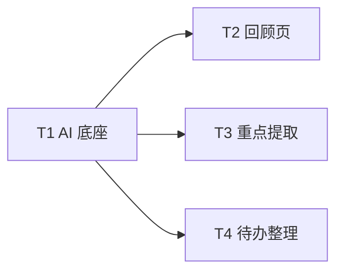

# 「个人信息管家」P1 AI 能力 · 增量设计（P1-AI-FEATURES-DESIGN）

> 版本：v1.0
> 作者：高见远（架构师）
> 状态：待工程师实现
> 范围：阶段总结（R-15）/ 后续行动建议（R-16）/ 重点信息提取（R-17）/ 待办整理（R-18）；**不含 VSIX**
> 模式：四个功能均为「LLM + 已有 records 数据」，全部复用 `aiService` 既有 `getModelId() → cloud.llm.chat.completions.create({messages:[system,user], stream:true}) → collectStream → parseJsonLoose` 链路。

---

## 0. 现状核对与复用清单

| 复用点 | 位置 | 说明 |
|--------|------|------|
| LLM 统一链路 | `web/src/services/aiService.ts` | `getModelId()` / `collectStream` / `parseJsonLoose` / `wrapLlmError` 全复用 |
| 记录查询 | `web/src/services/recordService.ts` | `listRecords` / `search` / `createRecord` / `updateTodoStatus` 复用 |
| Prompt 集中 | `shared/constants/prompts.ts` | 新增 3 条 prompt |
| 类型集中 | `shared/types/domain.ts` | 新增 Review/ActionItem/KeyPoint/TodoOrganize 类型 |
| 页面/导航 | `web/src/pages/*` + `web/src/components/Layout.tsx` + `web/src/App.tsx` | 新增 ReviewPage + 导航入口；改 RecordDetail / TodoPage |

**关键缺口**：`listRecords` 目前不支持「按创建时间区间」筛选，需新增 `listByRange` 供回顾页使用。待办整理可直接复用 `listRecords({type:'todo', pageSize:200})` + 客户端过滤 `todoStatus !== 'done'`（`TodoPage` 已这么用）。

---

## 1. 新增类型（`shared/types/domain.ts`）

```ts
/** 后续行动建议项（R-16）。 */
export interface ActionItem {
  title: string            // 可执行标题
  detail?: string          // 补充说明
  priority?: Priority      // high|medium|low
}

/** 阶段回顾结果（R-15 + R-16 合并）。 */
export interface ReviewResult {
  summary: string          // 阶段总结（2~5 段中文文本）
  actions: ActionItem[]    // 后续行动建议
}

/** 重点提取的关键点（R-17）。 */
export interface KeyPoint {
  point: string            // 关键点/结论
  detail?: string          // 补充说明
}

/** 待办合并分组（R-18）。 */
export interface TodoMergeGroup {
  keep: string             // 建议保留的标题
  merge: string[]          // 被并入的原标题
}

/** 待办整理后的排序项（R-18）。 */
export interface TodoOrganizeItem {
  title: string
  priority: Priority
}

/** 待办整理结果（R-18）。 */
export interface TodoOrganizeResult {
  summary: string
  mergeGroups: TodoMergeGroup[]
  ordered: TodoOrganizeItem[]
}
```

---

## 2. 新增 Prompt（`shared/constants/prompts.ts`）

### 2.1 阶段回顾（R-15 + R-16）

```ts
export const REVIEW_SYSTEM_PROMPT = `你是一名个人效率回顾助手。用户会给你某时间段内的个人记录列表（想法/资料/待办），请生成两部分内容：
1. summary：阶段总结（中文，2~5 段，概括这段时间做的事、关注的主题、重要进展，不编造记录之外的事实）。
2. actions：后续行动建议（3~8 条可执行的下一步行动，每条 title 简短可执行、detail 补充说明、priority 取 high/medium/low）。

要求：
- 只输出 JSON 对象，格式：{"summary":"...","actions":[{"title":"...","detail":"...","priority":"high|medium|low"}]}
- 若记录很少或无法判断，summary 说明即可，actions 可为空数组。
- 不要输出任何解释或 markdown 代码围栏。`
```

### 2.2 重点提取（R-17）

```ts
export const EXTRACT_KEY_POINTS_SYSTEM_PROMPT = `你是一名信息提取助手。请从用户给出的长文资料中提取关键点与结论。

要求：
- 只输出 JSON 数组，每个元素 {"point":"关键点/结论","detail":"补充说明（可选，没有可省略）"}。
- 提取 3~10 个最核心的点，简洁、不编造。
- 若内容很短或无明显要点，返回空数组 []。
- 不要输出任何解释或 markdown 代码围栏。`
```

### 2.3 待办整理（R-18）

```ts
export const ORGANIZE_TODOS_SYSTEM_PROMPT = `你是一名待办整理助手。用户会给你一份待办清单（标题+优先级），请分析并输出：
1. summary：一句整理结论（如「发现 2 组可合并的重复待办」）。
2. mergeGroups：语义重复或高度相关、可合并的待办分组，每组 keep 为建议保留的标题（取原标题或概括），merge 为被并入的原标题数组。
3. ordered：去重合并后的待办清单，按重要/紧急程度排序，每条 title 简洁可执行、priority 取 high/medium/low。

要求：
- 只输出 JSON 对象，格式：{"summary":"...","mergeGroups":[{"keep":"...","merge":["..."]}],"ordered":[{"title":"...","priority":"high|medium|low"}]}
- 若无需整理，mergeGroups 为空数组，ordered 为原清单排序即可。
- 不要编造不存在的待办，不要输出任何解释或 markdown 代码围栏。`
```

---

## 3. aiService 新增方法（`web/src/services/aiService.ts`）

三个方法均走既有链路，输入截断上限统一 30k 字符：

```ts
/** 阶段回顾：总结 + 行动建议（R-15/R-16）。 */
async generateReview(records: InfoRecord[]): Promise<ReviewResult> {
  const model = await getModelId()
  const text = records
    .map((r) => `[${r.type}] ${r.title}\n${r.content.slice(0, 500)}${r.category ? `\n分类:${r.category}` : ''}`)
    .join('\n---\n')
  const stream = cloud.llm.chat.completions.create({
    model,
    messages: [
      { role: 'system', content: REVIEW_SYSTEM_PROMPT },
      { role: 'user', content: text.slice(0, 30000) },
    ],
    stream: true,
  })
  const raw = await collectStream(stream)
  const parsed = parseJsonLoose<ReviewResult>(raw)
  if (parsed && typeof parsed.summary === 'string') {
    return {
      summary: parsed.summary,
      actions: Array.isArray(parsed.actions) ? parsed.actions.slice(0, 8) : [],
    }
  }
  return { summary: raw.trim() || '未能生成回顾', actions: [] }   // 降级
}

/** 重点提取（R-17）。 */
async extractKeyPoints(content: string): Promise<KeyPoint[]> {
  const model = await getModelId()
  const stream = cloud.llm.chat.completions.create({
    model,
    messages: [
      { role: 'system', content: EXTRACT_KEY_POINTS_SYSTEM_PROMPT },
      { role: 'user', content: content.slice(0, 30000) },
    ],
    stream: true,
  })
  const raw = await collectStream(stream)
  const parsed = parseJsonLoose<KeyPoint[]>(raw)
  return Array.isArray(parsed)
    ? parsed.filter((k) => k && typeof k.point === 'string').slice(0, 10)
    : []
}

/** 待办整理（R-18）。 */
async organizeTodos(todos: InfoRecord[]): Promise<TodoOrganizeResult> {
  const model = await getModelId()
  const text = todos.map((t) => `${t.title}（优先级:${t.priority ?? 'medium'}）`).join('\n')
  const stream = cloud.llm.chat.completions.create({
    model,
    messages: [
      { role: 'system', content: ORGANIZE_TODOS_SYSTEM_PROMPT },
      { role: 'user', content: text.slice(0, 30000) },
    ],
    stream: true,
  })
  const raw = await collectStream(stream)
  const parsed = parseJsonLoose<TodoOrganizeResult>(raw)
  if (parsed && Array.isArray(parsed.ordered)) {
    return {
      summary: parsed.summary ?? '',
      mergeGroups: Array.isArray(parsed.mergeGroups) ? parsed.mergeGroups : [],
      ordered: parsed.ordered.filter((o) => o && typeof o.title === 'string').slice(0, 50),
    }
  }
  return { summary: '未能整理待办', mergeGroups: [], ordered: [] }   // 降级
}
```

---

## 4. recordService 新增方法（`web/src/services/recordService.ts`）

回顾页需按时间区间拉取，新增：

```ts
/** 按创建时间区间拉取记录（回顾用，未删除）。 */
async listByRange(startIso: string, endIso: string, limit = 200): Promise<InfoRecord[]> {
  const { data, error } = await cloud.database
    .from('records')
    .select('*')
    .eq('is_deleted', false)
    .gte('created_at', startIso)
    .lte('created_at', endIso)
    .order('created_at', { ascending: false })
    .limit(limit)
  const rows = (unwrap({ data, error }) as RecordsRow[] | null) ?? []
  return rows.map(mapRecord)
}
```

---

## 5. UI 设计

### 5.1 回顾页（新增 `web/src/pages/ReviewPage.tsx`，阶段总结 + 行动建议合并）

**采纳主理人倾向**：合并为一个「回顾」页。

- 顶部：时间范围选择（`本周 / 本月 / 自定义` 三个 Tab 或分段按钮；自定义用 MUI `TextField type="date"` 起止两个输入）。
- 「生成回顾」按钮 → `recordService.listByRange(start, end)` → `aiService.generateReview(records)`。
- 结果分两部分渲染：
  - **阶段总结**：`summary` 多段文本（`whiteSpace: 'pre-wrap'`）。
  - **后续行动建议**：`actions` 列表，每条右侧「转待办」按钮 → `recordService.createRecord({ type:'todo', title: a.title, content: a.detail ?? '', priority: a.priority ?? 'medium', todoStatus:'pending' })` → toast「已添加待办」；点击后该条按钮置 `disabled` 防重复转。
- 空态：区间内无记录时提示「该时间段暂无记录」。
- 状态：`loading` / `error`（`friendlyError`）。

**导航接入**：
- `web/src/App.tsx`：`<Route path="/review" element={<ReviewPage/>} />`（在 `Layout` 的 `RequireAuth` 子路由内）。
- `web/src/components/Layout.tsx`：`NAV_ITEMS` 增加 `{ label:'回顾', path:'/review', icon:<InsightsIcon/> }`（放「VS 代码分析」之前）。

### 5.2 重点提取（`web/src/components/RecordDetail.tsx`）

**采纳主理人倾向**：作为详情页按钮，即时展示、不落库。

- 在正文下方、`重新生成摘要` 按钮旁，新增「提取重点」按钮（`!editing` 时显示）。
- 状态：`keyPoints: KeyPoint[]`、`extracting: boolean`。
- 点击 → `aiService.extractKeyPoints(`${record.title}\n${record.content}`)` → 结果用带项目符号的列表（或 MUI `List`）展示在正文与「相关记录」之间；再点可刷新；关闭弹窗即丢弃（不落库）。
- 空结果：提示「未提取到明显要点」。

### 5.3 待办整理（`web/src/pages/TodoPage.tsx`）

**采纳主理人倾向，并明确落库策略**：P1 **仅展示建议、不自动改库**（理由：合并/删除/改优先级会改动用户数据，存在误合并风险；先以「建议清单」形式呈现，用户确认后手动处理，P2 再加「一键应用」）。

- 「待办」标题旁新增「智能整理」按钮（`pending.length > 0` 时可用）。
- 点击 → 取 `pending` 列表 → `aiService.organizeTodos(pending)` → 以 Dialog 或页面内卡片展示：
  - `summary` 一句结论。
  - **合并建议**（`mergeGroups`）：每组显示 `keep`（高亮）+ `merge` 列表（划线/次要色）。
  - **整理后清单**（`ordered`）：按建议顺序渲染，每条显示 priority Chip。
- 结果即时展示、关闭即弃；不写库、不改原待办。

---

## 6. 有序任务列表（T1..T4）

### T1 · AI 底座（类型 + prompt + aiService + 数据方法）

- **目标**：四功能共用的类型 / prompt / AI 方法 / 数据方法就绪，可独立单测。
- **涉及文件**：
  - `shared/types/domain.ts`（新增 `ActionItem`/`ReviewResult`/`KeyPoint`/`TodoMergeGroup`/`TodoOrganizeItem`/`TodoOrganizeResult`）
  - `shared/constants/prompts.ts`（新增 3 条 prompt）
  - `web/src/services/aiService.ts`（`generateReview`/`extractKeyPoints`/`organizeTodos`）
  - `web/src/services/recordService.ts`（`listByRange`）
- **依赖**：无
- **完成标准**：`tsc --noEmit` 通过；三个方法可独立调用并返回符合类型的结果；LLM 输出解析失败时降级为纯文本/空数组、不抛未捕获异常。

### T2 · 回顾页（阶段总结 + 行动建议）

- **目标**：落地 R-15 + R-16 合并页。
- **涉及文件**：
  - `web/src/pages/ReviewPage.tsx`（新建）
  - `web/src/App.tsx`（`/review` 路由）
  - `web/src/components/Layout.tsx`（导航「回顾」入口）
- **依赖**：T1
- **完成标准**：时间范围（本周/本月/自定义）切换；生成后展示总结 + 行动建议；「转待办」能创建待办且防重复；空态/错误/加载态齐全。

### T3 · 重点提取（记录详情）

- **目标**：落地 R-17。
- **涉及文件**：
  - `web/src/components/RecordDetail.tsx`
- **依赖**：T1
- **完成标准**：详情页「提取重点」按钮可调 LLM 并即时展示关键点列表；不落库；空结果/错误有提示。

### T4 · 待办整理（待办页）

- **目标**：落地 R-18。
- **涉及文件**：
  - `web/src/pages/TodoPage.tsx`
- **依赖**：T1
- **完成标准**：「智能整理」按钮调 LLM；展示合并建议 + 排序后清单；仅建议不落库；无待办时按钮禁用并提示。

> 说明：T3、T4 为单文件 UI 改动（方法/类型已在 T1 就绪），粒度天然较小；T2/T3/T4 之间无依赖，可并行。

### 任务依赖图



---

## 7. 待明确事项（附默认建议，不阻塞）

| 编号 | 事项 | 默认建议 |
|------|------|---------|
| Q-P1-1 | 回顾默认时间范围与数据量上限 | 默认「本周」；拉取 ≤200 条，单条 content 截 500 字、总输入 ≤30k 字（LLM 输入上限保护） |
| Q-P1-2 | 行动建议「转待办」是否去重 | 默认不去重，靠按钮点击后 `disabled` 防重复；P2 加「已转」标记或按 title 去重 |
| Q-P1-3 | 重点提取结果是否落库 | 默认不落库（即时展示，与「重新生成摘要」落库不同）；P2 可存独立字段 |
| Q-P1-4 | 待办整理是否落库 | 默认仅展示建议、不自动改库（避免误合并/误删）；P2 提供「一键应用」 |
| Q-P1-5 | 阶段总结/行动建议结果是否落库可追溯 | 默认不落库（ReviewPage 即时展示）；P2 可存独立 review 表 |
| Q-P1-6 | 时间范围自定义控件 | MUI `TextField type="date"`（零新增依赖）；P2 换 `@mui/x-date-pickers` |
| Q-P1-7 | LLM 输出稳定性 | 复用 `parseJsonLoose` 容错；解析失败降级为纯文本 summary / 空数组，不阻塞 UI |

---

*本文档为 P1 AI 功能施工蓝图；实现时如与现有代码 / 云 SDK 实际行为有出入，以现有代码与 SDK 运行时行为为准，并回报架构师同步修订。*
