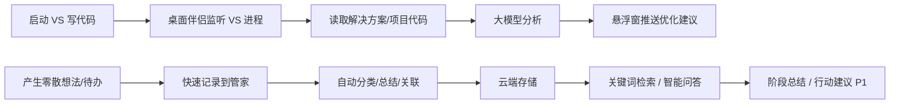

# 「个人信息管家 Agent」产品需求文档（PRD）

> 版本：v1.0（MVP）
> 作者：许清楚（产品经理）
> 状态：待架构师评审

---

## 一、项目信息

| 项 | 内容 |
| --- | --- |
| 产品名称 | 个人信息管家 Agent |
| 项目名 | `personal-agent` |
| 语言 | 中文 |
| 产品形态 | Web 应用 + 桌面伴侣程序（Electron） |
| 技术栈 | 前端 Vite + React + MUI + Tailwind CSS；桌面 Electron；后端 WorkBuddy 云服务 |
| 目标用户 | 程序员（个人零散信息管理 + Visual Studio 代码分析） |

**原始需求复述**：创建一个「个人信息管家 Agent」Web 应用，接入 Visual Studio 自动获取代码并分析给出优化建议；支持桌面显示；支持记录零散想法/资料/待办并自动分类、总结、关联；支持关键词检索、智能问答、重点信息提取、待办整理；能生成阶段总结与后续行动建议；数据存云端、接入大模型并发布上线。

---

## 二、产品定义

### 2.1 产品目标

1. **成为程序员的个人第二大脑**：将零散想法、资料、待办集中沉淀，自动分类、总结、关联，让信息"找得到、用得上"。
2. **把代码分析变成常驻陪伴**：VS 启动即自动唤醒，主动分析解决方案/项目代码并推送优化建议，让代码质量改进持续发生。
3. **桌面无感、随叫随到**：通过悬浮窗 + 系统托盘常驻桌面，实现不打断工作流的轻量交互与快速记录/查询。

### 2.2 用户故事

| 编号 | 用户故事 |
| --- | --- |
| US-1 | 作为程序员，我想在写代码时让系统自动分析我的 VS 解决方案并给出优化建议，这样我无需手动触发就能持续改进代码质量。 |
| US-2 | 作为程序员，我想随时把一闪而过的想法、资料链接、待办快速记下来，系统自动分类和总结，这样我不怕遗忘也不被整理负担困扰。 |
| US-3 | 作为程序员，我想用关键词检索和自然语言问答快速找到历史记录并提取重点，这样我能高效复用过去的积累。 |
| US-4 | 作为程序员，我想在桌面悬浮窗和托盘上不切换窗口就能查看/记录信息，这样不会打断当前编码思路。 |
| US-5 | 作为用户，我想我的数据安全存储在云端且应用已发布上线，这样我换设备也能访问、随时可用。 |

### 2.3 用户旅程（Mermaid）

---

## 三、需求池（Requirements Pool）

### 3.1 优先级说明

- **P0（Must have）**：MVP 必须交付，缺一不可。
- **P1（Should have）**：MVP 后尽快迭代，本期预留设计但可延后。
- **P2（Nice to have）**：远期增强，非阻塞。

### 3.2 需求列表

| 编号 | 需求名 | 描述 | 优先级 | 验收标准 |
| --- | --- | --- | --- | --- |
| R-01 | 用户登录 | 通过云服务完成账号注册/登录，隔离个人数据 | P0 | 用户可注册登录；数据按用户隔离，未登录无法访问 |
| R-02 | 信息记录（想法/资料/待办） | 支持新增三类信息：想法、资料（可含链接/文件）、待办（可设提醒） | P0 | 可分别创建三类记录；待办可标记完成；资料支持 URL 与文件上传 |
| R-03 | 自动分类 | 大模型对每条记录自动打标签/分类 | P0 | 新建记录后 5s 内自动生成分类，可手动修正 |
| R-04 | 自动总结 | 大模型对记录/批量内容生成摘要 | P0 | 记录详情页显示 AI 摘要，摘要准确概括要点 |
| R-05 | 智能关联 | 大模型自动关联语义相近的历史记录 | P0 | 打开某条记录时展示相关记录列表，命中相关项 |
| R-06 | 关键词检索 | 支持全文/标签/分类检索 | P0 | 输入关键词返回匹配记录，响应 < 2s |
| R-07 | 智能问答 | 基于个人内容做自然语言问答 | P0 | 可基于已存内容回答问题并引用来源记录 |
| R-08 | 桌面伴侣程序 | Electron 常驻后台：监听 VS 进程、系统托盘、悬浮窗 | P0 | 程序随系统启动常驻；托盘图标可见；悬浮窗 always-on-top |
| R-09 | VS 进程监听与自动唤醒 | 监听 VS(devenv.exe) 启动→自动唤醒分析流程 | P0 | VS 启动后 10s 内自动触发代码分析 |
| R-10 | 代码读取与分析 | 读取解决方案/项目代码，大模型分析并生成优化建议 | P0 | 能解析解决方案结构并输出结构化优化建议 |
| R-11 | 优化建议推送 | 分析结果通过悬浮窗推送展示 | P0 | 分析完成后悬浮窗弹出建议卡片，可展开/忽略 |
| R-12 | 桌面悬浮窗 | always-on-top 小窗：快速记录、查看建议、快捷检索入口 | P0 | 悬浮窗置顶不遮挡主工作区，支持折叠/拖动 |
| R-13 | 云端存储与同步 | 数据存云数据库 + 文件存储，多端可读 | P0 | 数据落云端，重新登录/换设备可同步 |
| R-14 | VSIX 插件（后续迭代） | 以 VS 扩展形式在 IDE 内展示分析建议 | P1 | 插件可在 VS 内安装并展示建议（后续版本验收） |
| R-15 | 阶段总结 | 按周/月对内容生成阶段总结 | P1 | 可生成某时间段总结报告 |
| R-16 | 后续行动建议 | 基于内容生成下一步行动项 | P1 | 输出可执行、可转待办的行动建议 |
| R-17 | 重点信息提取 | 从长篇资料中提取关键点/结论 | P1 | 能对长文/多篇资料输出重点清单 |
| R-18 | 待办整理 | 自动合并/去重/排序待办 | P1 | 自动识别重复待办并建议合并，按优先级排序 |
| R-19 | 发布上线 | 部署 Web + 桌面程序至线上 | P0 | 生产环境可访问、可下载安装，稳定运行 |

---

## 四、UI 设计稿说明

### 4.1 Web 主界面（信息管家主站）

**布局**：左侧导航栏 + 顶部搜索框 + 主内容区。

| 区块 | 说明 |
| --- | --- |
| 顶部搜索栏 | 关键词检索 + AI 问答入口（输入框可切换"搜索/问答"模式） |
| 左侧导航 | 菜单：全部信息 / 想法 / 资料 / 待办 / 分类标签 / VS 代码分析 / 设置 |
| 主内容区 | 记录列表（卡片式，含分类标签、摘要、时间）+ 排序/筛选 |
| 记录详情 | 单条记录全文、AI 摘要、相关记录列表、编辑/删除 |
| 快速记录入口 | "＋"按钮，弹窗选择类型（想法/资料/待办）快速新增 |
| 待办视图 | 待办列表，支持勾选完成、优先级、提醒时间 |
| VS 代码分析页 | 展示历次分析结果：解决方案名、问题列表、优化建议、严重级别 |
| 设置页 | 账号信息、VS 路径配置、悬浮窗偏好、通知开关 |

### 4.2 桌面悬浮窗（Electron，always-on-top）

| 区块 | 说明 |
| --- | --- |
| 置顶小窗（默认收起为窄条） | 可拖动、吸附屏幕边缘、折叠成图标 |
| 快速记录区 | 一键输入想法/待办，回车即存 |
| 建议卡片区 | VS 分析完成后弹出优化建议卡片，支持"展开详情/稍后/忽略" |
| 快捷入口 | 打开 Web 主界面、快速问答 |
| 状态提示 | 显示"已监听 VS / 分析中…"状态 |

### 4.3 系统托盘菜单（Electron）

| 菜单项 | 说明 |
| --- | --- |
| 显示/隐藏悬浮窗 | 切换悬浮窗显隐 |
| 打开主界面 | 跳转 Web 主界面 |
| 立即分析当前 VS 项目 | 手动触发一次代码分析 |
| 暂停/恢复 VS 监听 | 开关自动分析 |
| 设置 | 打开设置面板 |
| 退出 | 退出桌面伴侣程序 |

---

## 五、待确认问题（Open Questions）

| 编号 | 问题 | 默认假设 |
| --- | --- | --- |
| Q-01 | VS 代码分析是否允许将代码上传到云端大模型？隐私/合规敏感度如何？ | 默认可上传（用户个人项目），但需在设置中提供"关闭代码上传"开关；敏感代码本地脱敏处理 |
| Q-02 | VS 支持范围：仅 Visual Studio（Windows）还是也需 VS Code？ | 首期仅 Visual Studio（Windows），VS Code 后续 P1 |
| Q-03 | 大模型调用的具体模型与费用上限？ | 使用 WorkBuddy 云服务免密钥大模型，费用由平台承担，暂不设单用户限额 |
| Q-04 | 文件上传（资料）的大小/类型限制？ | 默认支持图片、PDF、常见文档，单文件 ≤ 50MB |
| Q-05 | 悬浮窗默认位置与是否允许用户禁用？ | 默认屏幕右下角，可在设置中禁用 |
| Q-06 | 待办提醒是否需要系统级通知/声音？ | 首期仅站内 + 悬浮窗提示，不接系统通知 |
| Q-07 | 智能问答是否要求严格引用来源、避免幻觉？ | 必须引用来源记录，无相关内容时明确回复"未找到" |
| Q-08 | 是否需多语言支持（如英文界面）？ | 首期仅中文 |
| Q-09 | 数据删除策略：是否提供回收站？ | 提供回收站，删除后 30 天内可恢复 |
| Q-10 | VS 分析频率：每次启动全量分析会否过重？ | 增量分析 + 缓存，仅分析变更文件，避免重复推送 |

---

## 六、验收与成功指标（建议）

- MVP 上线后，用户从启动 VS 到收到首条优化建议 ≤ 30s。
- 信息检索响应 < 2s，智能问答 < 5s。
- 自动分类/总结准确率需通过人工抽检（目标：分类正确率 ≥ 85%）。
- 悬浮窗不遮挡主工作区（默认收起为窄条）。
