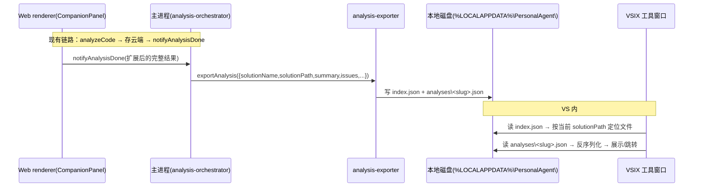
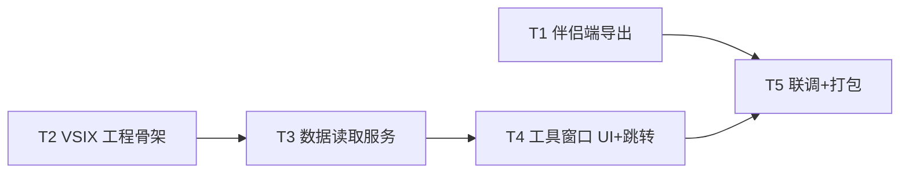

# 「个人信息管家」VSIX 插件设计（VSIX-DESIGN）

> 版本：v1.0（MVP）
> 作者：高见远（架构师）
> 状态：待工程师实现
> 范围：PRD R-14 —— 在 Visual Studio 内展示代码分析建议（另一套技术栈 C#/.NET VS 扩展）
> 上游：已完成的桌面伴侣（Electron）+ Web 端 `aiService.analyzeCode` + 云端 `code_analyses` 表

---

## 0. 现状核对与结论

| 现状事实 | 对 VSIX 的影响 |
|---------|---------------|
| 代码分析全流程：伴侣监听 devenv.exe → solution-reader 读码 → IPC 交 Web renderer → `aiService.analyzeCode`(cloud.llm) → 存云端 `code_analyses` 表 | 分析结果**只存在于 Web 端与云端**，主进程当前只收到 `analysisDone{analysisId, status, issueCount}`，**没有 summary/issues 全文** |
| 云端数据面需登录 token + 精确 Origin 匹配，原生 C# 无官方 SDK | VSIX **不能**直接查 `code_analyses`（需自研登录/session，复杂度高、收益低） |
| `CodeIssue`：`severity=error|warning|suggestion` + `title/description/suggestion/file/line` | 导出格式直接复用此结构，零转换 |
| solution-reader 的 `file` 是**相对解决方案目录**的路径 | VSIX 跳转时需「解决方案目录 + file」拼绝对路径 |

**关键决策（采纳主理人倾向）**：采用「伴侣导出本地文件、VSIX 读文件展示」的松耦合方案。理由：
1. 原生 VSIX 无 cloud SDK、无法拿到登录 token 与 Origin 匹配，直查云端需自研一套鉴权+数据面客户端，复杂度远超收益；
2. 伴侣已握有全部分析结果（Web 端 `result.issues/summary` + `saved`），只需把结果**回传主进程并落盘**，改动极小；
3. 本地文件方案零鉴权、零 LLM、零网络，VSIX 只做「读文件 + 展示 + 跳转」，工程可控、可离线。

---

## 1. 数据获取方案

### 1.1 数据流



### 1.2 伴侣端新增导出逻辑

**新增 `desktop/src/main/analysis-exporter.ts`**：

```ts
import { mkdirSync, writeFileSync, readFileSync, existsSync } from 'node:fs'
import { join } from 'node:path'
import { createHash } from 'node:crypto'

export interface AnalysisExportPayload {
  solutionName: string
  solutionPath: string
  projectName?: string | null
  summary: string
  issues: CodeIssue[]       // severity/title/description/suggestion/file/line
  status: 'done' | 'failed'
  message?: string
  analyzedAt: string        // ISO8601
  issueCount: number
}

export function exportBaseDir(): string {
  const base = process.env.LOCALAPPDATA || join(process.env.TEMP ?? '.', 'PersonalAgent')
  return join(base, 'PersonalAgent')
}

function slugOf(solutionPath: string): string {
  return createHash('sha1').update(solutionPath).digest('hex').slice(0, 16)
}

export function exportAnalysis(payload: AnalysisExportPayload): void {
  try {
    const dir = exportBaseDir()
    const analysesDir = join(dir, 'analyses')
    mkdirSync(analysesDir, { recursive: true })

    const slug = slugOf(payload.solutionPath)
    const fileName = `${slug}.json`
    const file = join(analysesDir, fileName)

    // 1) 每解决方案独立文件（覆盖为最新）
    writeFileSync(file, JSON.stringify({ schemaVersion: 1, ...payload }, null, 2), 'utf-8')

    // 2) 最近一次副本（调试/兜底）
    writeFileSync(join(dir, 'latest-analysis.json'), JSON.stringify({ schemaVersion: 1, ...payload }, null, 2), 'utf-8')

    // 3) 索引：solutionPath → 文件名 + 元信息（原子性可选，MVP 直接写）
    const index = readIndex(dir)
    index.solutions[payload.solutionPath] = {
      solutionName: payload.solutionName,
      file: fileName,
      analyzedAt: payload.analyzedAt,
    }
    writeFileSync(join(dir, 'index.json'), JSON.stringify({ version: 1, solutions: index.solutions }, null, 2), 'utf-8')
  } catch {
    /* 导出失败不阻塞分析主流程（仅影响 VSIX 展示） */
  }
}

function readIndex(dir: string): { solutions: Record<string, IndexEntry> } {
  try {
    const raw = readFileSync(join(dir, 'index.json'), 'utf-8')
    const parsed = JSON.parse(raw)
    return { solutions: parsed?.solutions ?? {} }
  } catch {
    return { solutions: {} }
  }
}
```

### 1.3 导出文件格式与路径约定

**路径**：`%LOCALAPPDATA%\PersonalAgent\`（`LOCALAPPDATA` 缺失时回退 `%TEMP%\PersonalAgent`）。

| 文件 | 内容 |
|------|------|
| `index.json` | `{ "version":1, "solutions": { "<solutionPath>": { "solutionName", "file", "analyzedAt" } } }` |
| `analyses\<sha1(path).slice(0,16)>.json` | 每解决方案最新分析结果（覆盖写） |
| `latest-analysis.json` | 最近一次分析结果的副本（调试/兜底，与团队指定文件名一致） |

**结果文件 JSON（`schemaVersion:1`）**：

```json
{
  "schemaVersion": 1,
  "solutionName": "MySolution",
  "solutionPath": "C:\\repo\\MySolution\\MySolution.sln",
  "projectName": "MyProject",
  "summary": "发现 5 个可优化项",
  "issues": [
    {
      "severity": "warning",
      "title": "未处理异常",
      "description": "方法可能抛出未处理的异常",
      "suggestion": "增加 try/catch 或向上抛出",
      "file": "MyProject/Service.cs",
      "line": 42
    }
  ],
  "status": "done",
  "message": null,
  "analyzedAt": "2025-01-01T10:00:00.000Z",
  "issueCount": 5
}
```

### 1.4 现有代码改动点（伴侣端）

1. **`desktop/src/shared/ipc-contract.ts` + `shared/types/ipc.ts`**：`AnalysisDonePayload` 扩展为包含 `solutionName / solutionPath / summary / issues: CodeIssue[] / analyzedAt`（与 `AnalysisExportPayload` 对齐，`analysisId` 保留）。
2. **`web/src/components/CompanionPanel.tsx`**：`handleVsStarted` 成功后，`bridge.notifyAnalysisDone({ analysisId: saved.id, status:'done', issueCount, solutionName, solutionPath, summary, issues, analyzedAt })`；失败分支同样带 `solutionName/solutionPath` 与 `status:'failed'`。
3. **`desktop/src/main/analysis-orchestrator.ts`**：`markAnalysisDone(payload)` 在回填状态后调用 `exportAnalysis(payload)`。
4. `CodeIssue` 类型直接复用 `shared/types/domain.ts`（无需新增类型，仅需在 ipc 类型里引用）。

---

## 2. VSIX 工程结构

### 2.1 文件清单（根 `personal-agent/vsix/`）

| 相对路径 | 职责 |
|---------|------|
| `vsix/PersonalAgentVsix.sln` | 解决方案文件 |
| `vsix/PersonalAgentVsix/PersonalAgentVsix.csproj` | VSIX 工程（SDK 风格 csproj，net472） |
| `vsix/PersonalAgentVsix/Properties/AssemblyInfo.cs` | 程序集元信息 |
| `vsix/PersonalAgentVsix/source.extension.vsixmanifest` | VSIX 清单（身份/目标 VS 版本/资产） |
| `vsix/PersonalAgentVsix/PersonalAgentVsixPackage.cs` | `AsyncPackage` 子类 + `[ProvideToolWindow]` + GUID |
| `vsix/PersonalAgentVsix/AnalysisToolWindow.cs` | `ToolWindowPane` 子类，承载 WPF 控件 |
| `vsix/PersonalAgentVsix/AnalysisToolWindowControl.xaml` | 工具窗口 WPF 界面 |
| `vsix/PersonalAgentVsix/AnalysisToolWindowControl.xaml.cs` | 代码后置：加载/刷新/跳转/状态 |
| `vsix/PersonalAgentVsix/Models/AnalysisResult.cs` | 结果 DTO（反序列化 JSON，与 §1.3 对齐） |
| `vsix/PersonalAgentVsix/Services/AnalysisFileService.cs` | 读 index.json + result 文件 + 路径解析 |
| `vsix/PersonalAgentVsix/Services/SolutionService.cs` | 获取当前解决方案 `FullName`（DTE） |
| `vsix/PersonalAgentVsix/Services/EditorNavigationService.cs` | 打开文件并跳转 `file:line`（DTE） |
| `vsix/PersonalAgentVsix/Converters/SeverityToBrushConverter.cs` | severity → 颜色（与 Web 主题一致） |
| `vsix/PersonalAgentVsix/Assets/icon.png` | 工具窗口/包图标 |
| `vsix/README.md` | 构建/安装说明（VS 内 Build 与 dotnet build 双路径） |

### 2.2 依赖包（NuGet）

| 包 | 版本 | 用途 |
|----|------|------|
| `Microsoft.VisualStudio.SDK` | `17.*`（按本机 VS 版本对齐） | VS 扩展 SDK（含 Shell/UI/DTE） |
| `Microsoft.VSSDK.BuildTools` | `17.*` | VSIX 打包/生成 .vsix |
| `Newtonsoft.Json` | `13.*` | JSON 反序列化（net472 稳定，避免 System.Text.Json 额外配置） |

> 目标框架：`net472`（VS 2022 及后续版本的 VSIX 标准目标框架，兼容性最好）。注意本机 VS 目录为 `...\Microsoft Visual Studio\18\`，需确认实际 VS 主版本（见 §5 Q-V1）。

### 2.3 关键类/接口

```csharp
// PersonalAgentVsixPackage.cs
[PackageRegistration(UseManagedResourcesOnly = true, AllowsBackgroundLoading = true)]
[ProvideToolWindow(typeof(AnalysisToolWindow), Style = VsDockStyle.Tabbed, Window = ToolWindowGuids.SolutionExplorer)]
[Guid("A1B2C3D4-....")]   // 唯一 GUID
public sealed class PersonalAgentVsixPackage : AsyncPackage
{
    protected override async Task InitializeAsync(CancellationToken t, IProgress<ServiceProgressData> p)
    {
        await base.InitializeAsync(t, p);
        // 注册完成；工具窗口经 View > Other Windows 打开
    }
}

// AnalysisToolWindow.cs
[Guid("...")]
public class AnalysisToolWindow : ToolWindowPane
{
    public AnalysisToolWindow() : base(null)
    {
        this.Caption = "个人信息管家";
        this.Content = new AnalysisToolWindowControl();
    }
}
```

```csharp
// Models/AnalysisResult.cs（与 §1.3 JSON 对齐，Newtonsoft 特性可选）
public class AnalysisResult
{
    public int SchemaVersion { get; set; }
    public string SolutionName { get; set; }
    public string SolutionPath { get; set; }
    public string ProjectName { get; set; }
    public string Summary { get; set; }
    public List<IssueDto> Issues { get; set; }
    public string Status { get; set; }        // done | failed
    public string Message { get; set; }
    public string AnalyzedAt { get; set; }
    public int IssueCount { get; set; }
}

public class IssueDto
{
    public string Severity { get; set; }      // error | warning | suggestion
    public string Title { get; set; }
    public string Description { get; set; }
    public string Suggestion { get; set; }
    public string File { get; set; }          // 相对解决方案目录
    public int? Line { get; set; }
}

// Services/AnalysisFileService.cs
public interface IAnalysisFileService
{
    string BaseDir { get; }
    AnalysisResult GetLatestForSolution(string solutionPath);  // 读 index → analyses\<slug>.json
    AnalysisResult GetLatestOverall();                          // 读 latest-analysis.json（兜底）
}
```

### 2.4 `.vsixmanifest` 要点

```xml
<PackageManifest Version="2.0.0" xmlns="...">
  <Metadata>
    <Identity Id="PersonalAgentVsix.<guid>" Version="1.0.0" Language="zh-CN" Publisher="个人信息管家" />
    <DisplayName>个人信息管家 VS 助手</DisplayName>
    <Description>在 Visual Studio 内展示「个人信息管家」生成的代码优化建议</Description>
  </Metadata>
  <Installation>
    <InstallationTarget Id="Microsoft.VisualStudio.Community" Version="[17.0,18.0)" />
  </Installation>
  <Dependencies>
    <Dependency Id="Microsoft.Framework.NDP" DisplayName=".NET Framework" Version="[4.7.2,)" />
  </Dependencies>
  <Assets>
    <Asset Type="Microsoft.VisualStudio.VsPackage" d:Source="Project" d:ProjectName="%CurrentProject%" Path="|%CurrentProject%;PkgdefProjectOutputGroup|" />
  </Assets>
</PackageManifest>
```

---

## 3. 工具窗口 UI 设计

### 3.1 布局（WPF XAML 结构）

```
┌──────────────────────────────────────────────┐
│ 个人信息管家                [刷新]  [状态Chip] │   ← 顶栏：解决方案名 + analyzedAt + 刷新按钮
├──────────────────────────────────────────────┤
│ 摘要区（summary，可换行 TextBlock）             │
├──────────────────────────────────────────────┤
│ 问题列表（ItemsControl，按原顺序）              │
│  ┌─[色条] [必须修复] 标题（粗体）  file:line ─┐│   ← 每项：左色条 + severity 标签 + 标题 + 位置
│  │      描述 / 建议（次级文字）                ││
│  └──────────────────────────────────────────┘│
│  ...                                          │
├──────────────────────────────────────────────┤
│ 空态/错误态（居中文案）                         │
└──────────────────────────────────────────────┘
```

### 3.2 严重级着色（与 Web 主题一致）

| severity | 中文标签 | 色值 | 色条/标签 |
|----------|---------|------|----------|
| `error` | 必须修复 | `#ef4444` | 红 |
| `warning` | 建议修复 | `#f59e0b` | 橙 |
| `suggestion` | 可优化 | `#0ea5e9` | 蓝 |

用 `SeverityToBrushConverter` 把 `severity` 字符串转 `Brush`；XAML 绑定 `Border.Background="{Binding Severity, Converter={StaticResource SeverityToBrush}}"`。

### 3.3 跳转交互

- 问题项整体（或 `file:line` 区域）绑定 `MouseLeftButtonUp` → `EditorNavigationService.OpenAndGoto(record.SolutionPath, issue.File, issue.Line)`。
- 实现（MVP 用 DTE，简单可靠）：

```csharp
// EditorNavigationService.cs
public void OpenAndGoto(string solutionPath, string relativeFile, int? line)
{
    if (string.IsNullOrEmpty(relativeFile)) return;
    var solutionDir = Path.GetDirectoryName(solutionPath);
    var fullPath = Path.GetFullPath(Path.Combine(solutionDir, relativeFile.Replace('/', Path.DirectorySeparatorChar)));
    if (!File.Exists(fullPath)) { /* 提示「文件不存在」 */ return; }

    var dte = (DTE)ServiceProvider.GetService(typeof(DTE));
    dte.ItemOperations.OpenFile(fullPath);
    if (line.HasValue && line.Value > 0)
    {
        var sel = (TextSelection)dte.ActiveDocument.Selection;
        sel.GotoLine(line.Value, true);
    }
}
```

- 无 `file/line` 的问题项仅展示、不可跳转。

### 3.4 状态与提示（全中文）

| 场景 | 判定 | 展示 |
|------|------|------|
| 无分析文件 | index.json 不存在或未命中当前 solution | 「暂无分析结果。请在桌面伴侣中完成一次 VS 分析」 |
| 当前无解决方案 | `SolutionService.CurrentSolutionPath` 为空 | 「当前未打开解决方案」 |
| 文件格式错误 | JSON 反序列化异常 | 「分析结果文件格式异常，请重新分析」 |
| 分析失败 | `status == "failed"` | 显示「分析失败」+ `message`（红色） |
| 正常 | `status == "done"` | 摘要 + 问题列表 |

- 「刷新」按钮：重读 index + result，重新渲染。
- 「立即分析」：MVP 留按钮位但置灰/隐藏（P2 通过本地信号文件触发伴侣，见 §5 Q-V7）。

---

## 4. 有序任务列表（T1..T5）

### T1 · 伴侣端导出（数据契约扩展 + 落盘）

- **目标**：分析完成后在 `%LOCALAPPDATA%\PersonalAgent\` 生成 `index.json` + `analyses\<slug>.json` + `latest-analysis.json`。
- **涉及文件**：
  - `desktop/src/shared/ipc-contract.ts`（`AnalysisDonePayload` 扩展 + `AnalysisExportPayload`）
  - `shared/types/ipc.ts`（镜像同步）
  - `desktop/src/main/analysis-exporter.ts`（新建）
  - `desktop/src/main/analysis-orchestrator.ts`（`markAnalysisDone` 调 `exportAnalysis`）
  - `web/src/components/CompanionPanel.tsx`（`notifyAnalysisDone` 回传完整结果）
- **依赖**：无
- **完成标准**：伴侣完成一次分析后，导出目录出现三份文件，`issues/summary/solutionPath/analyzedAt` 字段完整且与云端结果一致；导出失败不影响分析主流程（try/catch）。

### T2 · VSIX 工程骨架（可 Build 出空工具窗口）

- **目标**：VS 内能 Build 成功，`View > Other Windows` 出现「个人信息管家」工具窗口（空态）。
- **涉及文件**：
  - `vsix/PersonalAgentVsix.sln`
  - `vsix/PersonalAgentVsix/PersonalAgentVsix.csproj`
  - `vsix/PersonalAgentVsix/Properties/AssemblyInfo.cs`
  - `vsix/PersonalAgentVsix/source.extension.vsixmanifest`
  - `vsix/PersonalAgentVsix/PersonalAgentVsixPackage.cs`
  - `vsix/PersonalAgentVsix/AnalysisToolWindow.cs`
- **依赖**：无（与 T1 可并行）
- **完成标准**：`Build` 无错产出 `.vsix`；`F5` 实验实例能打开空工具窗口，Caption「个人信息管家」。

### T3 · 数据读取服务 + 模型

- **目标**：VSIX 能按当前解决方案读本地 JSON 并反序列化。
- **涉及文件**：
  - `vsix/PersonalAgentVsix/Models/AnalysisResult.cs`
  - `vsix/PersonalAgentVsix/Services/AnalysisFileService.cs`
  - `vsix/PersonalAgentVsix/Services/SolutionService.cs`
- **依赖**：T2
- **完成标准**：能读 `index.json` 并按 `DTE.Solution.FullName` 定位到正确的 `analyses\<slug>.json`；解析为 `AnalysisResult`；无文件/格式错返回可判定的空/错误态。

### T4 · 工具窗口 UI + 跳转

- **目标**：展示摘要 + 着色问题列表 + 点击跳转 file:line + 刷新 + 空态/错误态。
- **涉及文件**：
  - `vsix/PersonalAgentVsix/AnalysisToolWindowControl.xaml`
  - `vsix/PersonalAgentVsix/AnalysisToolWindowControl.xaml.cs`
  - `vsix/PersonalAgentVsix/Services/EditorNavigationService.cs`
  - `vsix/PersonalAgentVsix/Converters/SeverityToBrushConverter.cs`
- **依赖**：T3
- **完成标准**：见 §3.4 各状态；严重级着色与 Web 一致；点击问题项打开文件并跳到行；无 file/line 时不可点。

### T5 · 端到端联调 + 打包产出 .vsix

- **目标**：伴侣分析 → VSIX 展示全链路打通；产出可安装 .vsix。
- **涉及文件**：
  - `vsix/README.md`（VS 内 Build 与 `dotnet build` 双路径说明、安装步骤）
  - `vsix/PersonalAgentVsix/Assets/icon.png`
  - 联调验证（伴侣一次分析 → 打开 VS 工具窗口刷新可见结果）
- **依赖**：T1、T4
- **完成标准**：端到端一条龙跑通；`.vsix` 双击可安装到本机 VS；README 说明清楚（含 `dotnet CLI 异常` 时如何改用 VS 内 Build）。

### 任务依赖图



---

## 5. 待明确事项（附默认建议，不阻塞）

| 编号 | 事项 | 默认建议 |
|------|------|---------|
| Q-V1 | 本机 VS 目录为 `...\18\`，实际主版本待确认（17.x=2022 / 18.x=下一代） | csproj SDK 与 `InstallationTarget Version` 按实际 VS 版本对齐，默认按 `[17.0,18.0)`；若为 18.x 改为 `[17.0,19.0)` |
| Q-V2 | 数据获取：本地文件 vs 直查云端 | **采纳本地文件**（原生无 SDK/无 token/Origin 不匹配，直查云端需自研鉴权，复杂度高收益低） |
| Q-V3 | solutionPath 作为索引键含特殊字符/大小写差异 | 用 `sha1(path)` 作文件名 slug，`index.json` 存原始 path；VSIX 用 `DTE.Solution.FullName` 精确匹配（不匹配时回退 `latest-analysis.json`） |
| Q-V4 | `file` 相对路径基准 | 解决方案所在目录（与伴侣 solution-reader 的 `relative(slnDir)` 一致）；跳转时 `Path.Combine(solutionDir, file)` |
| Q-V5 | 跳转实现：DTE `GotoLine` vs `IWpfTextView` | MVP 用 DTE（简单可靠）；P2 换 `IWpfTextView` 做精确 caret 定位 |
| Q-V6 | 构建环境 `dotnet CLI` 异常，无法本会话产出 .vsix | 交付源码工程 + README 双路径（VS 内 Build 优先，`dotnet build` 若 SDK 可用）；**不阻塞**——用户本机 VS 打开即可 Build |
| Q-V7 | 「立即分析」按钮 | MVP 置灰/隐藏（P2 用「本地信号文件 + 伴侣轮询」或本地 HTTP 端口触发伴侣 `triggerManual`，需新增伴侣端监听） |
| Q-V8 | 工具窗口打开入口 | `View > Other Windows > 个人信息管家`（`ProvideToolWindow` 自动注册）；P2 可加 `ProvideMenuResource` 命令/工具栏图标 |
| Q-V9 | 多实例并发写 index.json 的原子性 | MVP 直接覆盖写（单机低频，风险极低）；P2 用「写临时文件 + rename」原子替换 |

---

*本文档为 VSIX 施工蓝图；实现时如与现有伴侣代码 / 本机 VS 实际版本有出入，以现有代码与 VS 运行时行为为准，并回报架构师同步修订。*
