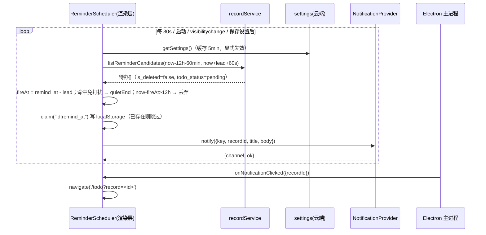
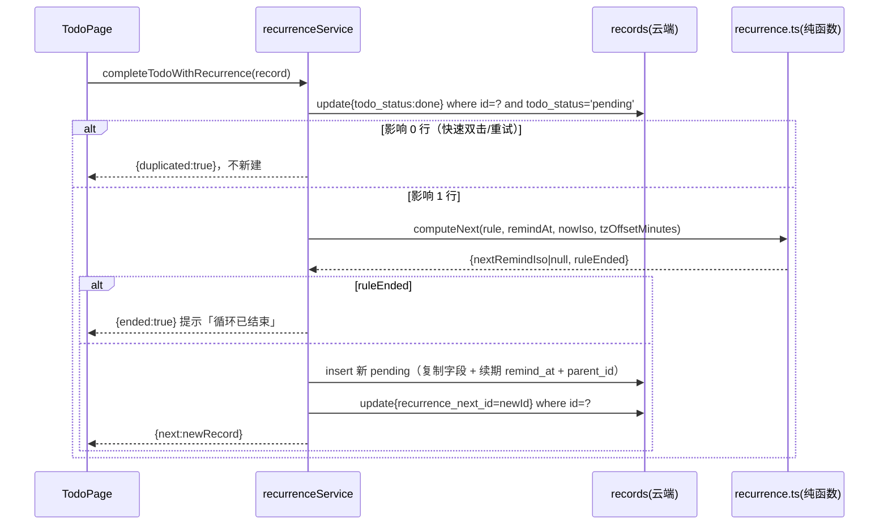
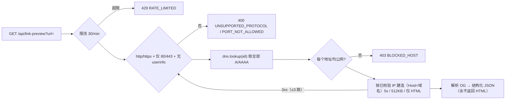

# 个人信息管家 · P0 技术设计与任务分解（2026-10，基线 v2.11.0）

> 输入：`docs/p0-2026-10/PRD-P0.md`。本文只做设计，不含生产代码。零新增第三方依赖。

## 1. 方案总览

三项 P0 共用一条主干：**records 加 4 个可空列 + settings 加 4 个列（纯增量，回滚无痛）**，其余全部是前端/主进程/部署服务器内的新模块。P0-A 调度器放渲染层（有登录态），30s 轮询，去重键写 localStorage；通知走 `NotificationProvider` 抽象（桌面 IPC → 主进程 `new Notification`，Web → Notification API，权限被拒 → 应用内 Snackbar）；窗口隐藏靠 `backgroundThrottling:false` 保精度。P0-B 循环推进是**纯函数**（注入 `nowIso` + `tzOffsetMinutes`，无日期库），幂等靠 **"条件更新 + returning"**（0 行即已被处理），不引入事务。P0-C `server.js` 新增零依赖 `GET /api/link-preview`（SSRF 校验 + 逐跳复验 + 5s/512KB/HTML-only），前端 fire-and-forget 回写 `link_meta`，失败只显示域名。

### 1.1 提醒链路（P0-A）



### 1.2 循环完成（P0-B）



### 1.3 链接代理解析链（P0-C）



## 2. 数据模型与迁移（`docs/p0-2026-10/migration.sql`）

| 表 | 新列 | 类型 / 默认 | 说明 |
|---|---|---|---|
| records | `recurrence` | JSONB, NULL | `{freq,interval,weekdays?,endDate?}`，**内部键用 camelCase**（与 mind_trees.payload 一致，不做二次映射） |
| records | `recurrence_parent_id` | BIGINT, NULL | 根记录为 NULL；子记录指向根 |
| records | `recurrence_next_id` | BIGINT, NULL | 幂等 + 追溯"由第 N 期生成" |
| records | `link_meta` | JSONB, NULL | `{title,description,image,site,fetchedAt,status,errorCode?}` |
| settings | `remind_lead_minutes` | INT NOT NULL DEFAULT 0 | 0/5/10/15/30/60，CHECK 0..1440 |
| settings | `quiet_hours_enabled` | BOOLEAN NOT NULL DEFAULT false | |
| settings | `quiet_start` / `quiet_end` | TEXT NOT NULL DEFAULT '22:00'/'08:00' | 本地墙钟 `HH:mm`，CHECK 正则 |

索引（`migration.sql` 共 3 条）：`records_owner_todo_remind_idx (owner_id, todo_status, remind_at) WHERE is_deleted=false`（提醒轮询）；`records_owner_recurrence_next_idx`、`records_owner_recurrence_parent_idx`（追溯/校验用，部分索引）。加列不影响既有 4 条 RLS 策略（按 owner_id，不带列清单）。全部可空 + PG 快默认，**旧行无需回填**：旧待办=无循环、旧链接=无元数据、旧设置=提前量 0 + 免打扰关，行为与 2.11.0 一致。

**类型同步 3 处**（改完必须 `tsc` 通过）：① `shared/types/domain.ts` —— `RecurrenceFreq`/`RecurrenceRule`/`LinkMeta`；`InfoRecord` + 4 字段（可选可 null）；`RecordCreateInput` + `recurrence`/`recurrenceParentId`；`UserSettings` + 4 字段。② `web/src/lib/database.types.ts` —— `RecordsRow` + `recurrence:unknown|null`/`recurrence_parent_id:number|null`/`recurrence_next_id:number|null`/`link_meta:unknown|null`，`SettingsRow` + 4 列（JSONB 用 `unknown`，与 `float_position` 同风格）。③ `web/src/services/recordService.ts` —— `mapRecord` 加 `toRecurrence()/toLinkMeta()` 归一（脏数据→null），`toSnake` 加 4 键，`createRecord` 加 `recurrence`/`recurrence_parent_id` 插入。

## 3. 契约

### 3.1 新增类型（`shared/types/domain.ts`）
```ts
export type RecurrenceFreq = 'daily' | 'weekly' | 'monthly'
export interface RecurrenceRule {
  freq: RecurrenceFreq
  interval: number              // 1..99
  weekdays?: number[]           // 0=周日 … 6=周六，仅 weekly；升序去重
  endDate?: string | null       // 'YYYY-MM-DD' 本地日，含当日
}
export interface LinkMeta {
  title?: string | null; description?: string | null; image?: string | null
  site?: string | null; fetchedAt?: string; status: 'ok' | 'failed'; errorCode?: string
}
```

### 3.2 纯函数契约（`web/src/lib/recurrence.ts` / `web/src/lib/reminder-schedule.ts`）
```ts
// 循环推进：全部注入，便于单测
computeNext(rule: RecurrenceRule, input: {
  remindAt: string | null      // ISO；null 表示无提醒时间
  nowIso: string               // 完成时刻（remindAt 为 null 时作为基准）
  tzOffsetMinutes?: number     // 默认 -new Date().getTimezoneOffset()（东八区=480）
}): { nextRemindIso: string | null; ruleEnded: boolean }
describeRecurrence(rule): string        // '每天' / '每周一、三' / '每月最后一天' / '每 2 天'
// 提醒判定
isInQuietHours(minuteOfDay: number, start: string, end: string): boolean   // start===end → false
resolveFireAt(remindAtIso, leadMinutes): number      // epoch ms
quietReleaseAt(fireAtMs, quiet): number              // 命中的 quietEnd 绝对时刻（跨零点正确）
shouldFire(input: { fireAtMs, nowMs, quiet, quietEnabled, firedAtMs? }):
  { action: 'fire' | 'defer' | 'drop'; atMs: number } // now-fireAt>12h → drop
```
算法要点：**DST/时区**统一在"平移时间轴"运算——`shifted = t + tz*60000`，用 UTC getter 读写墙钟字段再平移回来（中国无 DST，不产生 23:00/01:00 漂移）。daily：`shifted + interval*86400000`（保留时分）。weekly：以基准日为锚取"周起始（周日）"，仅遍历 `weekIdx % interval === 0` 的周、周内按 weekdays 升序取首个 `> base` 的日期（上限 400 周防死循环）。monthly：目标日 = 基准日号，月份 `m = interval, 2*interval, …`（上限 240 月），`day = min(baseDOM, daysInMonth)`（31 日 → 2 月取 28/29，满足 B3）。endDate 用本地日字符串比较（ISO 日期可字典序比较），`candidateDay > endDate` → `ruleEnded=true`、`nextRemindIso=null`，**等于当日仍生成**（B4）。`remindAt=null` → `nextRemindIso=null`，仅按 `nowIso` 判 endDate，上层仍新建记录。

### 3.3 通知通道抽象（`web/src/services/notification.ts`）
```ts
export type NotifyChannel = 'desktop' | 'web' | 'inapp'
export interface NotifyPayload { key: string; recordId: number; title: string; body: string }
export interface NotifyResult { channel: NotifyChannel; ok: boolean
  reason?: 'permission-denied' | 'unsupported' | 'error' }
export interface NotificationProvider {
  readonly channel: NotifyChannel
  isAvailable(): Promise<boolean>
  requestPermission(): Promise<'granted' | 'denied' | 'default'>
  notify(p: NotifyPayload): Promise<NotifyResult>
  onClick(cb: (recordId: number) => void): () => void    // Web 侧绑定实例 on click
}
export function createNotificationProvider(): NotificationProvider   // desktop > web > inapp 择优
```
IPC 契约（`desktop/src/shared/ipc-contract.ts` + 镜像 `shared/types/ipc.ts`）：

| 方向 | 通道名 | 载荷 | 返回 |
|---|---|---|---|
| renderer→main | `desktop:notify`（invoke） | `{ key, recordId, title, body }` | `{ ok: boolean; message?: string }` |
| main→renderer | `desktop:notify-clicked`（send） | `{ key: string; recordId: number }` | — |

preload 新增 `notify(payload)`、`onNotificationClicked(cb)`。主进程 `desktop/src/main/notifier.ts`：校验入参（title≤200、body≤500、recordId 正整数）→ `new Notification(...)` 存 Map 防 GC → `on('click')` 时 `showMainWindow()` + send `evtNotifyClicked` → `on('close')` 清理。**`desktop/src/main/index.ts` 必须加 `app.setAppUserModelId(appId)`（对齐 electron-builder appId），否则 Windows 上 `new Notification` 可能静默不显示。**

**点击 → 详情链路**（RecordDetail 是组件内 state，无路由）：主进程 `showMainWindow()`（托盘/最小化恢复）→ Layout 监听 `onNotificationClicked` → `navigate('/todo?record=<id>')` → TodoPage 读 `useSearchParams()`：`getRecord(id)` 命中且 `!isDeleted` → `setDetail(record)` 并清参数；软删/不存在 → Snackbar「该记录已删除」+ 清参数；Web 端 provider 的 `onClick` 复用同一逻辑。

### 3.4 HTTP API（`GET /api/link-preview?url=<encoded>`）
成功 `200`：`{ ok: true, data: { title, description, image, site, finalUrl, fetchedAt, status:'ok' } }`（title≤200、description≤300 字；`image` 已绝对化）。失败：`{ ok: false, code, message }`（`message` 中文）。

| HTTP | code | 触发 |
|---|---|---|
| 400 | `BAD_REQUEST` | 缺 url / 超长 / 解析失败 / 含 userinfo |
| 400 | `UNSUPPORTED_PROTOCOL` | 非 http/https（含 `file:`） |
| 400 | `PORT_NOT_ALLOWED` | 端口非 80/443 |
| 403 | `BLOCKED_HOST` | 任一跳解析到私网/回环/链路本地/保留地址或 `localhost` 类主机名 |
| 404 | `UPSTREAM_NOT_FOUND` | 目标 404/410 |
| 405 | `METHOD_NOT_ALLOWED` | 非 GET |
| 413 | `RESPONSE_TOO_LARGE` | 响应体 >512KB |
| 415 | `UNSUPPORTED_CONTENT_TYPE` | 非 `text/html` / `application/xhtml+xml`（含 .pdf） |
| 429 | `RATE_LIMITED` | >30 次/分钟/实例 |
| 502 | `UPSTREAM_ERROR` | 连接失败/DNS 失败/其它非 2xx |
| 504 | `TIMEOUT` | 5s 总超时 |

**校验链（`server/link-preview.js`，全部自己实现）**：
1. 限流：`Map<ip, number[]>`，60s 滑窗 30 次，惰性清理过期；超限 429。
2. URL：`new URL()`；协议 ∈ {http:,https:}；`username/password` 必须空；端口必须 `'' | 80 | 443` 且与协议匹配。
3. DNS：`dns.promises.lookup(host,{all:true,verbatim:true})`，**全部**地址过 `isPrivateAddress()`；主机名小写命中黑名单（`localhost`、`*.localhost`、`metadata.google.internal`、`*.local`、`*.internal`）直接拒。
4. 连接：`lookup` 钩子强制返回已校验 IP（防 DNS rebinding）、`host: ip`、`Host: hostname`、TLS `servername`；UA `PersonalAgentBot/2.11`，`Accept: text/html`。
5. 重定向：≤3 跳，**每跳重跑 2/3/4**。
6. 预算：单个 5s 总计时器销毁（504）；累计 >512KB 立即销毁（413）；`content-type` 取 `;` 前小写比对，非 HTML → 415；只读流不落盘。
7. 解析：`og:title`→`twitter:title`→`<title>`；`og:description`→`twitter:description`→`meta[name=description]`；`og:image`→`twitter:image`，相对/协议相对（`//`）用 `new URL(img, finalUrl)` 绝对化；`site = hostname` 去 `www.`；实体只处理 `&amp; &lt; &gt; &quot; &#39;`。
8. 缓存：`Map<url,{expires,data}>`，TTL 10min、上限 200 条（删最早），**只缓存成功**；`__resetForTest()` 供 QA。
9. `server.js`：在静态托管/`split('?')` 逻辑**之前**用 `new URL(req.url,'http://x')` 判 `pathname === '/api/link-preview'`，命中即 `handleLinkPreview(req,res)`；其余路径（含 `/version.json`、SPA 回退）不变。

前端 `web/src/services/linkPreviewService.ts`：`fetchLinkMeta(url)` 用 `AbortController` 6s（服务端 5s + 1s 余量），任何失败 → `{status:'failed', errorCode}`，**永不抛错、不 loading 卡死**；`isHttpUrl()`/`prettyHost()` 供展示；`enrichLinkMeta(record)`（后台，不 await）→ 抓成功写 `link_meta`，且**仅当 `record.title` 为空**才一并写 `title`；`retryLinkMeta(id)` 供详情"重新抓取"。开发态无该端点（Vite 5173 直连）→ fetch 404/网络错误 → 静默降级（可选：`vite.config.ts` 加 proxy 到 3000，不改也能过验收）。

## 4. 文件改动清单

| 路径 | 新增/修改 | 职责 | 依赖 |
|---|---|---|---|
| `docs/p0-2026-10/migration.sql` | 新增 | 增量 DDL（幂等），供主理人执行 | — |
| `docs/db-setup.sql` | 修改 | 追加同内容的"增量迁移 P0"段与建表注释 | — |
| `shared/types/domain.ts` | 修改 | 新增 `RecurrenceRule`/`LinkMeta`，扩展 `InfoRecord`/`RecordCreateInput`/`UserSettings` | — |
| `web/src/lib/database.types.ts` | 修改 | `RecordsRow`/`SettingsRow` 补 8 列 | — |
| `web/src/services/recordService.ts` | 修改 | 4 字段映射、`toSnake` 扩展、`createRecord` 透传、`listReminderCandidates(fromIso,toIso)`（仅用 `eq/gte/lte/order/limit`，不改 QA mock） | 上两项 |
| `web/src/lib/recurrence.ts` | 新增 | 循环推进 + 文案纯函数（§3.2） | 类型 |
| `qa/recurrence.test.ts` | 新增 | B1–B4 边界单测（含 2 月/31 日/跨周/endDate 等值） | recurrence.ts |
| `web/src/services/recurrenceService.ts` | 新增 | `completeTodoWithRecurrence()` 条件更新幂等 + 生成 + 回写 + 补偿（§1.2） | T01 |
| `web/src/components/RecurrenceField.tsx` | 新增 | "重复"控件：freq 下拉 / interval / 周几多选 / 结束日期。props `{ value, onChange, remindAt }`；默认 weekly 取 remind_at 星期（无则今天） | recurrence.ts |
| `web/src/pages/TodoPage.tsx` | 修改 | (a) `toggle()` 改走 `completeTodoWithRecurrence`，展示 `ended/duplicated/下一期已生成` 提示；(b) 读 `?record=` 定位详情（T03 区域） | T01/T02/T03 |
| `web/src/components/RecordCreateDialog.tsx` | 修改 | todo 分支嵌 `RecurrenceField`；提交带 `recurrence`；material 保存后 `enrichLinkMeta`（T05） | T01/T05 |
| `web/src/components/RecordDetail.tsx` | 修改 | 循环标识 chip + 「由第 N 期生成」+ 可编辑规则；链接封面/描述/失败重试（T05） | T01/T05 |
| `web/src/components/RecordCard.tsx` | 修改 | 循环 chip、`LinkCover` 16:9、域名角标 | T01/T05 |
| `qa/mocks/cloud.ts` | 修改 | 新增 `__queueDbResults([...])`：按 FIFO 逐次 `then()` 消费，支撑"条件更新 0 行/1 行"两路断言 | — |
| `qa/recurrence-service.test.ts` | 新增 | B5 幂等（0 行→不 insert）、B6 兼容（无规则只置 done）、补偿路径 | T01/T02 |
| `web/src/lib/reminder-schedule.ts` | 新增 | 纯函数：`isInQuietHours`/`quietReleaseAt`/`shouldFire`/`dedupeKey`/`pruneFired` | — |
| `web/src/services/reminderService.ts` | 新增 | 调度器生命周期（start/stop/tickNow/onSettingsSaved）、localStorage claim、12h 窗口、免打扰补发 | 上项 |
| `web/src/services/notification.ts` | 新增 | `NotificationProvider` 接口 + desktop/web/inapp 三实现 + 工厂 + 权限探测 | T04 |
| `web/src/store/noticeStore.ts` | 新增 | 应用内提示队列（降级通道 + 全局 toast 复用） | — |
| `web/src/components/NoticeHost.tsx` | 新增 | 渲染 Snackbar 队列；`<NoticeHost/>` 挂在 Layout | noticeStore |
| `web/src/pages/SettingsPage.tsx` | 修改 | 新增「提醒」卡片（总开关/提前量/免打扰开关+起止）；`save()` payload 带 3 新键 + `notify_enabled`；保存后 `reminderService.onSettingsSaved()`；首次开启总开关请求权限 | T03/T04 |
| `web/src/components/Layout.tsx` | 修改 | 挂 `<ReminderScheduler/>`（仅 `?mode=companion` 不挂）+ `<NoticeHost/>` + 监听通知点击 `navigate` | T03 |
| `desktop/src/shared/ipc-contract.ts` | 修改 | 加 `notify`/`evtNotifyClicked` 通道与 payload 类型 | — |
| `shared/types/ipc.ts` | 修改 | 镜像 `DesktopBridge` 加两方法 | 上项 |
| `desktop/src/preload/index.ts` | 修改 | 暴露 `notify()` / `onNotificationClicked()` | 上项 |
| `desktop/src/main/notifier.ts` | 新增 | 入参校验 + `new Notification` + click 事件 + 引用管理 | — |
| `desktop/src/main/ipc.ts` | 修改 | 注册 `IPC.notify`（`assertTrusted`） | notifier |
| `desktop/src/main/main-window.ts` | 修改 | `webPreferences.backgroundThrottling = false` | — |
| `desktop/src/main/index.ts` | 修改 | `app.setAppUserModelId('com.personalagent.desktop')` | — |
| `server/link-preview.js` | 新增 | 限流/SSRF/重定向/预算/OG 解析/缓存，CJS 导出纯函数供 QA | — |
| `server.js` | 修改 | 最前面加 `/api/link-preview` 路由，其余不变 | 上项 |
| `web/src/services/linkPreviewService.ts` | 新增 | 6s 超时抓取、失败降级、`enrichLinkMeta`、`retryLinkMeta` | 类型 |
| `web/src/components/LinkCover.tsx` | 新增 | props `{ record }`；仅 http(s) 渲染、`onError` 隐藏、`aspectRatio:'16/9'`、`objectFit:'cover'` | — |
| `qa/reminder-schedule.test.ts` | 新增 | A3/A5 免打扰跨零点、12h 丢弃、时区参数化 | reminder-schedule.ts |
| `qa/link-preview.test.ts` | 新增 | C3 地址判定矩阵、OG 解析、相对图 URL、限制错误码（本地 http server 打桩） | link-preview.js |
| `qa/run-tests.mjs` | 修改 | 注册 5 个新用例（`alias: {}` 或 webAlias） | 全部 |

## 5. 任务分解（按实现顺序，每项可独立验收）

| ID | 任务 | 源文件 | 依赖 | 优先级 |
|---|---|---|---|---|
| **T01** | **数据契约与纯函数地基**：执行迁移 SQL、三处类型同步、`records` 新列读写通路、循环推进纯函数 + 单测、QA 注册 | migration.sql、db-setup.sql、domain.ts、database.types.ts、recordService.ts、recurrence.ts、qa/recurrence.test.ts、qa/run-tests.mjs | — | P0 |
| **T02** | **循环任务业务闭环**：条件更新幂等、生成/回写/补偿、重复控件、卡片与详情循环标识、完成链路改造 | recurrenceService.ts、RecurrenceField.tsx、TodoPage.tsx（toggle 区）、RecordCreateDialog.tsx、RecordDetail.tsx、RecordCard.tsx、qa/mocks/cloud.ts、qa/recurrence-service.test.ts | T01 | P0 |
| **T03** | **提醒调度与设置**：纯函数调度判定、Scheduler、Provider 抽象 + 应用内降级、设置「提醒」卡片、`?record=` 导航、Layout 挂载 | reminder-schedule.ts、reminderService.ts、notification.ts、noticeStore.ts、NoticeHost.tsx、SettingsPage.tsx、Layout.tsx、TodoPage.tsx（param 区）、qa/reminder-schedule.test.ts | T01 | P0 |
| **T04** | **桌面通知链路**：IPC 契约与 preload、主进程 notifier、后台节流关闭、AppUserModelId | ipc-contract.ts、shared/types/ipc.ts、preload/index.ts、main/notifier.ts、main/ipc.ts、main-window.ts、main/index.ts | T03 | P0 |
| **T05** | **链接元数据与代理**：零依赖 OG 代理 + SSRF/限流/预算、前端抓取与降级、封面/域名/重试 UI | server/link-preview.js、server.js、linkPreviewService.ts、LinkCover.tsx、RecordCard.tsx（封面区）、RecordDetail.tsx（链接区）、RecordCreateDialog.tsx（触发）、qa/link-preview.test.ts | T01 | P0 |

验收映射：T01→§5 数据兼容；T02→B1–B6；T03→A3/A4/A5/A6(Web)；T04→A1/A2/A6(桌面)；T05→C1–C6。

## 6. 测试钩子（`node qa/run-tests.mjs`）
| 纯函数 / 模块 | 路径 | QA 如何 import |
|---|---|---|
| `computeNext`、`describeRecurrence` | `web/src/lib/recurrence.ts` | `import { computeNext } from '../web/src/lib/recurrence'`（`alias: {}`，无云依赖） |
| `shouldFire`、`isInQuietHours`、`quietReleaseAt`、`dedupeKey` | `web/src/lib/reminder-schedule.ts` | 同上；时区用 `tzOffsetMinutes` 显式传入，不依赖机器时区 |
| `isPrivateAddress`、`parseOg`、`resolveImageUrl`、`createRateLimiter`、`handleLinkPreview` | `server/link-preview.js`（CJS） | `import lp from '../server/link-preview.js'` 后取 `lp.isPrivateAddress`（esbuild 对 CJS 的 default 互操作）；HTTP 层用 `node:http` 起本地桩服务 |
| `recurrenceService.completeTodoWithRecurrence` | `web/src/services/recurrenceService.ts` | `alias: webAlias` + `qa/mocks/cloud.ts` 的 `__queueDbResults` 逐次给"0 行/1 行/insert/update"结果 |

不写 UI 快照测试（项目现状无此链路）；A1/A2 等端到端项按 PRD 手工验收，设计已在 §3.3 给出可观测点（`notify` 返回 `channel`）。

## 7. 风险与回滚

| 风险 | 处置 |
|---|---|
| 多标签页/主窗口+悬浮窗同弹 | 单端 `localStorage` claim（写后读校验）+ 内存 in-flight 锁；Electron 同 partition 下 localStorage 共享，可覆盖"双窗口"；`?mode=companion` 不挂 Scheduler。**多设备同时在线仍各弹一次**（PRD 仅要求单端不重复），彻底去重需服务端 claim 表（下期）。 |
| Windows 通知不显示 | `app.setAppUserModelId` 对齐 appId；provider 失败返回 `ok:false` 并自动降级为应用内提示，不静默吞。 |
| 重启后"晚提醒" | 统一策略 `now - fireAt > 12h` → drop 并写 fired 键，避免堆积（与 PRD §7.1 一致）。 |
| 循环半成品 | 回写失败重试 1 次并提示；下次完成条件更新返回 0 行 → 天然不重复。insert 失败则回滚原记录为 pending 并抛中文可重试错误。 |
| 代理误判内网 | 仅公网段通过 + 逐地址校验 + 建连钉 IP + 逐跳复验；单测覆盖 C3 全部 6 类地址。 |
| 保存变慢 | 抓取在 createRecord **之后** fire-and-forget，不进保存 await 链。 |
| 回滚 | 新列全可空、代码不 DDL；回退后循环记录退化普通待办、`link_meta` 不再展示（数据保留）、旧代码忽略新设置列。无需清理数据。 |

## 8. 与 PRD 的偏差 / 需主理人确认（未降标准，仅澄清）

1. **A3 与 A4 口径冲突**：同一条记录（同 `remind_at`）先以提前量 10 在 09:50 弹过，改回 0 后按 A4 不应再弹，则 A3 后半句"10:00±60s 触发"无法用同一条记录验证。设计取**去重键 = `记录id|remind_at`（严格遵循 A4）**，建议 A3 用两条记录或改 `remind_at` 验证。
2. **A5 精度**：要求 08:00–08:05 补发 → Scheduler 周期取 **30s**（最坏 30s 延迟），满足 ±60s。
3. **A6 权限拒降级需可见提示**：`noticeStore` + `NoticeHost`（Snackbar），首次开启总开关即请求权限并回显"已降级为应用内提示"；总开关关闭时 `drop` 且**不写 fired 键**（便于重开后 12h 内补发），取"更不打扰"策略。
4. **C2「无封面但显示域名」**：`link_meta` 缺失时域名由 `record.url` 的 host 推导，避免二次抓取。
5. **循环"完成过几次"**：本期用 `recurrence_parent_id` 链路在详情展示"由第 N 期生成"，不做全链聚合（PRD §4 未列验收项，避免 N+1）。
